# CRT 2026 Mentorship - Ep 1 | What is Candle Range Theory

**Canal de YouTube:** Mado  
**Enlace al Video:** [CRT 2026 Mentorship Ep 1 | What is Candle Range Theory](http://www.youtube.com/watch?v=yCeDCu-mjnI)  
**Duración Total:** 19 min 21 seg  

---

## 📌 Introducción y Propósito de la Mentoría
* **[00:00:00]** Inicio del *CRT 2026 Mentorship Episode 1*. La mentoría iniciará desde los conceptos más básicos, pasando por intermedios hasta alcanzar un nivel avanzado.
* **[00:00:16]** El objetivo principal es construir una base conceptual sólida. Sin una base fuerte, ningún otro concepto o estrategia avanzada funcionará.
* **[00:00:23]** Candle Range Theory (CRT) es uno de los conceptos más malinterpretados en internet debido a que mentores y "gurus" agregan giros innecesarios y terminología confusa.
* **[00:00:46]** El enfoque del curso es eliminar el "ruido", simplificar el concepto y mostrar qué es realmente CRT paso a paso.
* **[00:01:00]** La mentoría se desarrollará durante un período de aproximadamente 3 a 4 meses (primer trimestre del año), publicando al menos 1 episodio por semana.
* **[00:01:20]** Advertencia de estudio: No se deben ver los videos a velocidad 2x ni de forma casual. Se requiere estudio activo, libreta de notas y análisis detallado segundo a segundo.

---

## 💡 Concepto Fundamental: ¿Qué es Candle Range Theory (CRT)?
* **[00:02:13]** Cada vela en un gráfico (diario, 4H, 1H, etc.) no es una figura geométrica o forma aleatoria: representa un **rango delimitado por el tiempo** (*time-based range*).
* **[00:02:34]** Al hacer zoom en temporalidades menores (*lower timeframes*), se observa que dentro de una sola vela existe un rango más pequeño con un Alto (*High*) y un Bajo (*Low*) definidos.
  
* **[00:02:49]** Para comprender el mercado, el algoritmo y el dinero inteligente (*smart money*), no se requieren cientos de indicadores ni herramientas complejas. Solo se necesitan tres elementos:
  1. **Liquidez** (*Liquidity*)
  2. **Tiempo** (*Time*)
  3. **Precio** (*Price*)
  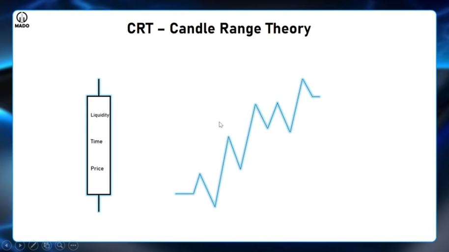
* **[00:03:07]** Los tres elementos están integrados dentro del sistema de CRT (*Liquidity + Time + Price = Time-based ranges*).
  

---

## 📐 Los 3 Pilares del Mercado en CRT

### 1. Liquidez (Liquidity)
* **[00:03:14]** El mercado siempre se mueve de un punto de liquidez a otro punto de liquidez:
  * De *Buyside Liquidity* (BSL) hacia *Sellside Liquidity* (SSL).
  * O de *Sellside Liquidity* (SSL) hacia *Buyside Liquidity* (BSL).
  
* **[00:03:35]** En la estructura de CRT:
  * El Alto de la vela del rango (**CRT High**) representa la **Buyside Liquidity** (BSL).
  * El Bajo de la vela del rango (**CRT Low**) representa la **Sellside Liquidity** (SSL).
  

### 2. Tiempo (Time)
* **[00:03:43]** Cada vela se forma dentro de una ventana de tiempo específica según su temporalidad.
  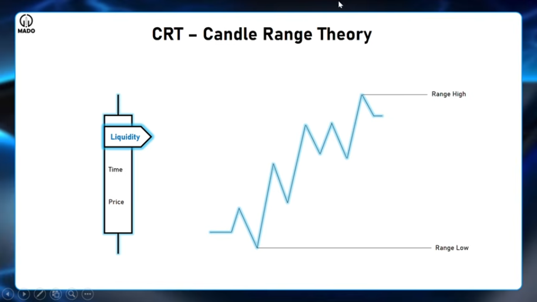
* **[00:03:58]** Cada vela posee un Apertura (*Open*) y Cierre (*Close*) definidos en el tiempo. El mercado no solo se desplaza en precio, sino estrictamente dentro del marco del tiempo.
  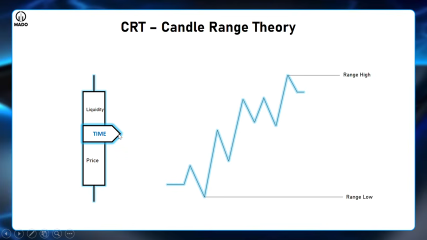

### 3. Precio (Price)
* **[00:04:06]** La vela en sí misma representa el rango de precio desde el punto más alto hasta el punto más bajo (y de Apertura a Cierre). Ofrece datos objetivos sin necesidad de indicadores.
  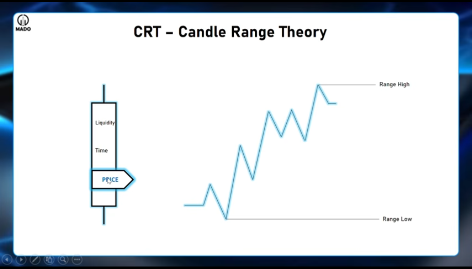

---

## ⚔️ Rangos Convencionales vs. Candle Ranges (Rangos de Velas)

* **[00:04:36]** Comparativa crítica para entender la superioridad técnica de CRT frente a los rangos tradicionales.
  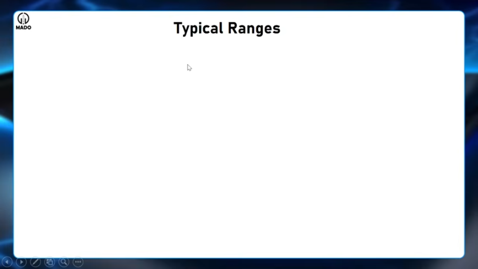

### Problemas de los Rangos Convencionales:
* **[00:04:48]** **Altos y Bajos Inconsistentes:** Es subjetivo determinar qué alto o bajo seleccionar como límite del rango; cada trader marca líneas distintas.
  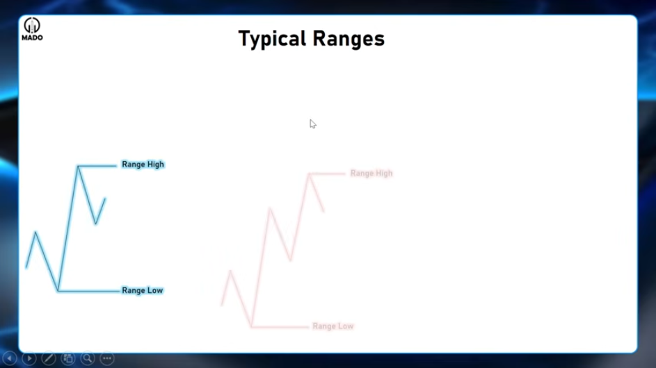
* **[00:05:04]** **Sin Apertura y Cierre Fijos:** No hay un punto claro de inicio ni de finalización en el tiempo.
  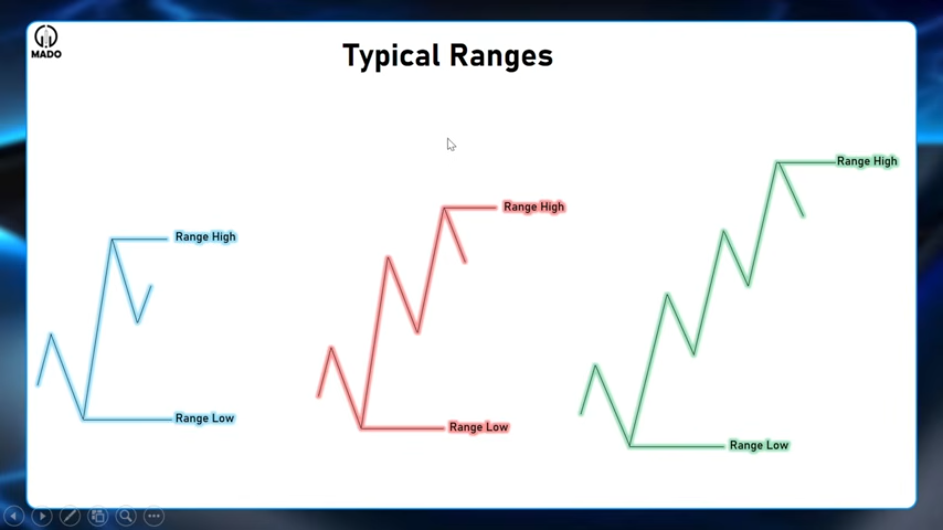
* **[00:05:17]** **Sin Objetivos Fijos:** No ofrecen referencias claras de extracción de liquidez ni metas de salida precisas.
  

### Ventajas de los Candle Ranges (CRT):
* **[00:05:32]** **Estructura Estándar:** Todas las velas (mensuales, diarias, de 1H) poseen la misma anatomía: Apertura (*Open*), Alto (*High*), Bajo (*Low*) y Cierre (*Close*).
  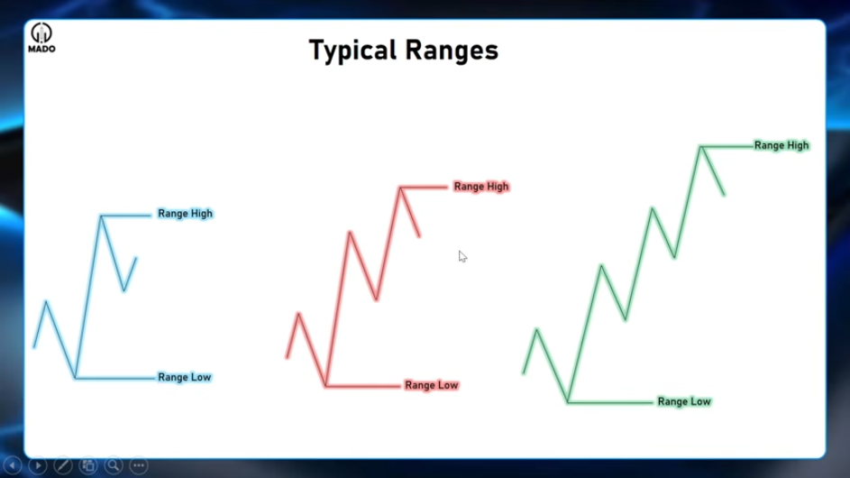
* **[00:05:58]** **Fractalidad:** El precio es completamente fractal. Los patrones observados en temporalidades altas ocurren de idéntica manera en temporalidades bajas, variando únicamente la velocidad de ejecución.
  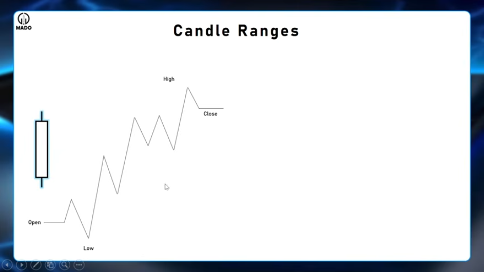
* **[00:06:11]** **Objetividad Completa:** Ofrecen puntos de referencia fijos (Altos/Bajos claros) y tiempos de apertura y cierre determinados por el reloj.
  
* **[00:06:37]** **Objetivos Claros:** Los niveles del CRT High y CRT Low actúan como grandes piscinas de liquidez (*liquidity pools*).
  

---

## 🔄 Las 2 Posibles Conductas del Mercado sobre un Candle Range
* **[00:06:48]** Cuando se establece un Candle Range, solo existen dos escenarios posibles:
  1. **Ruptura Verdadera (*True Break*):** **[00:06:48]** El precio rompe por encima del CRT High o por debajo del CRT Low y continúa de forma expansiva en esa misma dirección.
  2. **Ruptura Falsa (*False Break / Turtle Soup*):** **[00:07:03]** El precio liquida (*raid / purge*) un extremo del rango (barriendo la liquidez), revierte la dirección e ingresa de nuevo al rango para expandirse rápidamente hacia el extremo opuesto. Este patrón es el núcleo fundamental de CRT.

---

## 🧩 Tipos de Candle Range Theory (CRT)

* **[00:08:02]** Aunque existen variaciones, CRT se categoriza en tres o cuatro modelos principales:
  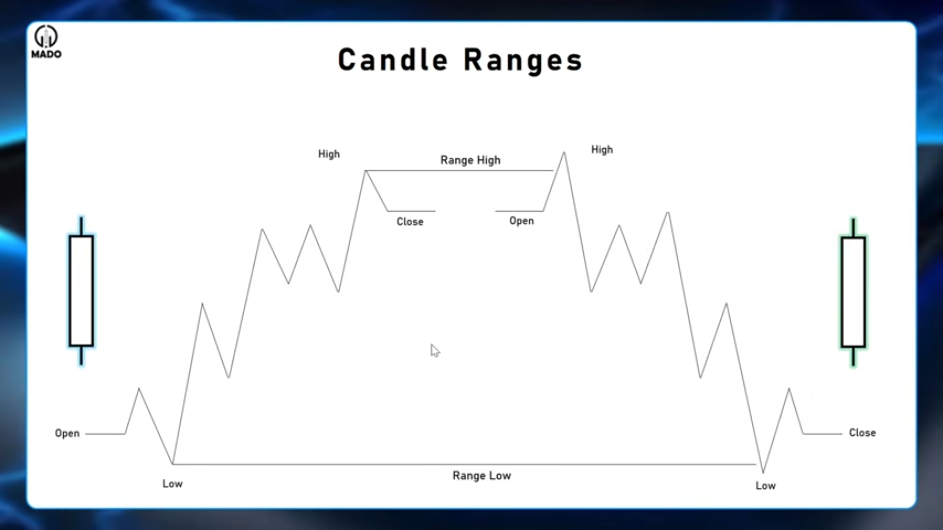

### 1. 3-Candle CRT (Modelo de 3 Velas) - *El modelo preferido*
* **[00:08:15]** Formado por tres velas secuenciales basadas en el ciclo **AMD** (Accumulation, Manipulation, Distribution):
  * **Vela 1 (Acumulación / Rango):** **[00:08:22]** Establece los límites del rango (CRT High / CRT Low).
    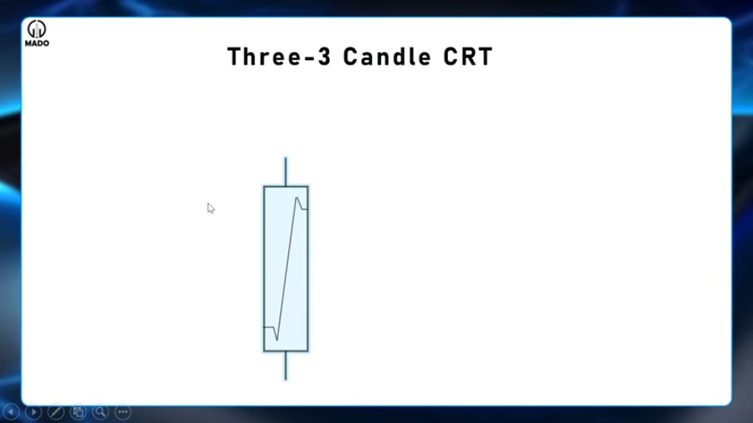
  * **Vela 2 (Manipulación / Purga):** **[00:08:29]** Ejecuta la purga de liquidez (*liquidity purge*), barrido (*raid*) o *Turtle Soup* de un extremo.
    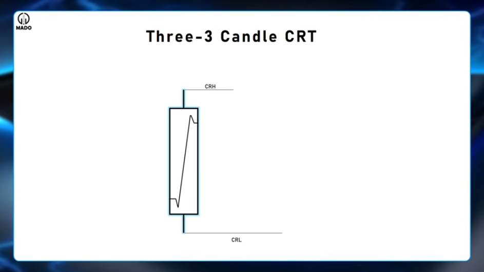
  * **Vela 3 (Distribución / Expansión):** **[00:08:37]** Expande el precio agresivamente hacia el extremo opuesto del rango inicial.
    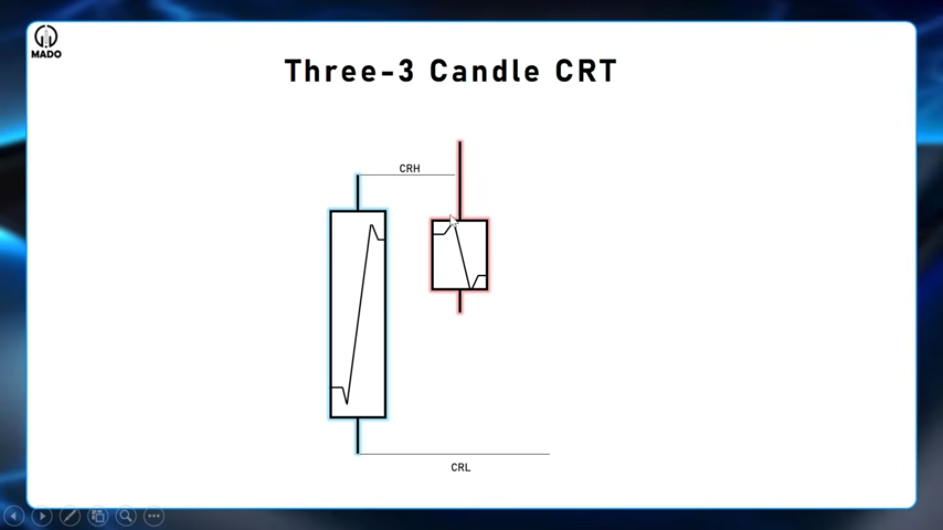
* **[00:08:45]** Aclaración importante: no cualquier secuencia de tres velas constituye un CRT válido. Para que sea un CRT genuino, debe seguir un protocolo específico y cumplir características muy puntuales (rango bien definido, purga real de liquidez, rechazo y expansión hacia el lado opuesto). Esto es justamente lo que le da objetividad al concepto, en contraposición a marcar rangos de forma arbitraria.
* **[00:09:07]** **Aplicación por Temporalidades / Teoría del Tiempo:**
  * **Gráfico Semanal:** **[00:09:07]** Semana 1 = Rango, Semana 2 = Manipulación, Semana 3 = Distribución.
    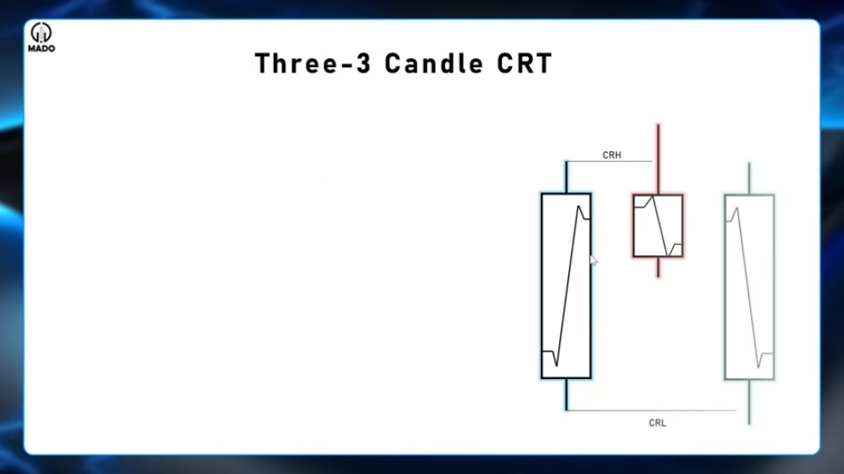
  * **Gráfico Diario:** **[00:09:21]** Lunes = Rango, Martes = Manipulación, Miércoles = Distribución / Expansión.
    
  * **Gráfico de 4 Horas:** **[00:09:28]** Vela 1:00 AM = Rango, Vela 5:00 AM = Manipulación, Vela 9:00 AM = Distribución.
    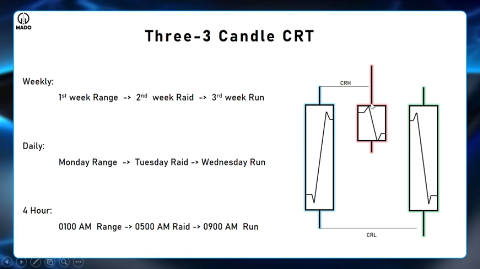

### 2. 2-Candle CRT (Modelo de 2 Velas)
* **[00:09:53]** La **Vela 1** establece el rango. La **Vela 2** cumple ambas funciones dentro de su propio cuerpo y mechas: barre la liquidez de un extremo (*manipulación*) y se expande fuertemente hacia el lado opuesto (*distribución*).
  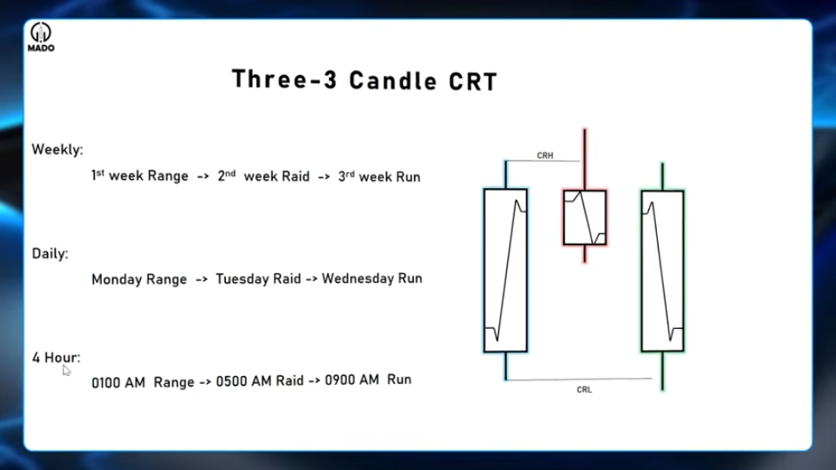
* **[00:10:15]** Frecuente en eventos de noticias de alto impacto (carpetas rojas), donde la alta volatilidad comprime las fases.
  

### 3. Multiple Candle CRT (CRT de Múltiples Velas)
* **[00:10:22]** Se presenta en dos formatos principales:
  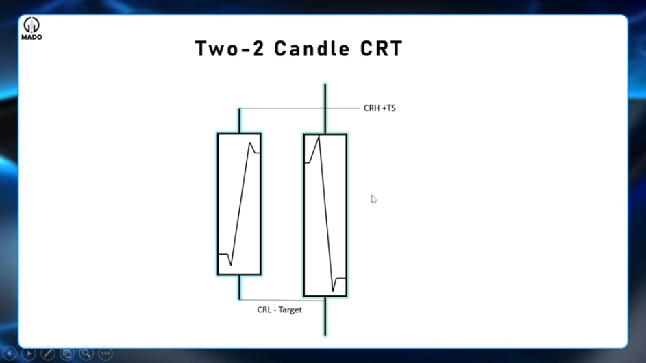
  * **Inside Bar CRT:** **[00:10:32]** La Vela 1 establece el rango. Las velas subsecuentes (2, 3, 4 o más) permanecen atrapadas dentro del rango inicial. Se debe esperar con paciencia la purga de uno de los extremos para operar la distribución posterior.
    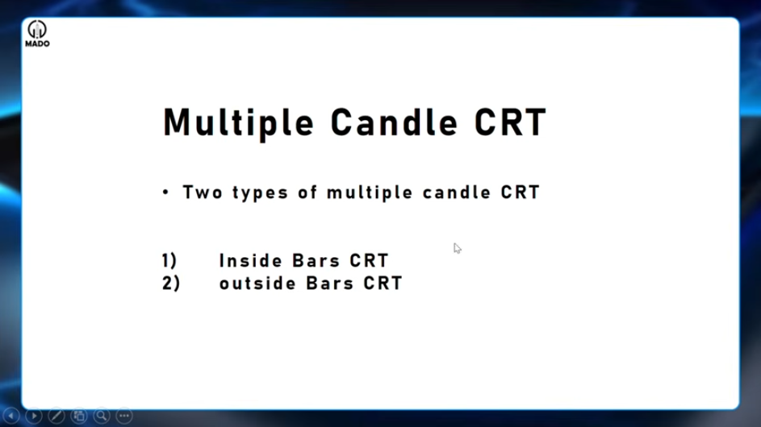
  * **Outside Bar CRT:** **[00:11:06]** La Vela 1 establece el rango. La Vela 2 barre el Alto o el Bajo, y posteriormente múltiples velas consecutivas distribuyen el precio en dirección al lado opuesto del rango.
    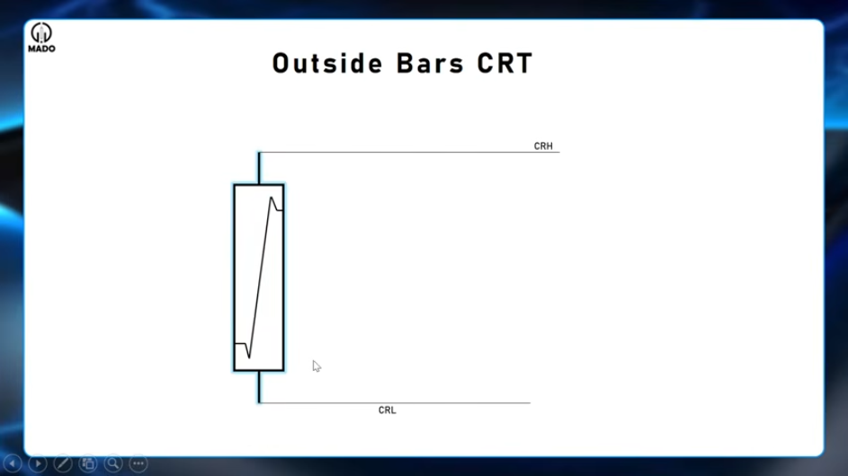

---

## 🎯 CRT Combinado con Niveles Clave (Key Levels)

* **[00:11:48]** Los *Key Levels* son zonas institucionales donde el mercado decide expandirse o revertir (Order Blocks, Fair Value Gaps, Breaker Blocks, Rejection Blocks, o Altos/Bajos mayores).
  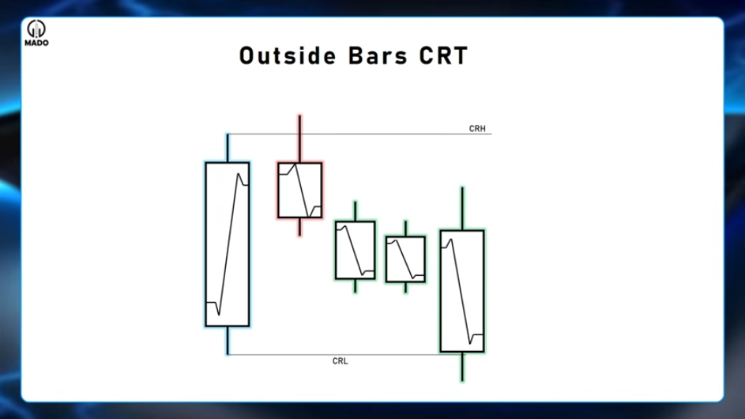
* **[00:12:02]** Los setups de CRT más confiables ocurren cuando la manipulación reacciona directamente en un *Key Level* de temporalidad mayor.

### Dinámica del Setup Teórico:
1. **[00:12:34]** El mercado forma un Candle Range justo debajo o arriba de un *Key Level*, acumulando *Buyside Liquidity* por arriba y *Sellside Liquidity* por abajo. De esta forma el mercado tiende una trampa: los participantes se posicionan en ambos lados del rango, esperando la expansión en cualquier dirección.
   
2. **[00:12:59]** La Vela 2 purga el CRT High (limpia la BSL), toca/mitiga el *Key Level*, rechaza la zona y cierra de nuevo dentro del rango.
   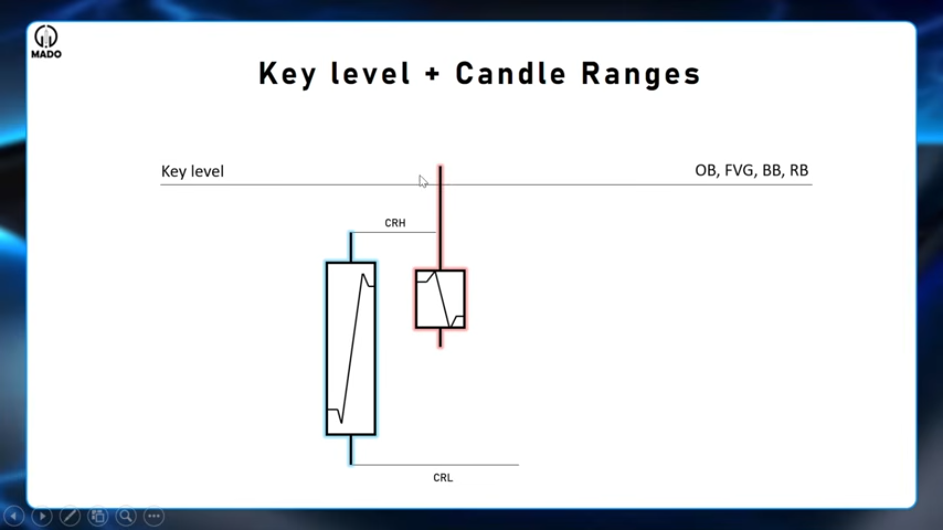
3. **[00:13:16]** Fase de manipulación completada. La expectativa cambia inmediatamente a la fase de expansión hacia el extremo opuesto del rango (CRT Low).
   

### Variante: la Vela 2 completa Manipulación y Expansión en un Solo Movimiento
* **[00:13:45]** Segundo ejemplo teórico sobre el mismo *Key Level*: el mercado forma un Candle Range justo debajo de él, generando *Buyside Liquidity* y *Sellside Liquidity* en ambos extremos. El "dinero tonto" (*dumb money*) coloca stops y entradas en ambos lados del rango, esperando ser barrido — esa es la liquidez que el mercado va a tomar.
* **[00:14:00]** La Vela 2 purga el CRT High (limpiando la BSL) y toca el *Key Level*, pero a diferencia del caso anterior, en lugar de rechazar y cerrar dentro del rango, se expande inmediatamente hacia abajo en el mismo movimiento, dirigiéndose directo al CRT Low.
* **[00:14:25]** En este escenario la Vela 2 cumple una doble función: no solo ejecuta la manipulación, sino que también completa la expansión en un solo golpe. Este comportamiento es frecuente en eventos de noticias de alto impacto, cuando la volatilidad alcanza para barrer un lado y correr de inmediato hacia el otro.
* **[00:14:40]** Lección clave que remarca Mado: si bien el CRT clásico se desarrolla en tres pasos claros (Rango → Manipulación → Expansión), bajo ciertas condiciones de mercado —especialmente en movimientos impulsados por noticias— la segunda vela por sí sola puede completar el ciclo entero.

---

## 📊 Ejemplos Gráficos Explicados en el Video

* **[00:15:05] Ejemplo 1 - Búsqueda de Key Level inferior:**
  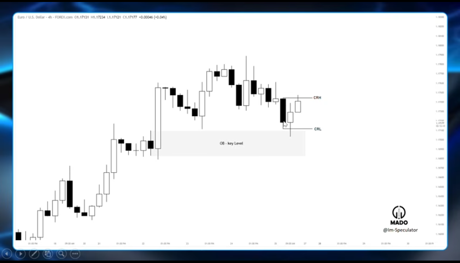
  * Un bloque clave (*Key Level*) se encuentra por debajo del rango.
  * La Vela 1 crea liquidez en ambos extremos.
  * La Vela 2 baja, purga el CRT Low, reacciona contra el *Key Level* y cierra dentro del rango.
  * **[00:15:42]** Tras la purga, se busca confirmación en *Lower Timeframe* (LTF) como un Order Block o modelo de entrada dentro de la Vela 2. Mado aclara que la elección de la LTF específica para la entrada se desarrollará recién en el Episodio 2; el objetivo de este episodio es solo dejar clara la relación entre CRT y Key Levels.
    

* **[00:16:11] Ejemplo 2 - 3-Candle CRT con Rejection Block:**
  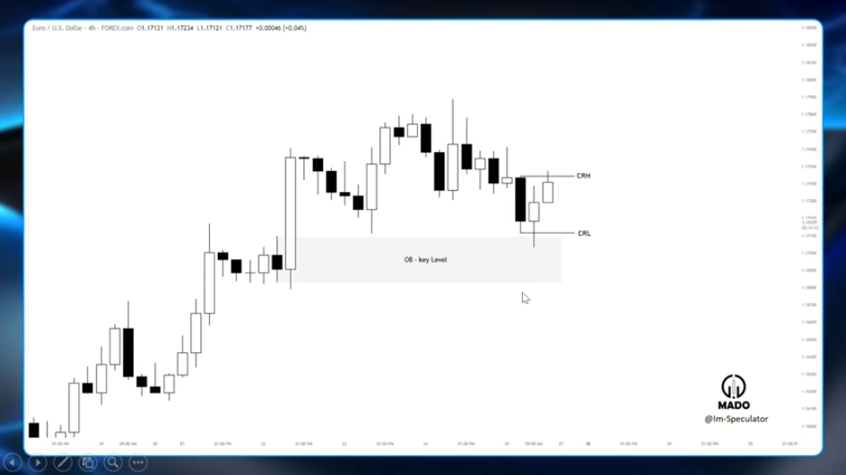
  * Un *Rejection Block* actúa como *Key Level* arriba del precio.
  * La Vela 1 establece el rango. La Vela 2 purga el CRT High y reacciona al Rejection Block, cerrando dentro del rango.
  * La Vela 3 expande directamente hasta alcanzar el CRT Low.

* **[00:16:53] Ejemplo 3 - 2-Candle CRT en Gráfico Real:**
  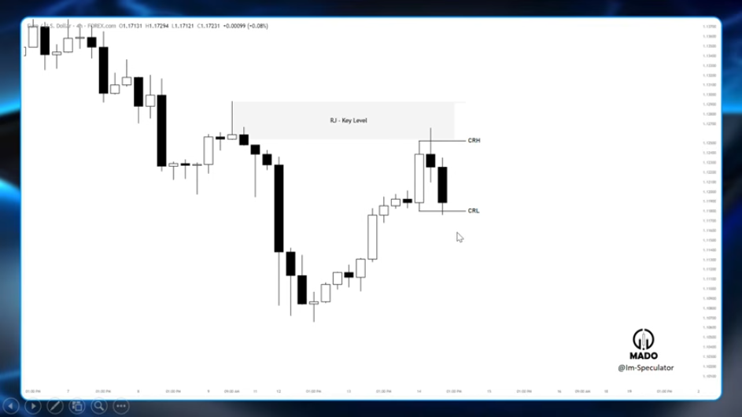
  * Un *Key Level* arriba. La Vela 1 crea el rango.
  * La Vela 2 barre el CRT High, testea el *Key Level* y en esa misma vela cae con fuerza a buscar el CRT Low.

* **[00:17:22] Ejemplo 4 - Multiple Candle CRT (Consolidación tras Purga):**
  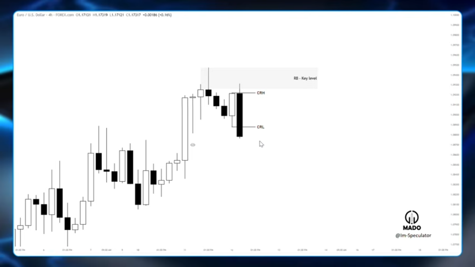
  * Vela 1 establece el rango. Vela 2 purga el CRT High en el *Key Level*.
  * El mercado consolida en varias velas dentro del rango antes de iniciar el movimiento expansivo final hacia el CRT Low.

* **[00:18:12] Ejemplo 5 - Multiple Candle CRT (Consolidación previa a la Purga):**
  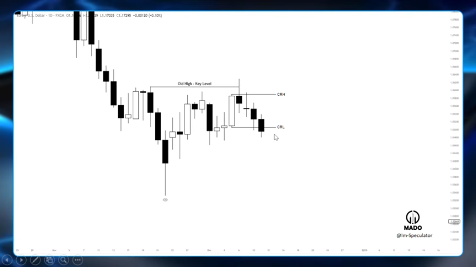
  * Vela 1 establece el rango. Varias velas quedan atrapadas internamente.
  * Finalmente, el mercado purga el CRT High, reacciona en el *Key Level* y cae hacia el CRT Low.

---

## 🔮 Conclusión y Próximos Pasos
* **[00:18:42]** La base de CRT radica en la secuencia: **Rango $\rightarrow$ Manipulación $\rightarrow$ Expansión**.
  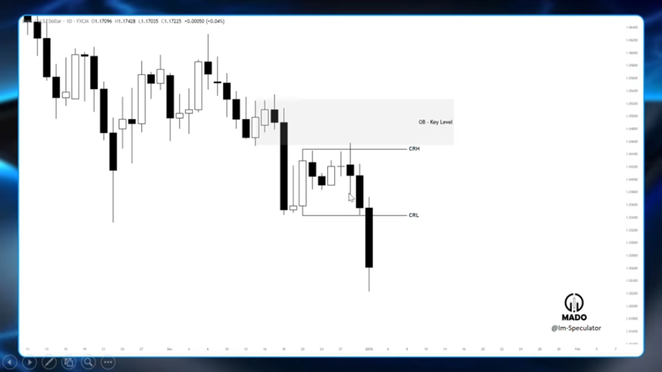
* **[00:19:06]** En el Episodio 2 se profundizará en la alineación de temporalidades (*Timeframe Alignment*), modelos de entrada en temporalidades menores (*LTF Entry Models*) y reglas de ejecución precisas.
  
