# charter-10: CRT 2026 Mentorship EP 10 | Know Everything About the 5 AM CRT

## 📌 Introduction and Core Principle

* **Episode objective:** Define the 5 AM CRT as a layered setup that combines the Asia and London ranges, intraday profiles, higher-timeframe context, key levels, SMT, and lower-timeframe execution [00:00:04-00:01:28].
  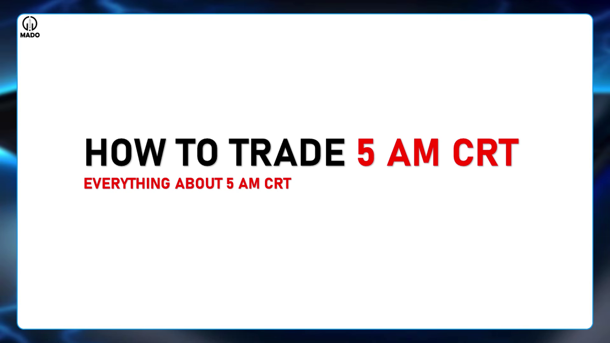
* Mado presents the 5 AM CRT as more layered than the 1 AM CRT because it combines two prior 4H candles, three intraday profiles, order flow, key levels, and SMT rather than relying on a single prior-candle relationship [00:00:53-00:01:18].
  

---

## 🕔 What the 5 AM CRT Is

* **Timestamp:** [00:01:31]
  
* For Forex, the CRT is the single 4H candle that opens at **5:00 a.m.**; for indices, the corresponding candle opens at **6:00 a.m.** [00:02:08-00:02:27].
  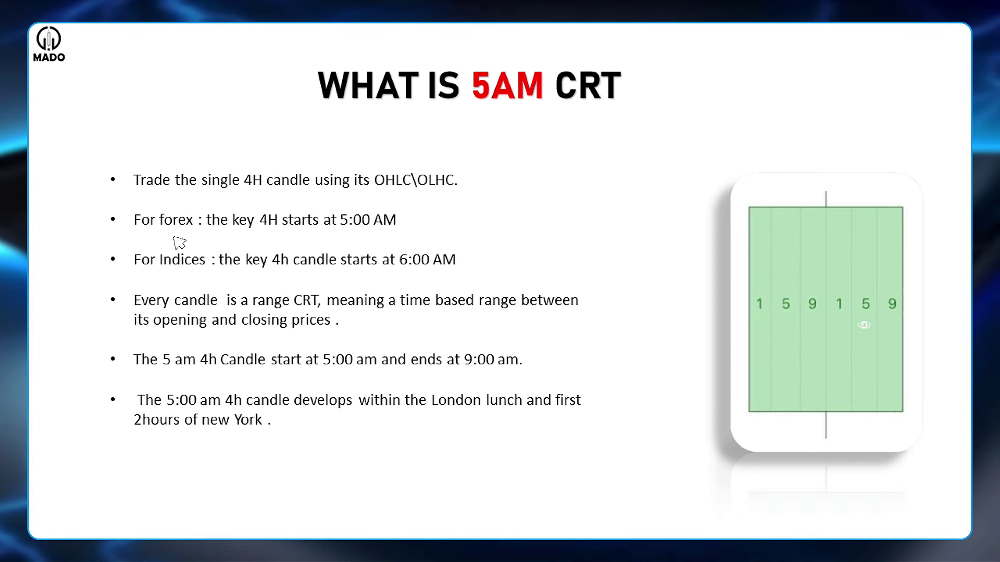
* The Forex candle runs from **5:00 a.m. to 9:00 a.m.** [00:02:44-00:02:50].
  
* It contains the end of London, the London-lunch lull, and the opening ignition of New York. Mado frames that concentration of session behavior as the reason this particular 4H candle can be highly informative [00:02:56-00:03:24].
  
* The recurring principle remains time-first: candle, opening time, range, session, and narrative have to agree before an entry pattern means anything [00:04:04-00:04:50].
  

---

## 🧭 Two Prior Ranges and Three 5 AM Scenarios

* **Timestamp:** [00:04:54]
  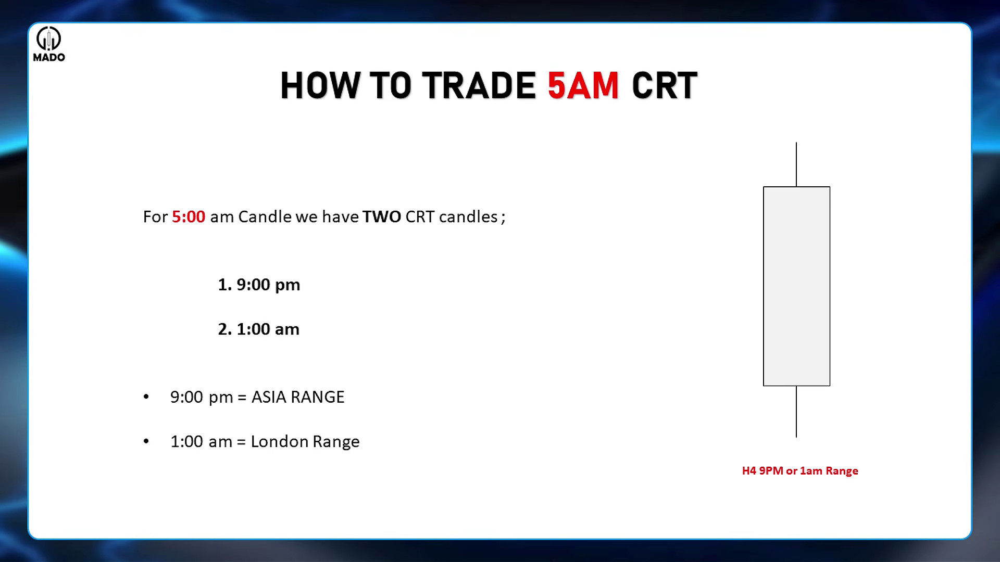
* Before profiling the 5 AM candle, profile both preceding 4H candles: **9 PM** is the Asia range and **1 AM** is the London range [00:05:08-00:05:25].
  
* Mado states that the two completed ranges must reveal their behavior before bias is built; the task is to observe and profile rather than predict [00:06:07-00:06:22].
  
* **Scenario 1 — 9 PM range + 1 AM range → 5 AM manipulation and expansion:** both earlier candles consolidate, building the Turtle Soup liquidity; the 5 AM candle sweeps that liquidity and expands [00:06:23-00:07:09].
  
* This scenario is described as the cleanest: the two quiet candles are the stored fuel, while the 5 AM candle performs both the manipulation and the launch [00:06:53-00:07:09].
  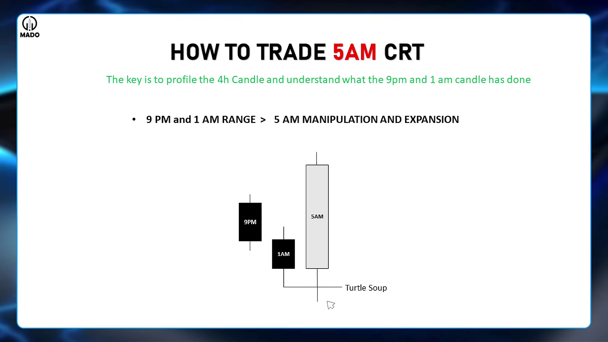
* **Scenario 2 — 1 AM retracement into a key level → 5 AM reversal and expansion:** the 1 AM candle retraces into a key level; the 5 AM candle Turtle Soups that retracement, rejects it, and expands in the opposite direction [00:07:13-00:07:53].
  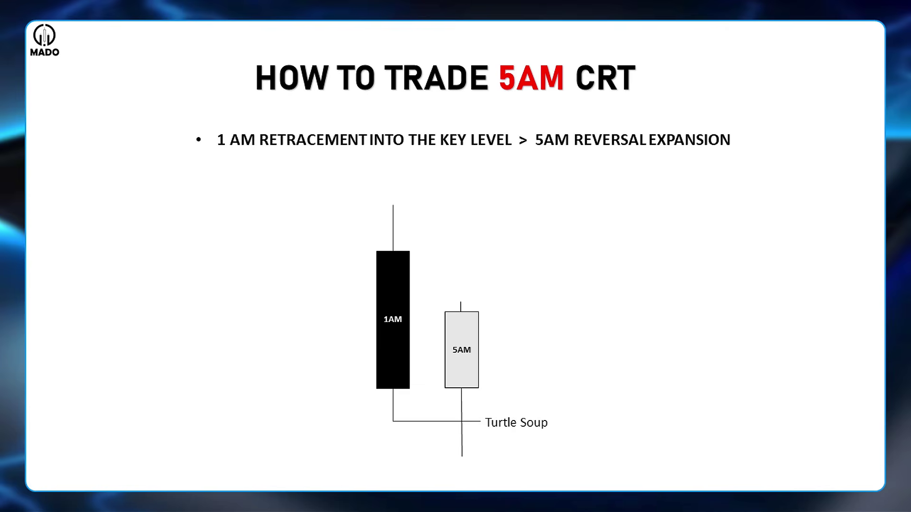
* **Scenario 3 — 1 AM reversal → 5 AM continuation:** the 1 AM candle already executes the reversal/manipulation and establishes direction; the 5 AM candle continues that commitment instead of needing a new manipulation [00:07:56-00:08:29].
  
* None of the scenarios is to be predicted in advance. Mado says the 9 PM and 1 AM candles must first print and reveal the sequence [00:08:29-00:09:02].
  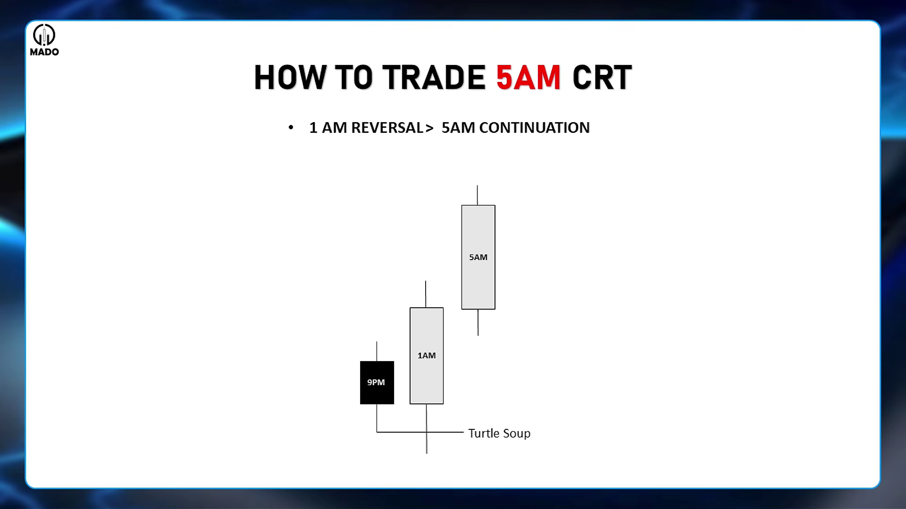

---

## 🎯 Higher-Timeframe Order Flow and Key Levels

* **Timestamp:** [00:09:06]
  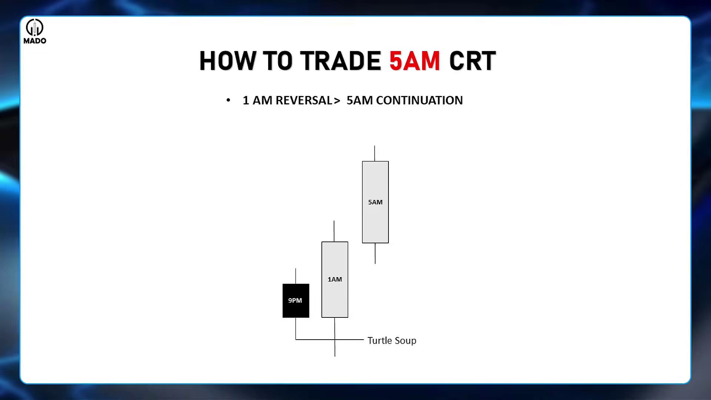
* A dip through a key level is noise on its own. With bullish higher-timeframe order flow, the same dip can represent resting liquidity taken below the level before continuation higher [00:09:06-00:09:39].
  
* The lesson warns that a 5 AM setup that fights the higher-timeframe order flow is trading against the broader context, not with it [00:09:41-00:10:00].
  

---

## 📊 Three Intraday Profiles

* **Timestamp:** [00:10:06]
  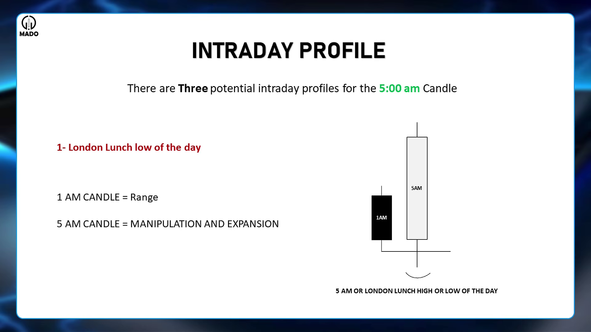
* The 5 AM CRT has three intraday profiles, not the two discussed for the 1 AM CRT [00:10:06-00:10:42].
  
* **Profile 1 — London lunch high/low of day:** the 1 AM candle ranges; the 5 AM candle performs manipulation plus expansion; the 5 AM/London-lunch period often marks the day’s high or low, typically within **5:00-7:00 a.m.** [00:10:45-00:11:23].
  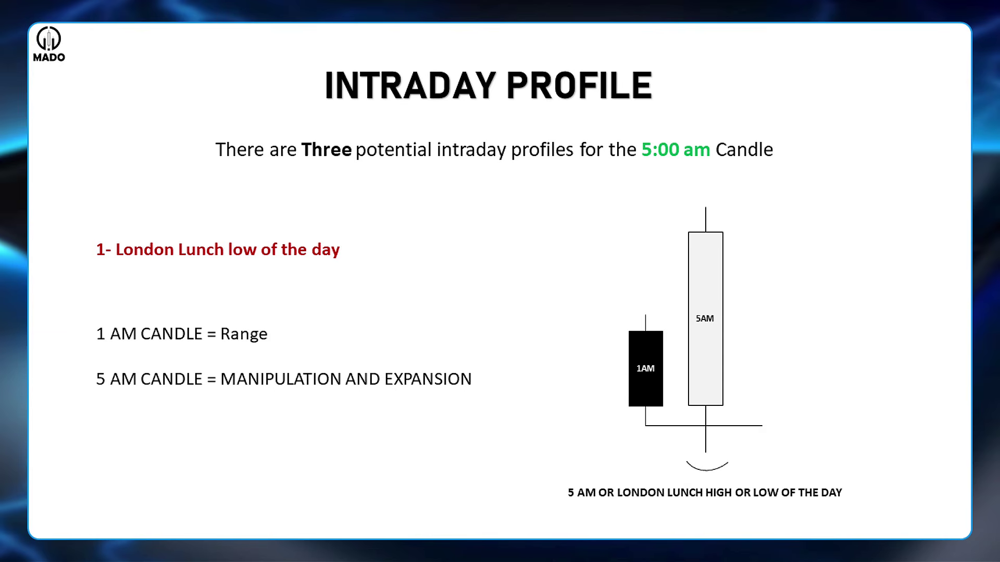
* The profile diagram anchors the potential high/low-of-day outcome to the London-lunch portion of the 5 AM range [00:11:17].
  
* Its visual signature is Asia chopping, London extending quietly, then London lunch producing the clean breakout: “flat, flat, then fire” [00:11:33-00:12:05].
  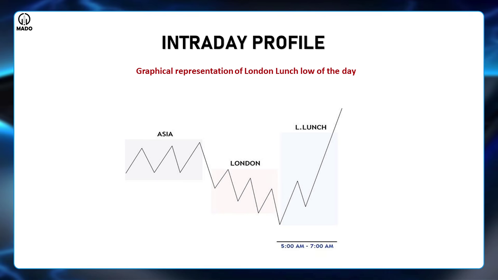
* **Profile 2 — New York reversal:** the 1 AM candle still ranges and 5 AM performs manipulation plus expansion, but the day’s extreme arrives during the 5 AM/New York period rather than London lunch [00:12:11-00:12:41].
  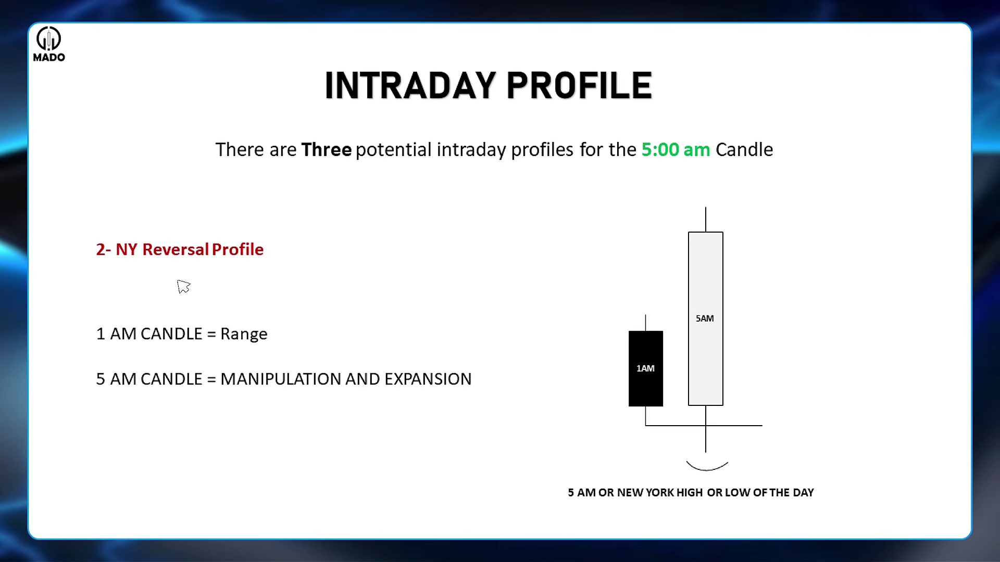
* Profiles 1 and 2 cannot be distinguished ahead of time from their early candle sequence; their difference is where price ultimately prints the daily extreme, so the market must reveal it [00:12:59-00:13:13].
  
* The visual New York-reversal signature is a climb through London, a final New York liquidity grab, then a hard reversal [00:13:16-00:13:48].
  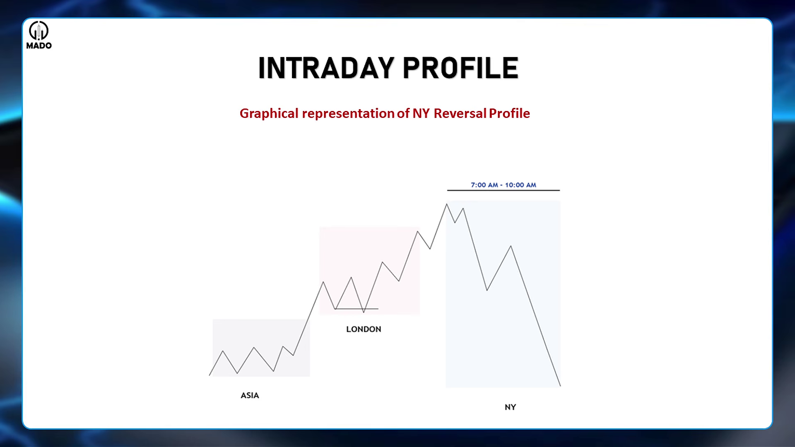
* **Profile 3 — New York continuation:** 9 PM ranges, 1 AM performs the manipulation and expansion, and 5 AM continues the direction established at 1 AM; the 5 AM/New York period may mark the daily extreme around **7:00-10:00 a.m.** [00:14:29-00:14:57].
  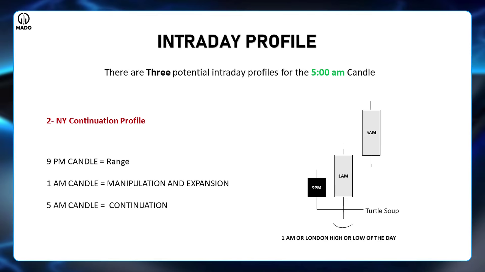
* The summary distinguishes profiles 1 and 2 by the timing of the day’s extreme, while profile 3 is structurally different because 1 AM has already committed direction [00:15:09-00:15:42].
  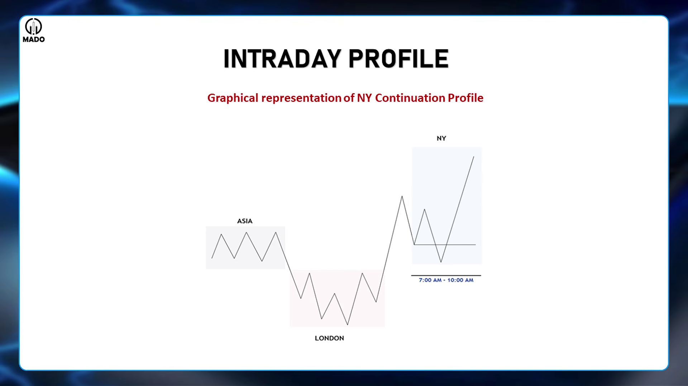

---

## 🔍 5 AM Candle Anatomy and Time Windows

* **Timestamp:** [00:16:12]
  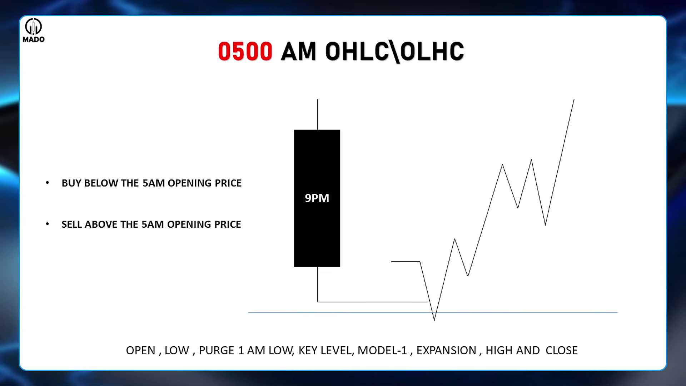
* In a bullish open-low-high-close sequence, the 5 AM candle opens, purges the **1 AM low**, waits for Model 1 confirmation, expands toward the high, and closes near that high [00:16:23-00:16:37].
  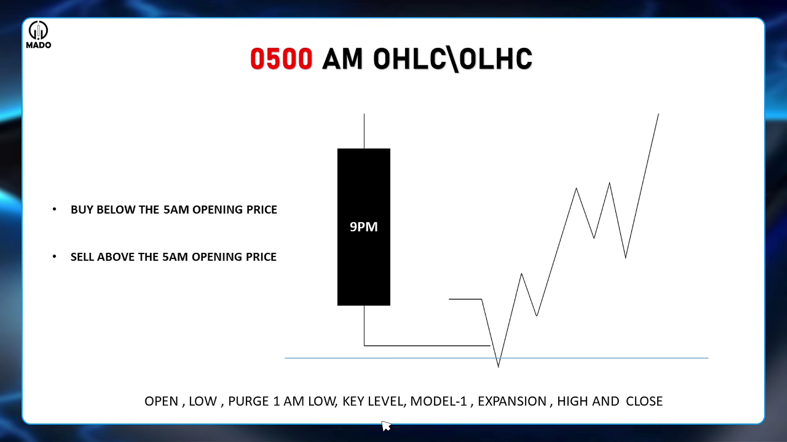
* The purge is the Turtle Soup and is treated as the necessary fuel of the move rather than a decorative wick [00:17:00-00:17:17].
  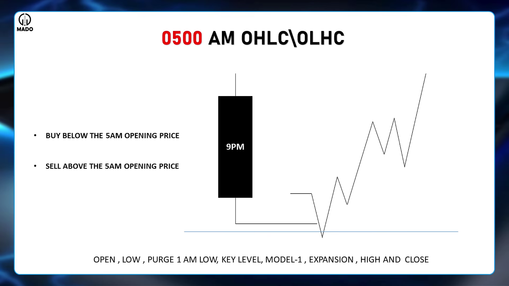
* The bearish mirror is open → purge of the 1 AM high → bearish Model 1 → expansion to the low → close near the low. The concise rule is buy below the 5 AM open and sell above it, after the proper sequence [00:17:17-00:17:25].
  
* The highest-probability windows named are **6:00-7:00 a.m.** (London lunch) and **7:00-8:30 a.m.** (New York open) [00:17:47-00:18:17].
  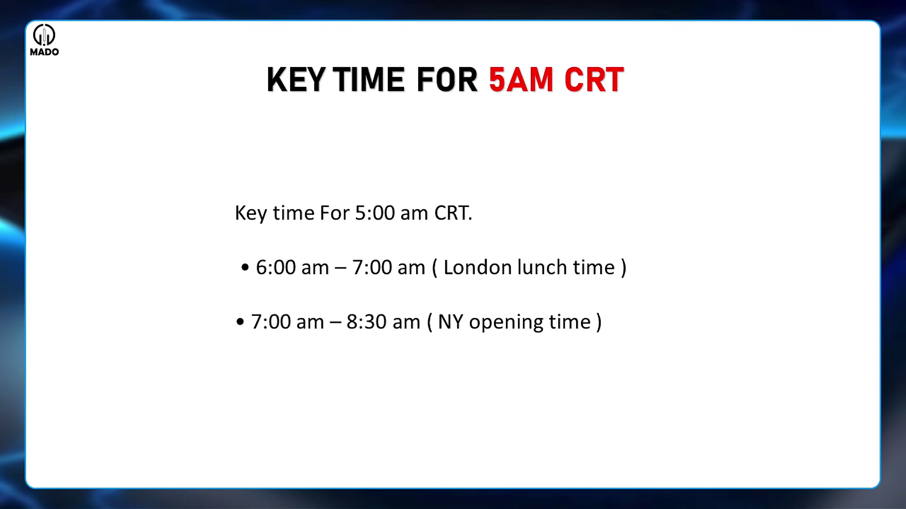
* The 5 AM candle is described as more forgiving than 1 AM because it forms in more liquid, established sessions; this does not remove the requirement to wait for time and confirmation [00:18:20-00:18:49].
  

---

## 🧠 M15 Entry Model and Execution Checklist

* **Timestamp:** [00:18:50]
  
* The execution timeframe is **M15**. After the relevant range level is swept, wait for Model 1; the lower-timeframe Model 1 is the stated entry trigger [00:18:50-00:19:32].
  
* **Step 1:** mark the 1 AM candle’s high, low, and 50% midpoint [00:19:37-00:19:58].
  
* The checklist begins from the completed 1 AM range before any lower-timeframe trigger is considered [00:19:44].
  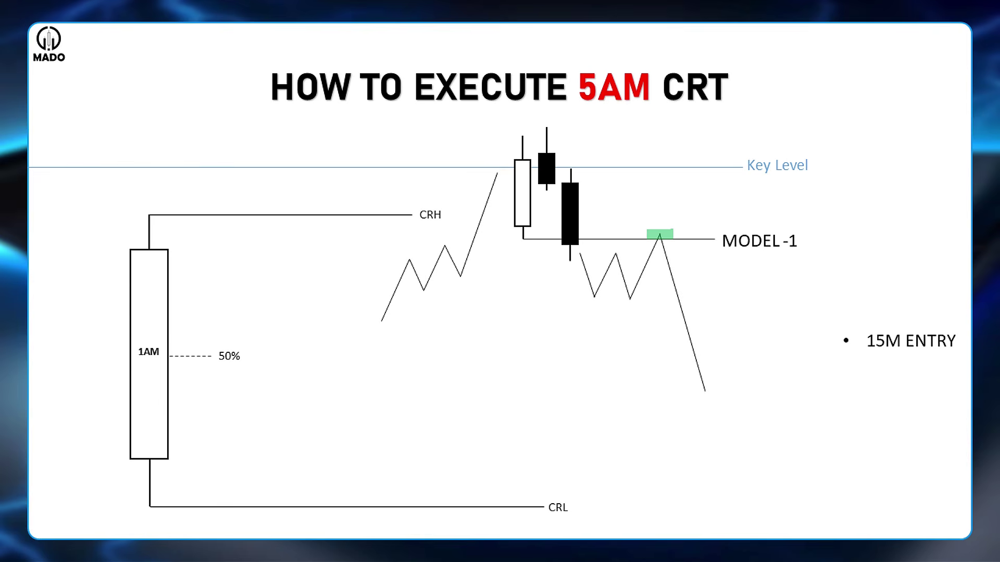
* **Step 2:** profile the 9 PM candle too, because it can be the operative range depending on the scenario [00:20:02-00:20:13].
  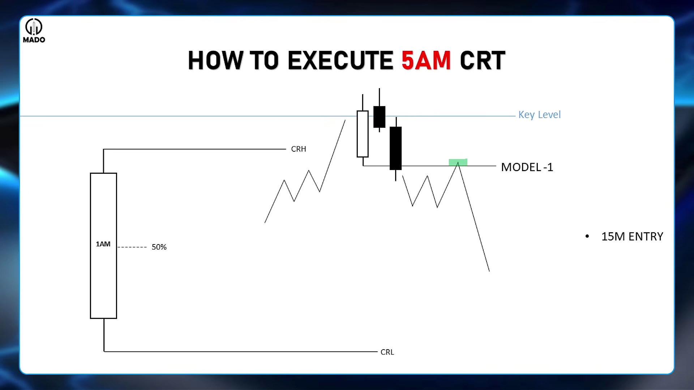
* **Steps 3-4:** watch price approach the scenario-relevant key level, then wait for the Turtle Soup/manipulation [00:20:16-00:20:27].
  
* **Step 5:** drop to M15 and wait for Model 1 confirmation [00:20:28-00:20:32].
  
* **Step 6:** enter in the expansion direction after confirmation; the stated stop is beyond the sweep and the target is the opposite side of the range or the next major liquidity draw [00:20:36-00:20:46].
  

---

## 🔗 Framework and First Live Example

* **Timestamp:** [00:21:10]
  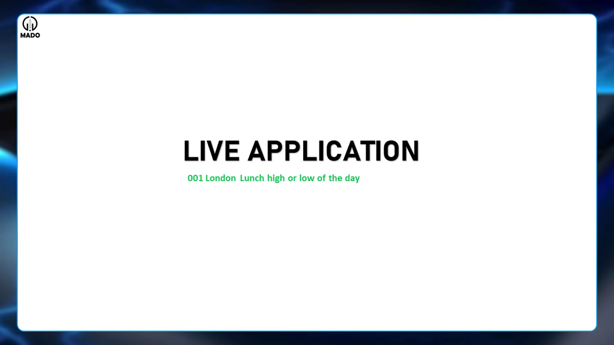
* The episode says a 4H CRT range cannot be traded merely because it exists: weekly and daily context, the specific 4H range, and tradeable market conditions still have to be connected [00:21:10-00:21:50].
  
* In the first EURUSD example, the market has rallied into a higher-timeframe premium key level; the narrative is therefore a possible retracement rather than another long [00:22:01-00:23:04].
  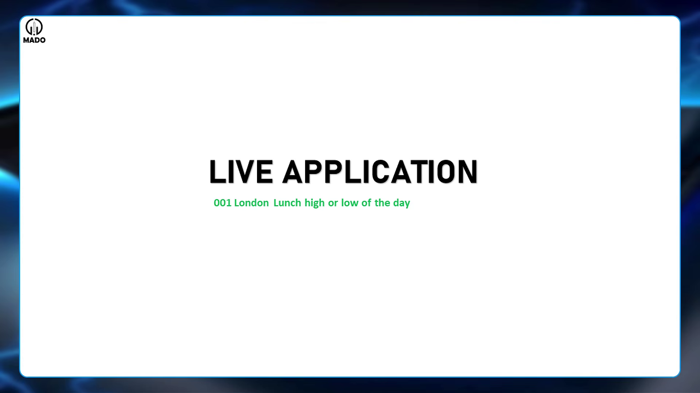
* The example explicitly starts by connecting the weekly and daily setting to the intraday CRT hypothesis [00:22:12].
  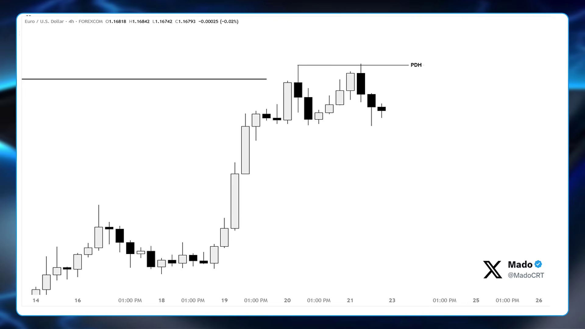
* The Friday example adds weekly expansion, TGIF retracement expectation, and the previous day’s Turtle Soup before using the 5 AM CRT as the framework [00:23:07-00:23:31].
  
* Its profile is 1 AM range → London range → 5 AM manipulation/expansion [00:23:31-00:23:37].
  
* On M15, price purges both the Asia and London ranges in the 5:00-7:00 window, then produces Model 1. The stated chain is higher-timeframe context → CRT profile → key time → M15 execution [00:24:13-00:24:55].
  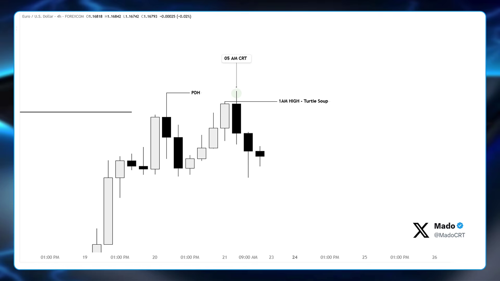
* The chart then ties the sweep and M15 confirmation back to the pre-existing higher-timeframe bearish premise [00:24:34].
  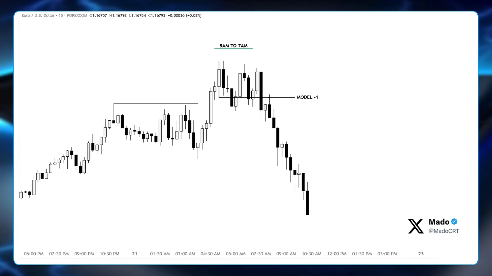
* The example later prints the high of day in London lunch, completing the profile [00:25:00-00:25:23].
  
* The completed move is presented as the profile’s London-lunch high-of-day resolution [00:25:06].
  

---

## 📈 Second Example: 1 AM Retracement, 5 AM Reversal

* **Timestamp:** [00:25:45]
  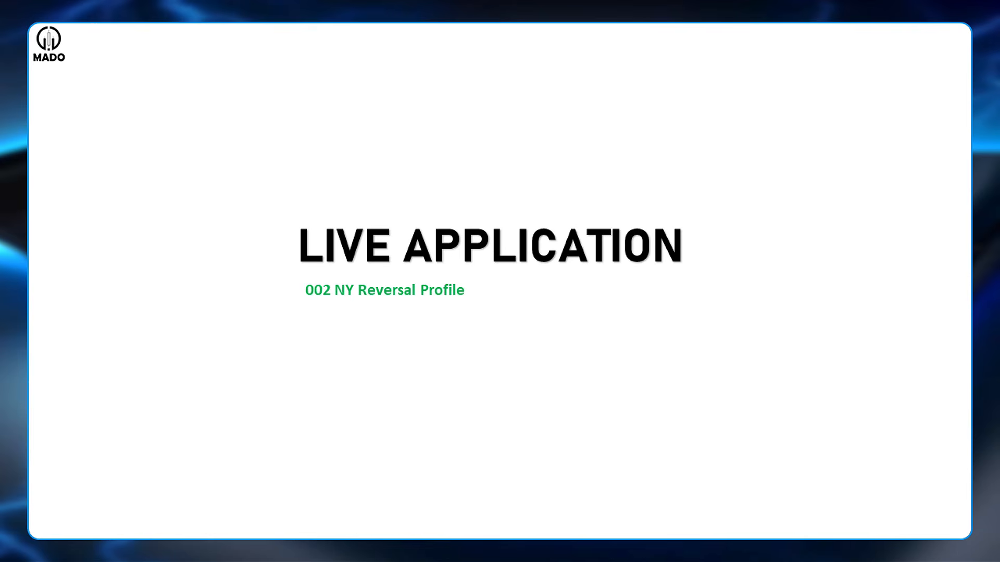
* The second example resets the reading process from higher-timeframe order flow before evaluating its 1 AM and 5 AM sequence [00:25:58].
  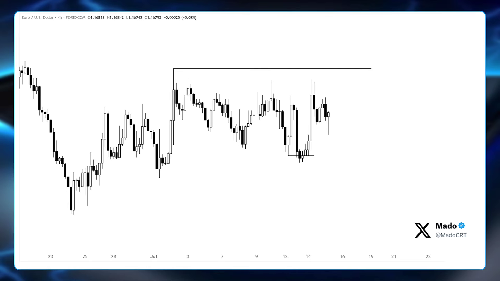
* The second EURUSD example has bullish order flow; 1 AM retraces, then the 5 AM candle purges the 1 AM low and fills a discounted gap, creating an expectation for higher prices [00:26:02-00:26:20].
  
* The aggressive expansion is explained through two objectives: the short-term low was Turtle Soupped and price filled the discounted gap [00:26:26-00:26:45].
  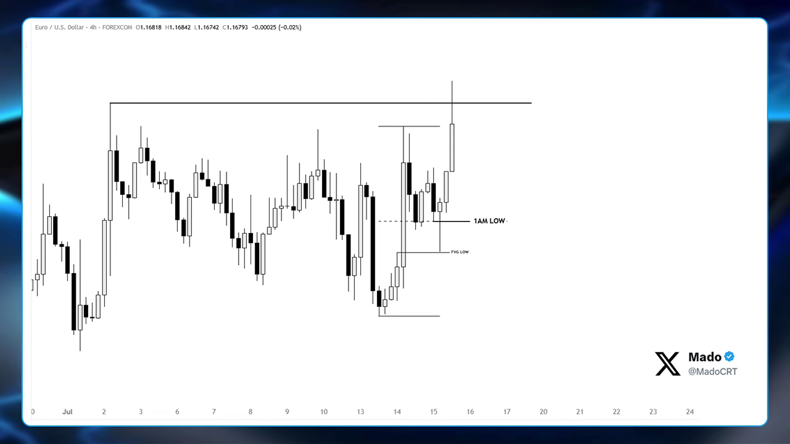
* On M15, the sweep and key-level tap occur in the **7:00-8:30** window. This example is explicitly a Turtle Soup entry, not a valid Model 1, so the lesson warns against forcing every move into Model 1 [00:26:51-00:27:31].
  

---

## 📉 Third Example: New York Continuation and CISD

* **Timestamp:** [00:27:46]
  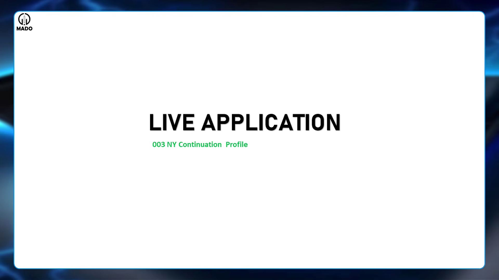
* The distinction is that the 5 AM candle inherits an already-established direction rather than creating the reversal itself [00:28:06].
  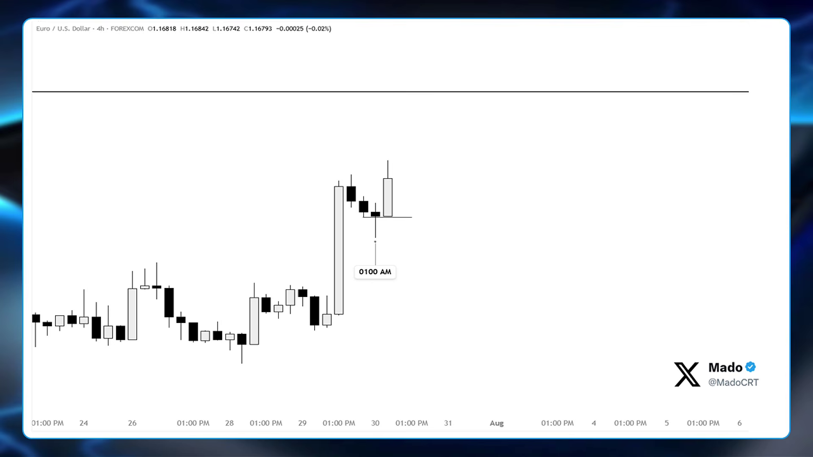
* In the continuation example, the 1 AM candle purges the 5 PM low and reverses higher. Since manipulation and reversal already occurred at 1 AM, the 5 AM expectation is continuation toward the draw on liquidity [00:27:46-00:28:28].
  
* For a continuation setup, the lesson names **CISD** as the confirmation before execution, in the same broad manner as a 1 AM continuation [00:28:32-00:29:05].
  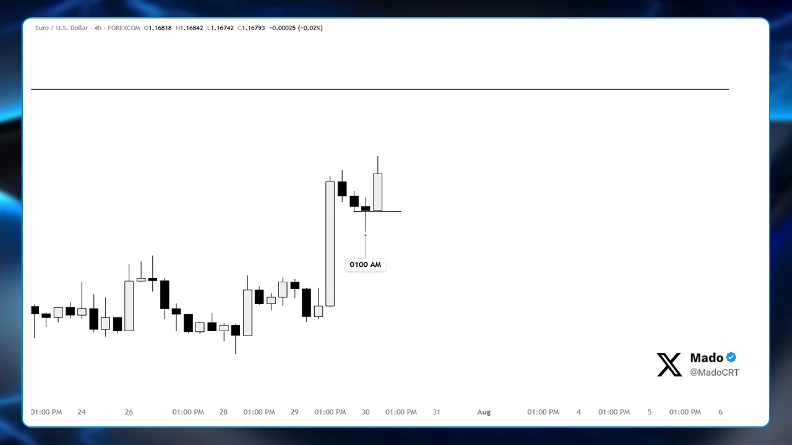
* The chart illustrates the CISD confirmation inside the continuation sequence [00:28:55].
  
* Mado says he personally does not trade this profile even though it can be valid; validity and fit with an individual trading plan, risk management, and psychology are distinct questions [00:29:07-00:29:43].
  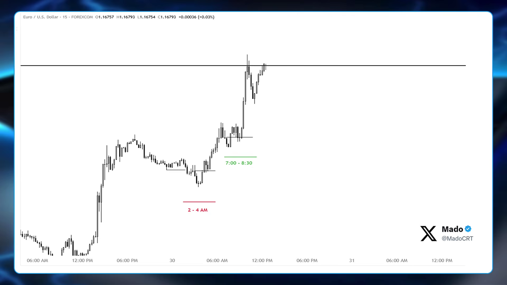
* A setup should be used only after it fits the trader’s plan and has been properly backtested and forward tested [00:29:43-00:29:54].
  

---

## ✅ Closing Summary

* The 5 AM CRT is presented as a complete, layered model: two prior 4H ranges, three profiles, order flow, key levels, time windows, and M15 execution must be read together [00:29:56-00:30:10].
  
* The episode closes by recommending repeated study rather than rushing to trade a complex model [00:29:43-00:30:33].
  

---

## 🔗 Video Link

* **URL:** https://www.youtube.com/watch?v=zjhV63Sx6zc
