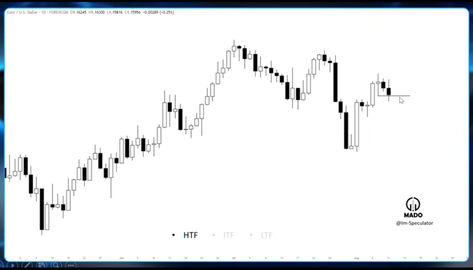
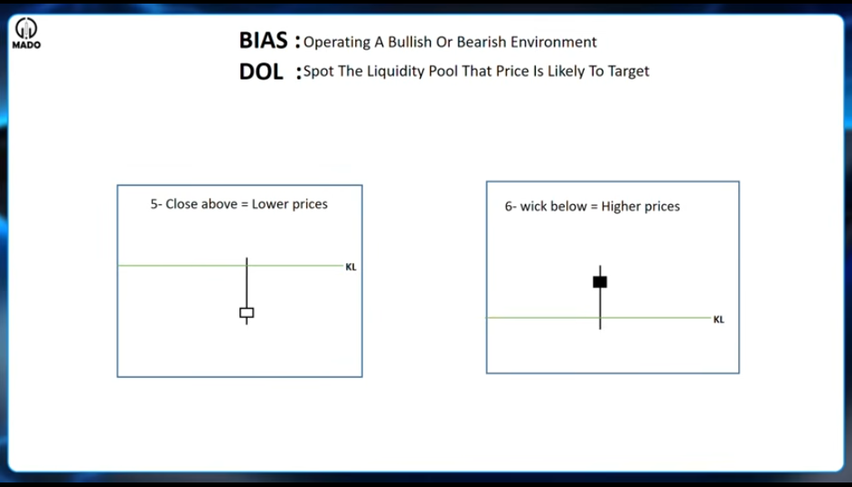
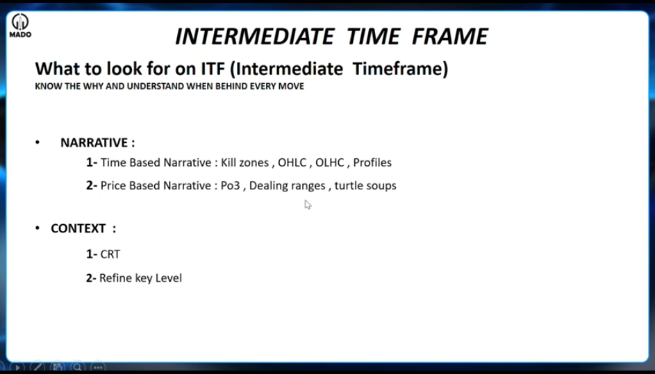
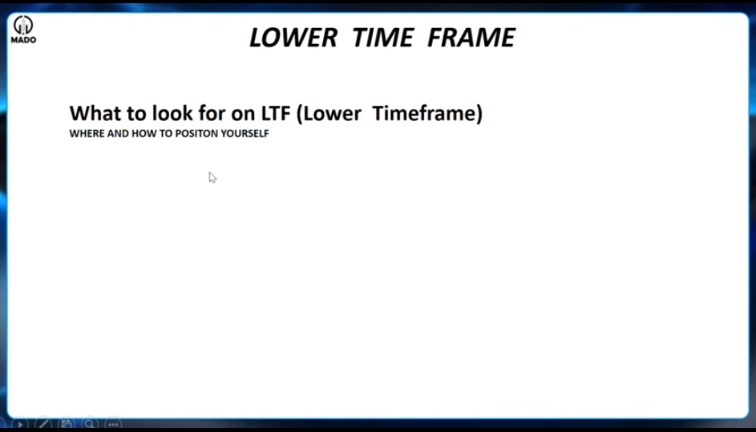
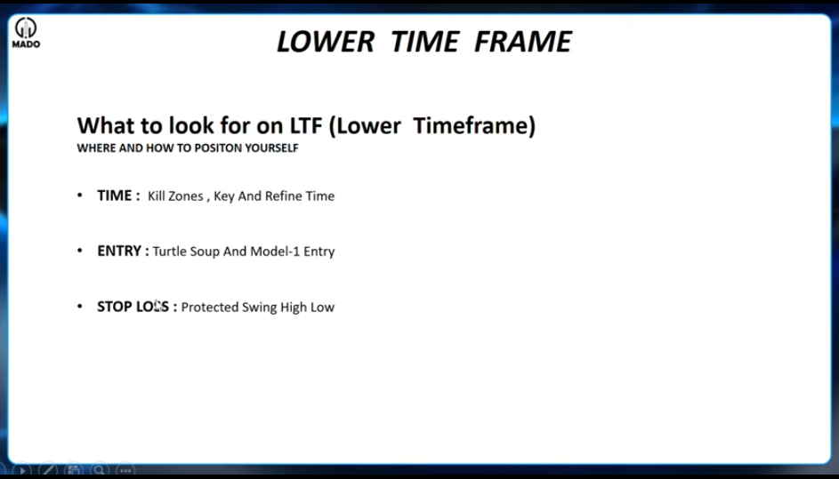
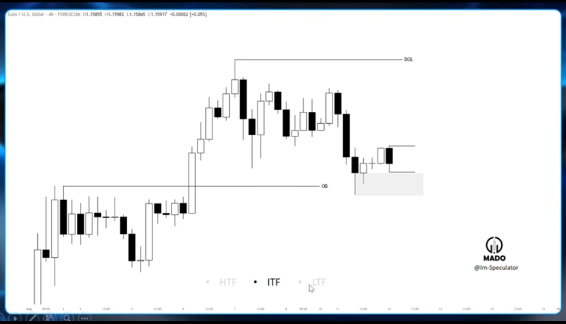
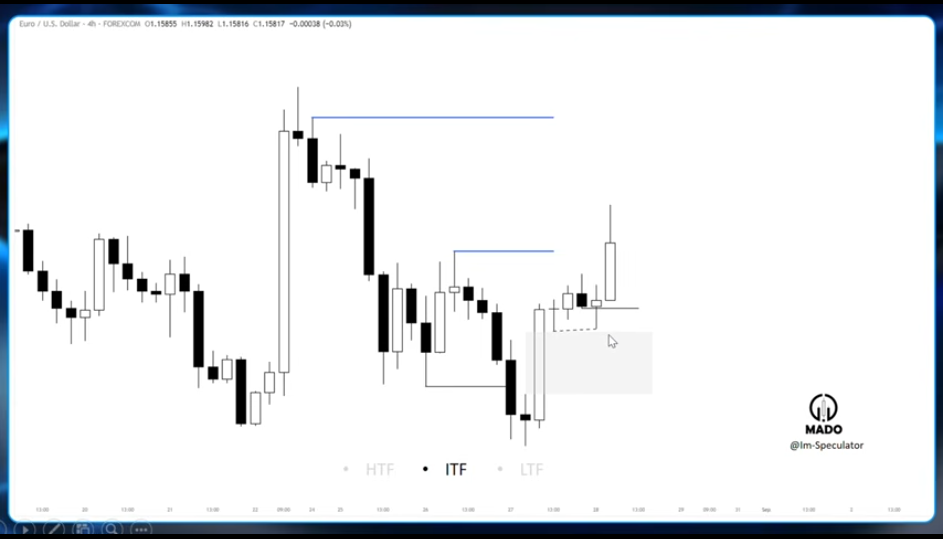

# CRT 2026 Mentorship - Ep 3 | How to Sync HTF, ITF, and LTF

**Canal de YouTube:** Mado  
**Enlace al Video:** [CRT 2026 Mentorship EP 3 | How to Sync HTF , ITF  and  LTF](http://www.youtube.com/watch?v=AXW4wDUWSr8)  
**Duración Total:** 17 min 01 seg  

---

## 📌 Introducción y Propósito de la Sincronización
* **[00:00:04]** Bienvenida a la clase. Se recomienda haber estudiado detenidamente los episodios 1 y 2 antes de continuar.
* **[00:00:21]** Objetivo del episodio: Explicar el proceso de pensamiento completo para conectar el marco temporal alto (*Higher Time Frame - HTF*), el marco temporal intermedio (*Intermediate Time Frame - ITF*) y el marco temporal bajo (*Lower Time Frame - LTF*).
* **[00:00:50]** Integrando estos tres marcos temporales paso a paso, el trader puede construir una narrativa lógica y una estructura clara de trading, desde el análisis macro hasta la entrada exacta en LTF.

---

## 🧭 Higher Time Frame (HTF) - Análisis del Entorno Macro
* **[00:01:04]** Todo análisis comienza en el HTF para comprender el entorno del mercado: dónde está el precio, a dónde quiere ir, cómo llegará y por qué.

### Elementos Clave a Analizar en HTF:
1. **Order Flow (Flujo de Órdenes):** **[00:01:23]** Identifica la dirección prevalente de la entrega del precio y la estructura del mercado.
   * **Bullish Order Flow:** Ocurre cuando el mercado rechaza por debajo de un bajo (*low*) y rompe por encima de un alto (*high*).
   * **Bearish Order Flow:** Ocurre cuando el mercado rechaza por encima de un alto (*high*) y rompe por debajo de un bajo (*low*).
   
2. **Bias (Sesgo Direccional):** **[00:02:03]** Define si el mercado o la vela actual opera en un entorno alcista o bajista. Consiste en anticipar si la vela que estamos operando cerrará alcista o bajista leyendo la estructura OHLC/OLHC.
   * **Close Above = Precios más altos:** Si el mercado cierra por encima de la vela previa, se esperan precios más altos en la siguiente vela.
   * **Close Below = Precios más bajos:** Si el mercado cierra por debajo de la vela previa, se esperan precios más bajos en la siguiente vela.
   * **Close Inside:** Si el mercado cierra dentro del rango previo, una vela bajista sugiere continuidad a la baja y una alcista sugiere continuidad al alza.
   * **Uso de Mechas (Wicks):** Una mecha superior indica precios más bajos; una mecha inferior sugiere precios más altos a continuación.
   * **Advertencia:** El autor aclara que esto es solo *una confluencia* para identificar el bias, no una regla absoluta a seguir a ciegas — siempre se debe combinar con lógica y contexto de mercado apropiado para armar una idea de trade clara.
   
3. **Draw on Liquidity (Objetivos de Liquidez):** **[00:11:29]** Identificación de puntos de liquidez clave en el corto plazo (como los máximos o mínimos de velas previas) hacia los cuales se dirige el precio.
   
4. **Key Levels (Niveles Clave):** **[00:11:52]** Identificación de zonas macro de soporte o resistencia, tales como *Fair Value Gaps* (FVG) u *Order Blocks*.
   

---

## 🎯 Intermediate Time Frame (ITF) - Narrativa y Contexto
* **[00:05:06]** En el marco temporal intermedio, la atención se centra principalmente en dos pilares: la **Narrativa** y el **Contexto**.
  

### A. Tipos de Narrativa en ITF
1. **Narrativa Basada en Tiempo (Time-based Narrative):** **[00:05:19]**
   * **Kill Zones:** Asia, Londres y Nueva York. Cada sesión tiene comportamientos únicos que estructuran las expectativas temporales.
   * **Estructuras de Sesión:** Análisis de perfiles de mercado (como el perfil de 4H) y la estructura interna OHLC/OLHC dentro de la sesión.
   * El autor aclara que las Kill Zones se van a desarrollar en mucha más profundidad en un capítulo aparte; por ahora alcanza con tenerlas presentes como marco de referencia temporal.
   
2. **Narrativa Basada en Precio (Price-based Narrative):** **[00:06:06]**
   * Incluye conceptos como *Time-based Power of 3 (PO3)*, *Dealing Ranges*, *Turtle Soup* y perfiles semanales o de 4 horas.
   * Ayuda a entender en qué áreas el precio va a consolidar, expandir, retroceder o generar liquidez.
   * El autor menciona que ya desarrolló el *Time-based PO3* en detalle en un posteo de Twitter/X, y recomienda buscarlo para profundizar en ese concepto.
   

### B. Contexto y Refinamiento
* **Candle Range Theory (CRT):** **[00:06:40]** Se aplica CRT en el ITF para obtener una imagen clara de cómo evoluciona el precio dentro de la estructura general definida por el HTF. Como traders CRT, se remarca que Candle Range Theory se usa pura y exclusivamente para dar contexto en el ITF.
  
* **Refinamiento de Key Levels:** **[00:07:01]** Los niveles clave de HTF se refinan en ITF para obtener zonas de retesteo más precisas que se alineen con los setups CRT.
  

---

## 🔬 Lower Time Frame (LTF) - Ejecución y Gestión
* **[00:07:37]** El marco temporal bajo es donde la teoría y el análisis se convierten en acción y ejecución concreta.

### Los 4 Pilares de la Ejecución en LTF:
1. **Time (Alineación Temporal):** **[00:07:52]** Las entradas se deben ejecutar dentro de horas clave fijadas por las *Kill Zones*:
   * **London Kill Zone:** 2:00 a.m. a 5:00 a.m. (UTC-5 / UTC-4).
   * **New York Kill Zone:** 7:00 a.m. a 10:00/11:00 a.m. (UTC-5 / UTC-4).
   * **Recomendación práctica:** olvidarse del huso horario local y configurar directamente el gráfico en UTC-5 / UTC-4, operando exclusivamente dentro de estas dos Kill Zones (Londres y Nueva York).
   
2. **Entry Model (Modelo de Entrada):** **[00:08:42]** El autor utiliza **Model-1** (entrada en Order Block formado tras la purga y cierre de confirmación). Aclara que Model-1 es su elección personal, no una obligación: cada trader debe encontrar, estudiar y dominar el modelo de entrada que mejor se adapte a su propio estilo, y operarlo con confianza. En sus palabras, "tu modelo de entrada es tu arma — usalo con precisión".
   
3. **Stop-Loss (Gestión de Riesgo):** **[00:09:11]** Colocación estratégica del stop en los *Protected Swing Highs / Lows* (el mínimo o máximo protegido que originó la formación del Model-1). El autor enfatiza que, sin un stop-loss correctamente ubicado, "no estás trading, estás apostando" (*gambling*).
   
4. **Target / Exit (Salida y Parciales):** **[00:09:44]** Objetivos en el 50% del rango CRT o en el CRT High/Low. Mantener siempre una relación Riesgo:Beneficio mínima de 1:2 o 1:3. El autor remarca que, incluso con un winrate modesto, sostener esta relación mínima de riesgo:beneficio permite que la curva de capital (*equity curve*) crezca de forma constante en el tiempo.
   

---

## 📈 Ejemplos Gráficos e Integración en Gráficos Reales

### Ejemplo 1: EUR/USD Diario a LTF (Sincronización Completa)
* **[00:10:32] HTF (Diario):** Order Flow alcista (rechaza bajos, rompe altos). Cierre dentro del rango previo (expectativa alcista). En este ejemplo se identifican **dos** *draws on liquidity*: el alto de la vela previa y, a continuación, el alto de la vela siguiente a esa. Zona de soporte en FVG u Order Block — concretamente, el nivel clave usado en este ejemplo es un **Rejection Block** (bloque de rechazo).
* **[00:12:05] ITF:** Vela de Asia (9:00 p.m., dentro de la Asia Kill Zone pero fuera del foco del autor) y vela de Londres (1:00 a.m.). Londres no alcanza el nivel clave (el Rejection Block) — el precio solo retrocede un poco sin tocarlo — pero genera un *Turtle Soup* de ese bajo y reacciona. Aunque técnicamente ahí podría empezar a buscarse una entrada, el autor descarta ese setup porque la vela de Londres "no dio nada significativo, solo un retroceso" (sin un setup limpio), así que se sigue de largo. Se define la vela CRT. Expectativa: purga del bajo de la vela CRT retesteando el bloque refinado.
  
* **[00:13:17] LTF:** El precio purga el bajo a las 5:30 a.m. (fuera de Kill Zone, por lo que no se opera). A las 7:45 a.m. (durante New York Kill Zone), el precio purga el bajo de corto plazo y cierra por encima.
  
* **[00:13:55] Ejecución:** Entrada **Model-1** en la vela de confirmación en New York Kill Zone. Stop loss bajo el *protected swing low*. TP al 50% del CRT / CRT High con parciales tomados antes de ir por los objetivos macro.
  

### Ejemplo 2: SMT Divergence y Key Level Divergence
* **[00:14:47] HTF / ITF (4H):** Order Flow alcista y precio operando dentro de la vela actual (cierre por dentro). Nuevamente se identifican **dos** *draws on liquidity*: el alto de la vela actual, seguido del alto de la vela siguiente. Identificación de un FVG en 4H como zona de soporte en EUR/USD.
  
* **[00:15:23] Divergencia:** El mercado sube sin rellenar completamente el FVG en EUR/USD, pero crea una *Key Level SMT Divergence* con un activo correlacionado que sí tocó su nivel clave.
  * **Advertencia:** El autor señala que este es un tema que amerita un capítulo aparte, pero deja una advertencia clave: a veces se espera que el precio toque un key level en un activo mientras el activo correlacionado ya lo tocó — y esa es justamente la forma en la que, y la razón por la que, se terminan perdiendo entradas (*missed entries*).
  
* **[00:15:53] LTF:** En LTF el precio purga un bajo, forma la SMT y cierra por encima. Entrada en el alto de la vela de confirmación (**Model-1**) con stop loss en el *swing low* y objetivo en el CRT High o ratio R:R 1:2 / 1:3.
  

---

## 🔮 Conclusión del Episodio
* **[00:16:29]** Resumen final: La metodología es puramente mecánica y basada en reglas, sin nada complicado de por medio. Requiere paciencia para esperar la alineación narrativa y la confirmación en el tiempo antes de ejecutar. Siguiendo el framework de forma mecánica todo empieza a encajar ("click").
* **[00:16:50]** Recomendación de cierre: tomarse el tiempo necesario para estudiar el comportamiento del precio y dejar que los setups se presenten solos — cuanto más tiempo de pantalla (*screen time*) se le dedique al análisis, más afilada se vuelve la ejecución.
  
