# CRT 2026 Mentorship - Ep 3 | How to Sync HTF, ITF, and LTF

**Canal de YouTube:** Mado  
**Enlace al Video:** [CRT 2026 Mentorship EP 3 | How to Sync HTF , ITF  and  LTF](http://www.youtube.com/watch?v=AXW4wDUWSr8)  
**Duración Total:** 17 min 01 seg  

---

## 📌 Introducción y Propósito de la Sincronización
* **[00:00:04]** Bienvenida a la clase. Se recomienda haber estudiado detenidamente los episodios 1 y 2 antes de continuar.
* **[00:00:21]** Objetivo del episodio: Explicar el proceso de pensamiento completo para conectar el marco temporal alto (*Higher Time Frame - HTF*), el marco temporal intermedio (*Intermediate Time Frame - ITF*) y el marco temporal bajo (*Lower Time Frame - LTF*).
* **[00:00:50]** Integrando estos tres marcos temporales paso a paso, el trader puede construir una narrativa lógica y una estructura clara de trading, desde el análisis macro hasta la entrada exacta en LTF.

---

## 🧭 Higher Time Frame (HTF) - Análisis del Entorno Macro
* **[00:01:04]** Todo análisis comienza en el HTF para comprender el entorno del mercado: dónde está el precio, a dónde quiere ir, cómo llegará y por qué.
  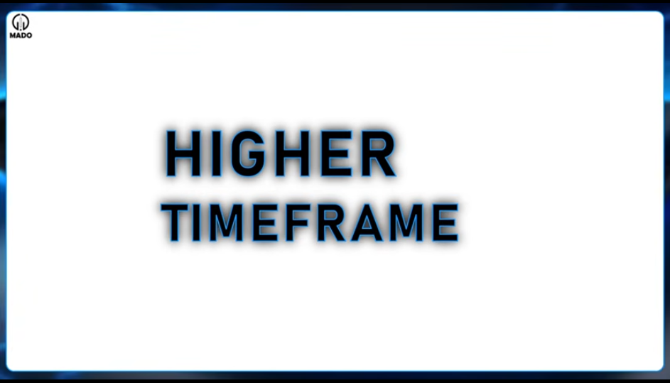

### Elementos Clave a Analizar en HTF:
1. **Order Flow (Flujo de Órdenes):** **[00:01:23]** Identifica la dirección prevalente de la entrega del precio y la estructura del mercado.
   * **Bullish Order Flow:** Ocurre cuando el mercado rechaza por debajo de un bajo (*low*) y rompe por encima de un alto (*high*).
   * **Bearish Order Flow:** Ocurre cuando el mercado rechaza por encima de un alto (*high*) y rompe por debajo de un bajo (*low*).
   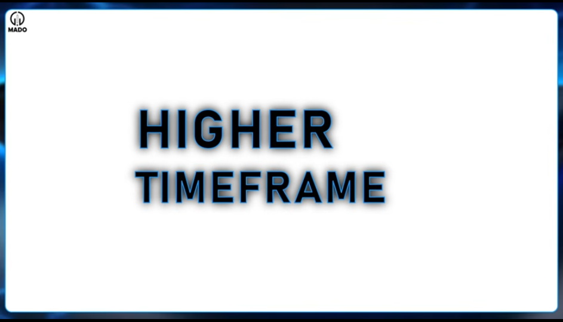
2. **Bias (Sesgo Direccional):** **[00:02:03]** Define si el mercado o la vela actual opera en un entorno alcista o bajista. Consiste en anticipar si la vela que estamos operando cerrará alcista o bajista leyendo la estructura OHLC/OLHC.
   * **Close Above = Precios más altos:** Si el mercado cierra por encima de la vela previa, se esperan precios más altos en la siguiente vela.
   * **Close Below = Precios más bajos:** Si el mercado cierra por debajo de la vela previa, se esperan precios más bajos en la siguiente vela.
   * **Close Inside:** Si el mercado cierra dentro del rango previo, una vela bajista sugiere continuidad a la baja y una alcista sugiere continuidad al alza.
   * **Uso de Mechas (Wicks):** Una mecha superior indica precios más bajos; una mecha inferior sugiere precios más altos a continuación.
   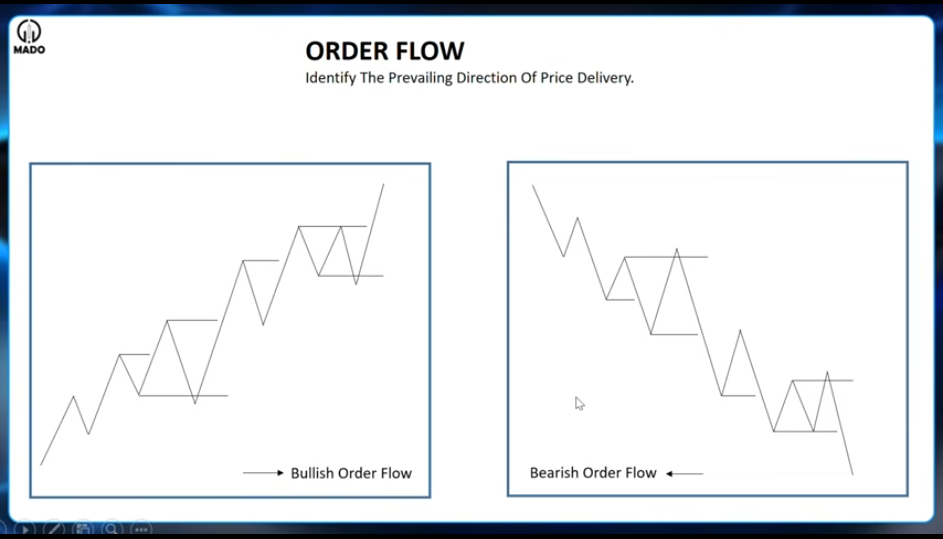
3. **Draw on Liquidity (Objetivos de Liquidez):** **[00:11:29]** Identificación de puntos de liquidez clave en el corto plazo (como los máximos o mínimos de velas previas) hacia los cuales se dirige el precio.
   
4. **Key Levels (Niveles Clave):** **[00:11:52]** Identificación de zonas macro de soporte o resistencia, tales como *Fair Value Gaps* (FVG) u *Order Blocks*.
   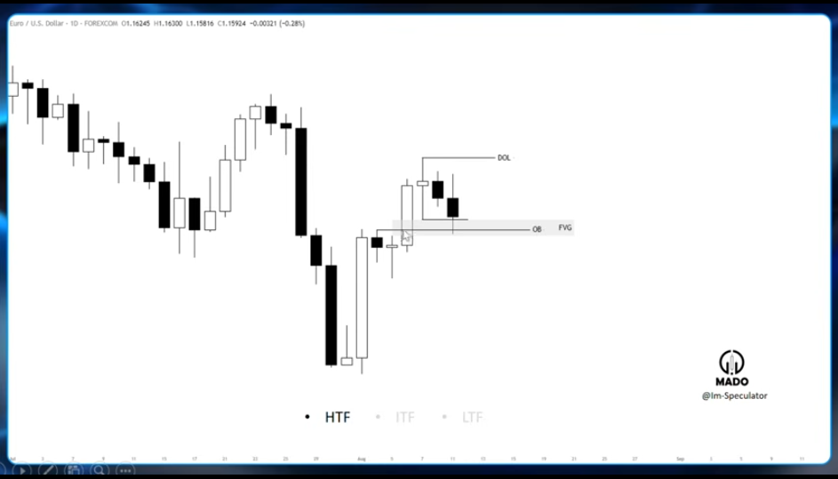

---

## 🎯 Intermediate Time Frame (ITF) - Narrativa y Contexto
* **[00:05:06]** En el marco temporal intermedio, la atención se centra principalmente en dos pilares: la **Narrativa** y el **Contexto**.
  

### A. Tipos de Narrativa en ITF
1. **Narrativa Basada en Tiempo (Time-based Narrative):** **[00:05:19]**
   * **Kill Zones:** Asia, Londres y Nueva York. Cada sesión tiene comportamientos únicos que estructuran las expectativas temporales.
   * **Estructuras de Sesión:** Análisis de perfiles de mercado (como el perfil de 4H) y la estructura interna OHLC/OLHC dentro de la sesión.
   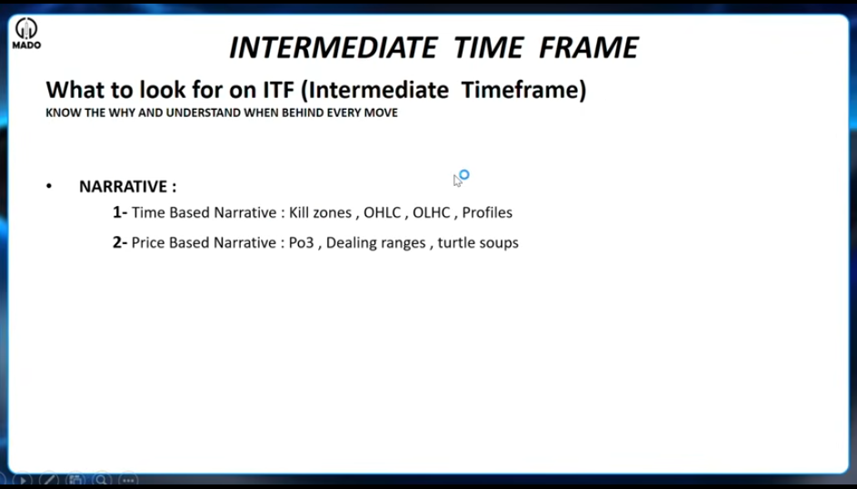
2. **Narrativa Basada en Precio (Price-based Narrative):** **[00:06:06]**
   * Incluye conceptos como *Time-based Power of 3 (PO3)*, *Dealing Ranges*, *Turtle Soup* y perfiles semanales o de 4 horas.
   * Ayuda a entender en qué áreas el precio va a consolidar, expandir, retroceder o generar liquidez.
   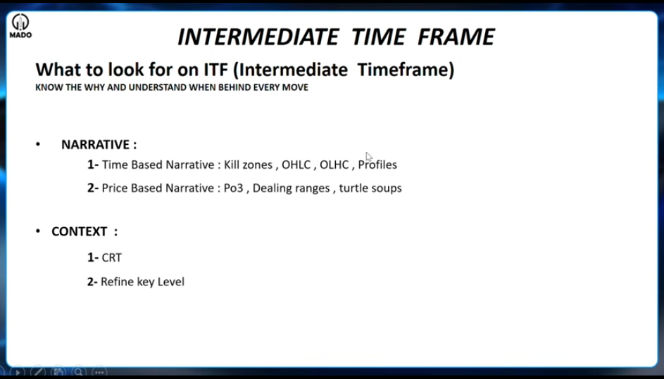

### B. Contexto y Refinamiento
* **Candle Range Theory (CRT):** **[00:06:40]** Se aplica CRT en el ITF para obtener una imagen clara de cómo evoluciona el precio dentro de la estructura general definida por el HTF.
  
* **Refinamiento de Key Levels:** **[00:07:01]** Los niveles clave de HTF se refinan en ITF para obtener zonas de retesteo más precisas que se alineen con los setups CRT.
  

---

## 🔬 Lower Time Frame (LTF) - Ejecución y Gestión
* **[00:07:37]** El marco temporal bajo es donde la teoría y el análisis se convierten en acción y ejecución concreta.
  

### Los 4 Pilares de la Ejecución en LTF:
1. **Time (Alineación Temporal):** **[00:07:52]** Las entradas se deben ejecutar dentro de horas clave fijadas por las *Kill Zones*:
   * **London Kill Zone:** 2:00 a.m. a 5:00 a.m. (UTC-5 / UTC-4).
   * **New York Kill Zone:** 7:00 a.m. a 10:00/11:00 a.m. (UTC-5 / UTC-4).
   
2. **Entry Model (Modelo de Entrada):** **[00:08:42]** El autor utiliza **Model-1** (entrada en Order Block formado tras la purga y cierre de confirmación).
   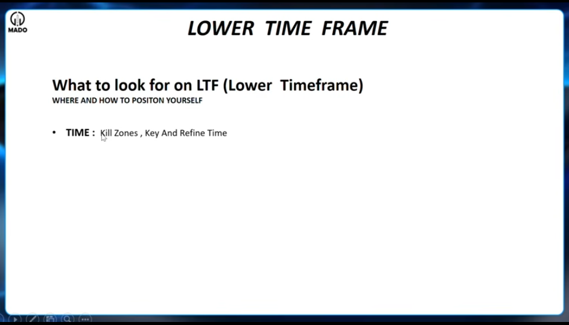
3. **Stop-Loss (Gestión de Riesgo):** **[00:09:11]** Colocación estratégica del stop en los *Protected Swing Highs / Lows* (el mínimo o máximo protegido que originó la formación del Model-1).
   
4. **Target / Exit (Salida y Parciales):** **[00:09:44]** Objetivos en el 50% del rango CRT o en el CRT High/Low. Mantener siempre una relación Riesgo:Beneficio mínima de 1:2 o 1:3.
   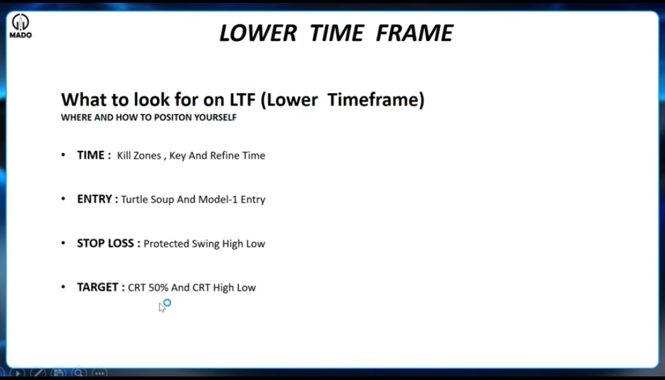

---

## 📈 Ejemplos Gráficos e Integración en Gráficos Reales

### Ejemplo 1: EUR/USD Diario a LTF (Sincronización Completa)
* **[00:10:32] HTF (Diario):** Order Flow alcista (rechaza bajos, rompe altos). Cierre dentro del rango previo (expectativa alcista). *Draw on liquidity* en el alto de la vela previa. Zona de soporte en FVG u Order Block.
  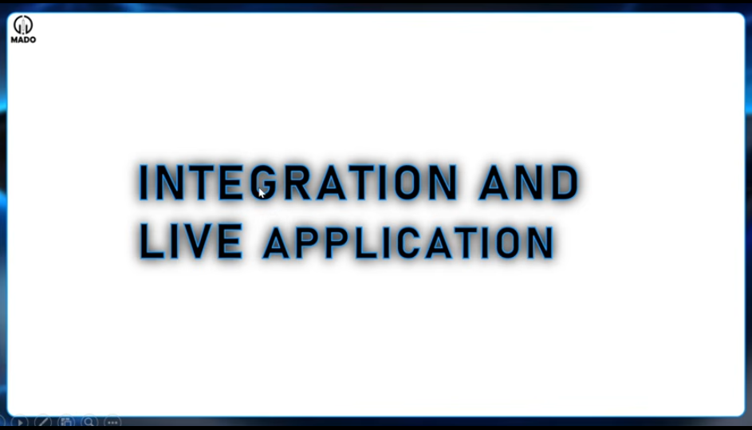
* **[00:12:05] ITF:** Vela de Asia (9:00 p.m.) y vela de Londres (1:00 a.m.). Londres no alcanza el nivel clave (bloque de rechazo) pero genera un *Turtle Soup*. Se define la vela CRT. Expectativa: purga del bajo de la vela CRT retesteando el bloque refinado.
  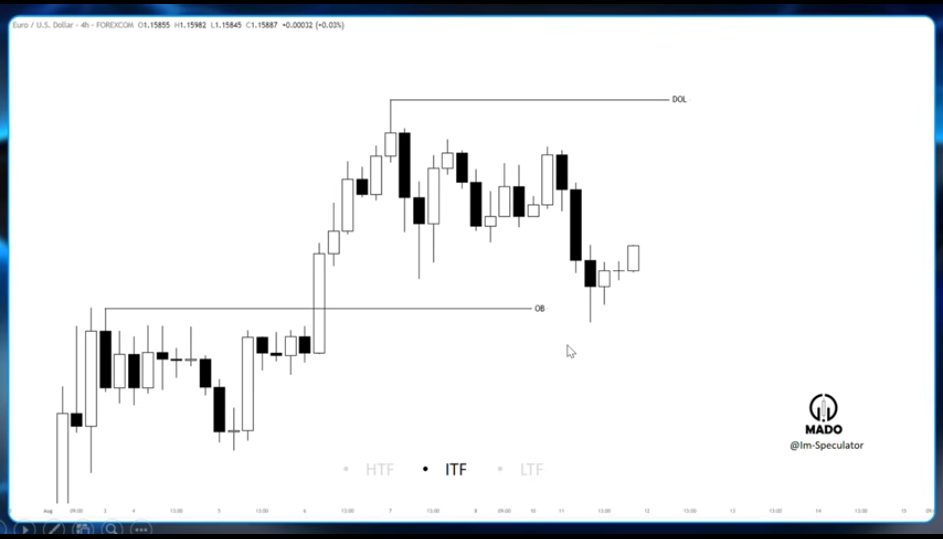
* **[00:13:17] LTF:** El precio purga el bajo a las 5:30 a.m. (fuera de Kill Zone, por lo que no se opera). A las 7:45 a.m. (durante New York Kill Zone), el precio purga el bajo de corto plazo y cierra por encima.
  
* **[00:13:55] Ejecución:** Entrada **Model-1** en la vela de confirmación en New York Kill Zone. Stop loss bajo el *protected swing low*. TP al 50% del CRT / CRT High con parciales tomados antes de ir por los objetivos macro.
  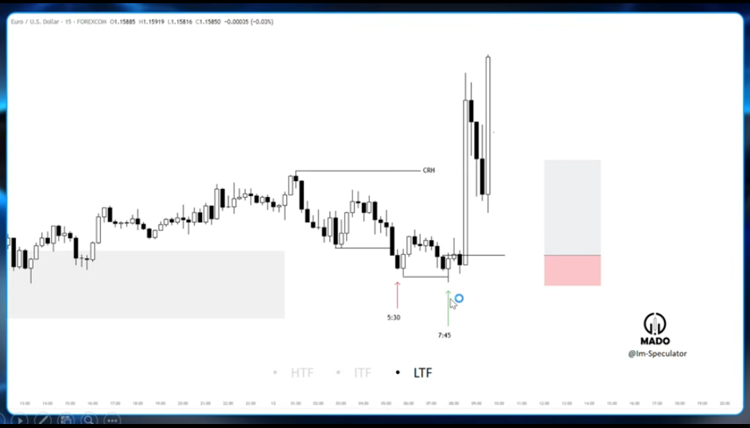

### Ejemplo 2: SMT Divergence y Key Level Divergence
* **[00:14:47] HTF / ITF (4H):** Identificación de un FVG en 4H como zona de soporte en EUR/USD.
  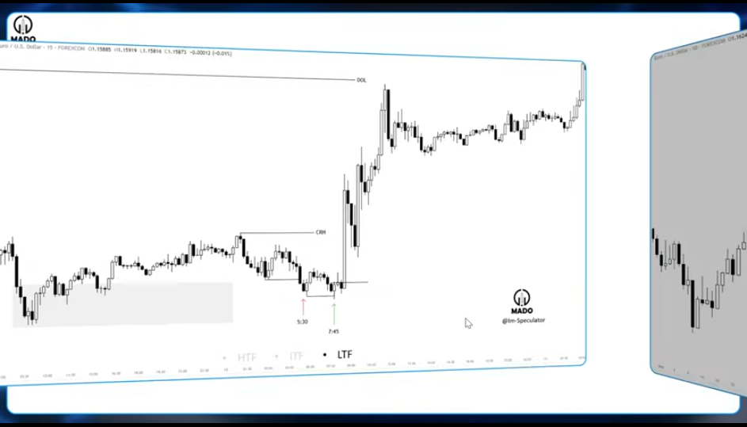
* **[00:15:23] Divergencia:** El mercado sube sin rellenar completamente el FVG en EUR/USD, pero crea una *Key Level SMT Divergence* con un activo correlacionado que sí tocó su nivel clave.
  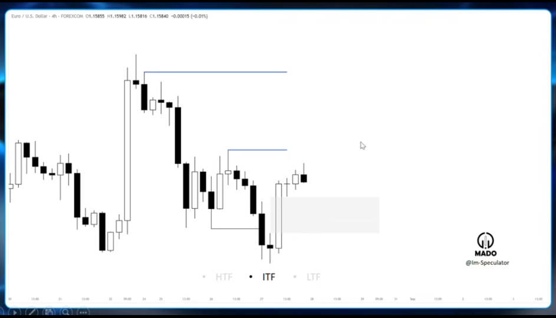
* **[00:15:53] LTF:** En LTF el precio purga un bajo, forma la SMT y cierra por encima. Entrada en el alto de la vela de confirmación (**Model-1**) con stop loss en el *swing low* y objetivo en el CRT High o ratio R:R 1:2 / 1:3.
  

---

## 🔮 Conclusión del Episodio
* **[00:16:29]** Resumen final: La metodología es puramente mecánica y basada en reglas. Requiere paciencia para esperar la alineación narrativa y la confirmación en el tiempo antes de ejecutar.
  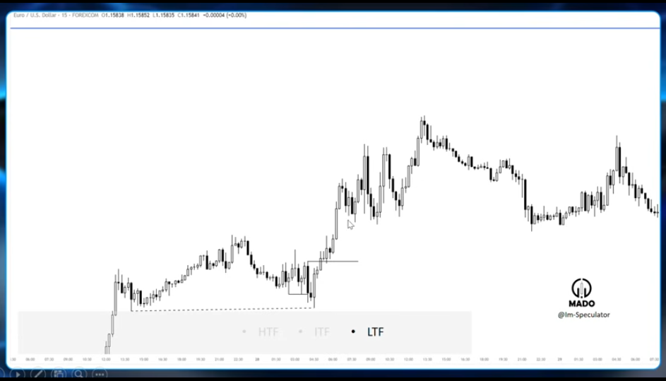
