# charter-4: CRT 2026 Mentorship EP 4 | Complete TSQ Sequence & All Phases Explained

## 📌 Introducción y Visión General
* **Concepto de TSQ (Turtle Soup Sequence):** Es el viaje del precio y la secuencia de entrega institucional (*delivery sequence*) dentro o después de la purga de una **CRT (Candle Range Theory)** [00:00:06].
* **El Problema en el Mercado:** Aunque existen muchos diagramas en línea sobre la secuencia, muy pocos operadores entienden realmente cómo funciona en condiciones de mercado en vivo [00:00:16].
* **Propósito:** Actúa como la pieza del rompecabezas que conecta la estructura, el tiempo (*timing*) y la confianza para alinearse con el flujo de órdenes verdadero [00:00:51].
* **Serie Multi-Parte:** El autor adelanta que este tema se va a desarrollar en un video de múltiples partes —probablemente dos o tres—, donde se van a explorar las distintas variaciones de la secuencia y, más importante todavía, dónde y cómo usarla en el mercado en vivo [00:01:01].
* **Variabilidad de Fases:** Existen entre **5 y 6 fases** principales en el TSQ, pero el mercado **no siempre mostrará todas las fases** en cada movimiento [00:01:15].
  * En mercados con tendencias muy fuertes, solo se observan 2 o 3 fases (ejemplo: Turtle Soup y Modelo 1) antes de la expansión [00:01:58].
  * En mercados lentos o consolidados, el precio se tomará su tiempo desarrollando todas las fases: Breaker Block, retroceso a la zona OTE y un Kiss of Death antes de completar el recorrido [00:02:04].

---

## 🛠️ Las 5 Fases Detalladas de la Secuencia TSQ

> **Regla Cardinal:** *Toda secuencia TSQ comienza con un Turtle Soup y termina con un Turtle Soup* [00:03:00].
> 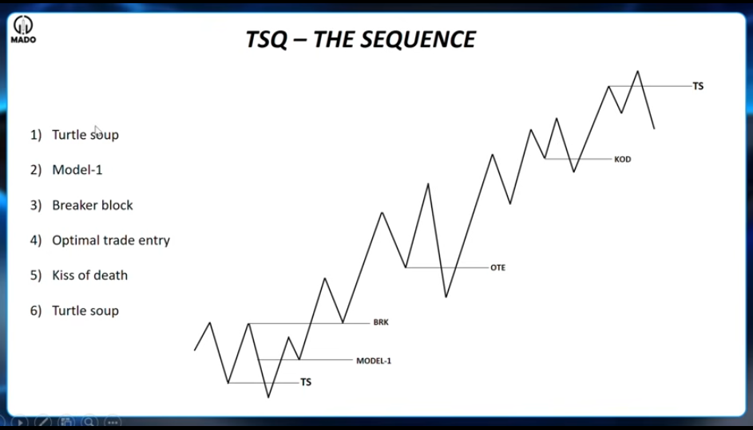

### 1. 🐢 Fase 1: Turtle Soup (El Origen y la Purga)
* **Marca de tiempo en video:** [00:02:53]
  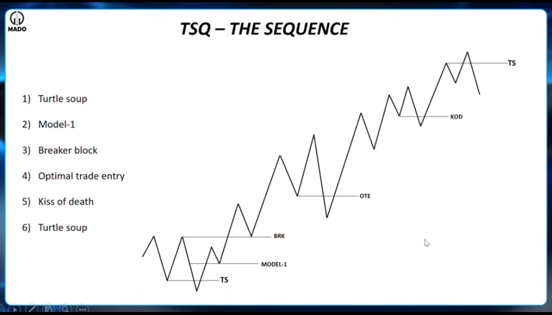
* **Origen Histórico:** En los años 80, Richard Dennis y William Eckhardt entrenaron a los "Turtles" para operar rupturas (*breakouts*) de máximos o mínimos [00:03:08]. El Turtle Soup hace lo opuesto: opera la **falsa ruptura** (*failed breakout*) [00:03:23].
  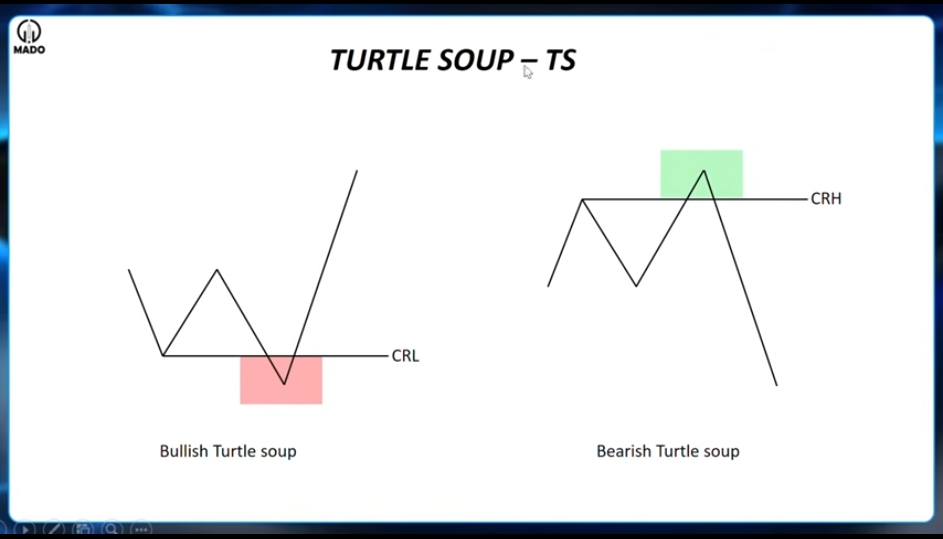
  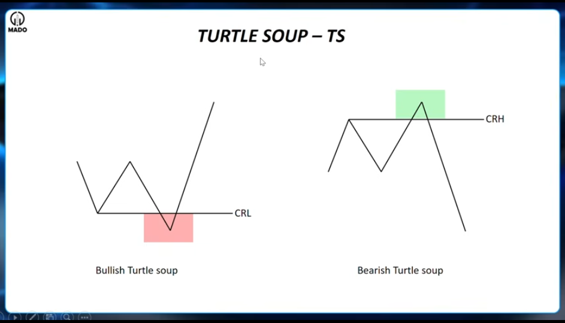
* **Mecanismo:** El precio purga un máximo o mínimo anterior, atrapa la liquidez de los operadores minoristas que compran/venden la ruptura y luego revierte violentamente en dirección opuesta [00:03:36].
  
* **Identificación con CRT:** Para saber qué máximo o mínimo tomar en cuenta, se busca que la purga coincida con un **CRT High** o **CRT Low** de temporalidad superior [00:04:12].
  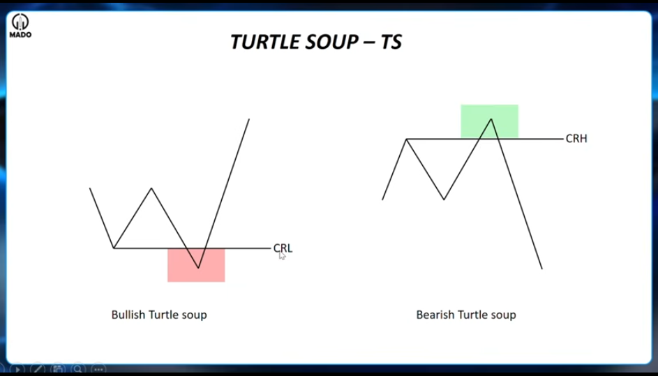
  * *Bullish Turtle Soup:* Purga del CRT Low + Reversión alcista [00:04:20].
    
  * *Bearish Turtle Soup:* Purga del CRT High + Reversión bajista [00:04:28].
    

### 2. 🧩 Fase 2: Modelo 1 (La Confirmación Mecánica)
* **Marca de tiempo en video:** [00:04:43]
  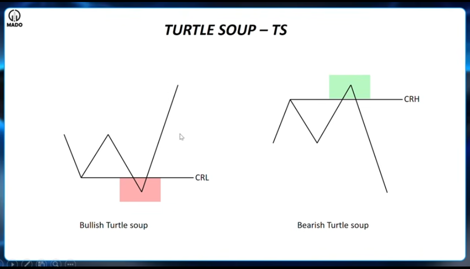
* **Relación:** El Turtle Soup es la trampa; el Modelo 1 es la confirmación [00:05:06].
  
* **Mecanismo:** Tras la purga, el mercado estabiliza y crea una vela específica que realizó la purga del CRT [00:05:20].
  
  * *Entrada Alcista:* Cierre del cuerpo de la vela por encima de la vela que purgó el CRT Low [00:05:43].
    
  * *Entrada Bajista:* Cierre del cuerpo de la vela por debajo de la vela que purgó el CRT High [00:05:59].
    
* **Importancia:** No se adivina. Esta vela específica del Modelo 1 se convierte en el "motor" o corazón de toda la secuencia expansiva [00:06:22].
  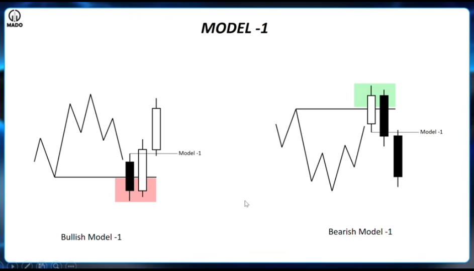
* **Insight Avanzado:** Después del Modelo 1, el precio no siempre corre directo hacia el objetivo — a veces se consolida o incluso perfora un poco más profundo antes de expandirse. Aun así, esa vela específica del Modelo 1 sigue siendo la que termina funcionando como el motor del movimiento [00:06:24].

### 3. 🛡️ Fase 3: Breaker Block (Cambio Estructural y Desenmascaramiento)
* **Marca de tiempo en video:** [00:06:45]
  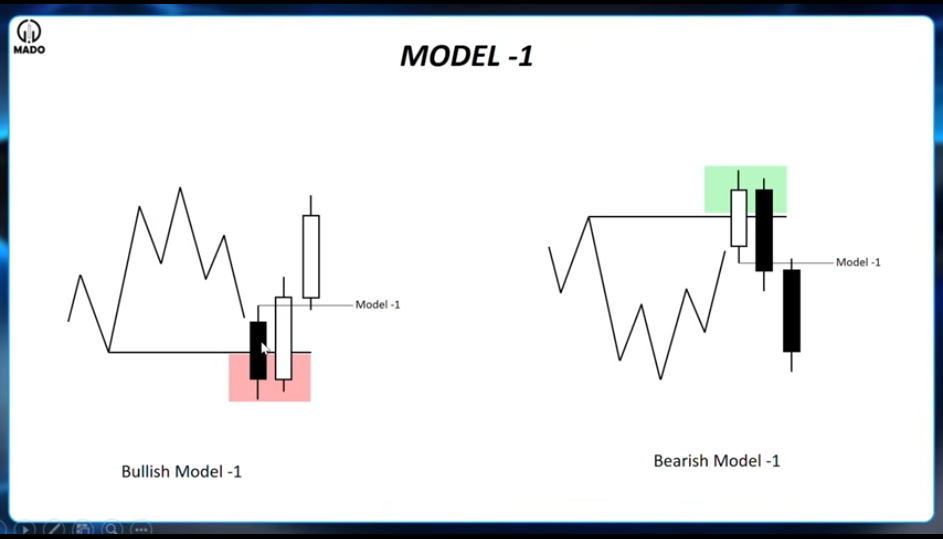
* **Concepto:** Expone completamente dónde el dinero minorista quedó atrapado pensando que tenían un "Modelo 1 falso" [00:06:58].
  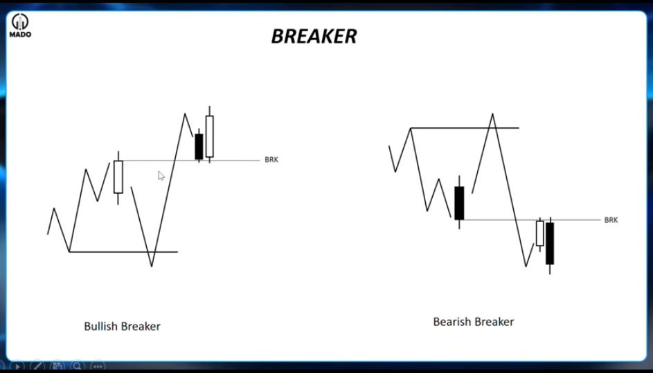
* **Mecanismo:** Es el verdadero **Market Structure Shift (MSS)** [00:07:11].
  
  * En escenario alcista: Es la última vela bajista antes del impulso alcista que rompe la estructura [00:07:18].
    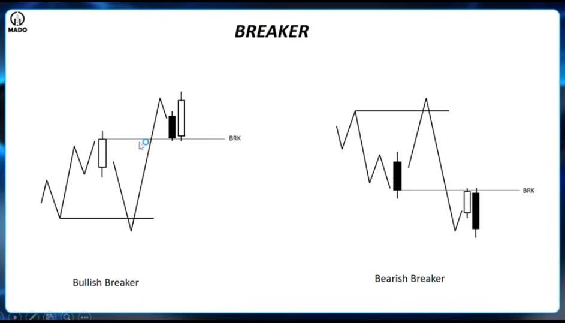
  * En escenario bajista: Es la última vela alcista antes del impulso bajista [00:07:25].
    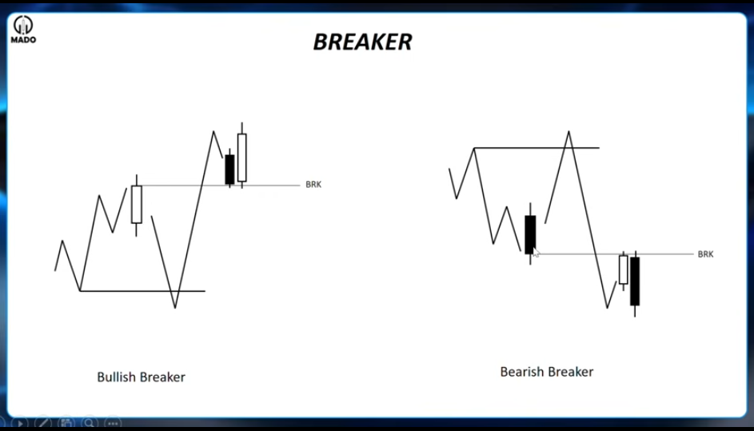
* El retest a esta vela ofrece una zona de rechazo de alta probabilidad para continuar con la secuencia [00:07:45].
  
* **El Engaño Detrás de la Vela:** La vela que termina siendo el Breaker Block es, en el momento en que se forma, la misma vela que los traders leyeron como un Modelo 1 válido — pensaron que había purgado el máximo o mínimo de corto plazo y cerrado correctamente en la dirección esperada — pero en realidad era un Modelo 1 falso (*fake Model 1*) que los dejó atrapados operando en la dirección equivocada [00:07:35].

### 4. 📐 Fase 4: OTE (Optimal Trade Entry)
* **Marca de tiempo en video:** [00:07:46]
  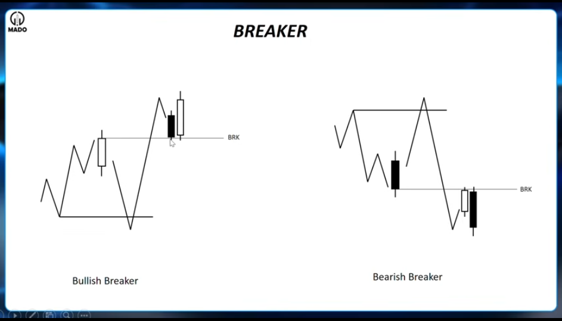
* **Concepto:** Es el punto ideal de retroceso (*pullback*) tras el desplazamiento [00:07:53].
  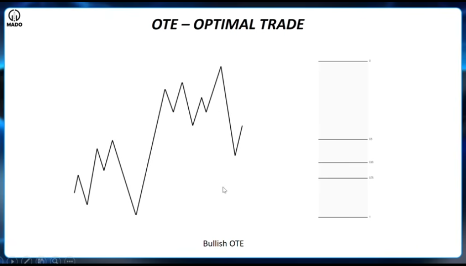
* **Medición:** Se aplica la herramienta de Fibonacci desde el Swing Low hasta el Swing High (en compras) o del Swing High al Swing Low (en ventas) [00:08:28].
  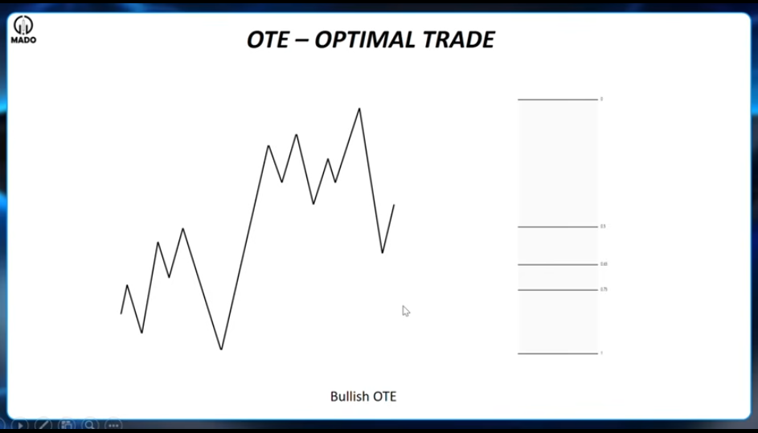
* **Zona Clave:** El rango situado entre el **60% y el 75%** de retroceso (usualmente pasando por el 50%) [00:08:34].
  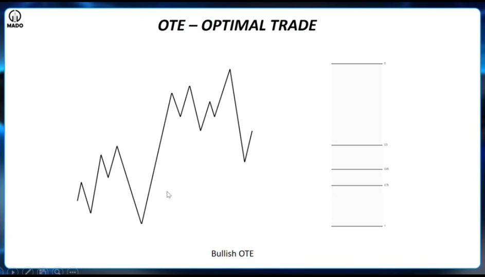
* **Filtros de Contexto:** El OTE no funciona solo. Requiere un sesgo claro de HTF (*Higher Time Frame Bias*), purga previa de liquidez y un modelo de entrada dentro de la zona OTE [00:08:52].
  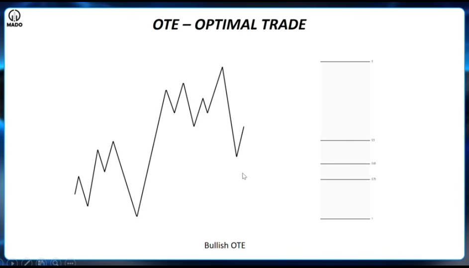
* **Autoevaluación:** Antes de operar el OTE, conviene hacerse tres preguntas: ¿Tengo un sesgo HTF claro? ¿Se purgó liquidez antes de que el precio retroceda al OTE? ¿Veo un modelo de entrada válido formándose dentro de la zona OTE? Cuando los tres se alinean —sesgo, liquidez y modelo de entrada— recién ahí el OTE se vuelve de alta probabilidad [00:08:53].
* **Cómo Operarlo:** Una vez que el mercado hizo el desplazamiento (*displacement*) y retrocede a la zona OTE, se busca confirmación en LTF: una vela CRT, un Turtle Soup, o incluso un Modelo 1 en miniatura (*micro Model 1*) [00:09:13].
* **Gestión de Riesgo:** El Stop Loss se ubica por debajo del mínimo protegido (en compras) o por encima del máximo protegido (en ventas) [00:09:23].
  
* **Objetivo:** El target puede ser el próximo Draw on Liquidity o un CRT High/Low claro [00:09:37].

### 5. 💀 Fase 5: Kiss of Death (La Redistribución Final)
* **Marca de tiempo en video:** [00:09:54]
  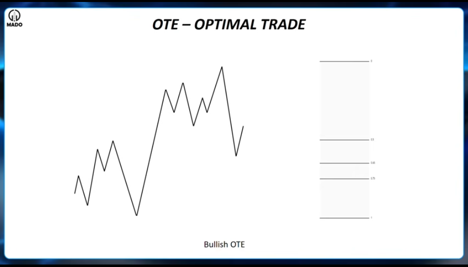
* **Concepto:** Es la fase favorita del autor y de traders como Romeo o ICT (quien lo llama *Redistribución*) [00:09:54].
* **Definición:** Es el **último Turtle Soup** o falso MSS justo antes de que el precio alcance el objetivo final (*Draw on Liquidity* / DOL) [00:10:08].
  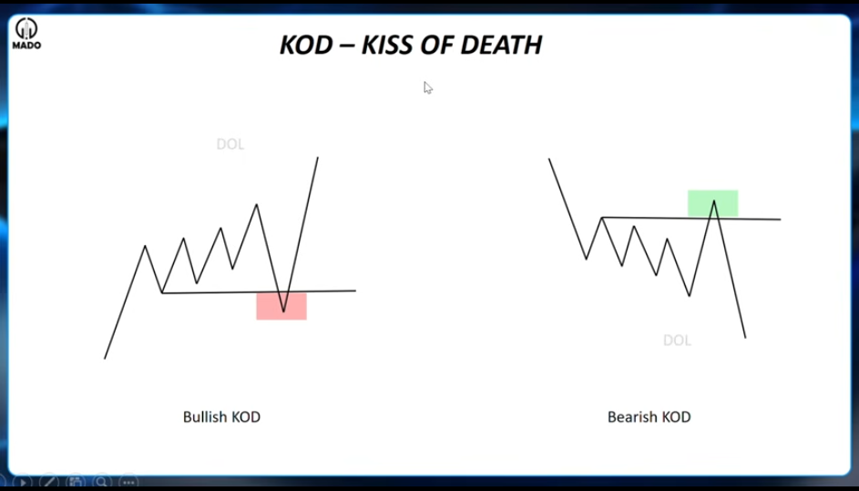
* **Mecanismo:** El mercado genera un último engaño cerca del objetivo objetivo para atrapar liquidez final antes de expandir violentamente y tocar el objetivo [00:10:22].
  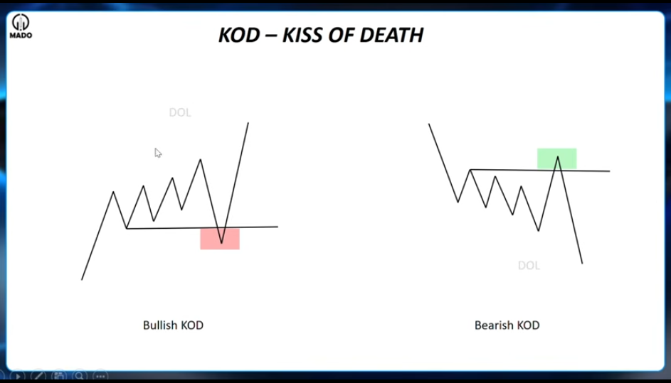

---

## 💡 Por Qué el TSQ Resuelve el Problema del Timing

* **El Problema:** Muchos traders luchan a la hora de identificar el modelo ideal para su entrada, especialmente en las temporalidades bajas (*Lower Time Frame* / LTF). Es uno de los mayores desafíos: saber exactamente cuándo y dónde ejecutar [00:10:51].
* Se puede tener el sesgo correcto y leer perfectamente el HTF, y aun así terminar entrando demasiado temprano o demasiado tarde [00:11:03].
* **La Solución:** El TSQ elimina esa confusión al dar una secuencia estructurada de fases de entrada claras y basadas en reglas. Cada fase tiene su propia lógica, propósito y timing, formando un framework completo para entender cómo se mueve el precio paso a paso dentro del candle range [00:11:13].
* **Consejo del Autor:** No hace falta dominar las seis fases de entrada. La clave está en enfocarse en una o dos fases que resuenen y entenderlas en profundidad — estudiar cómo se forman, dónde aparecen y cómo reacciona el mercado alrededor de ellas. Una vez que uno se siente cómodo con esas, el resto se empieza a reconocer naturalmente [00:11:34].

---

## ⏰ Alineación de Temporalidades (Top-Down Alignment)

* **Marca de tiempo en video:** [00:12:09]
  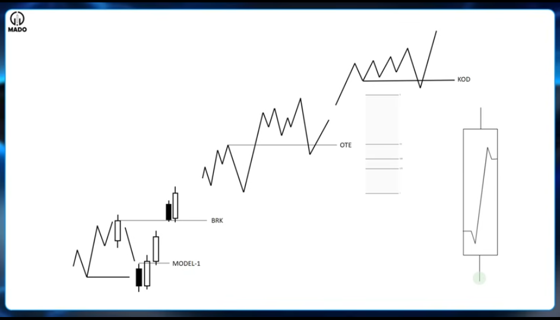
* **Regla General:** CRT establece la estructura marco, mientras que TSQ define el movimiento interno del precio [00:13:19].
  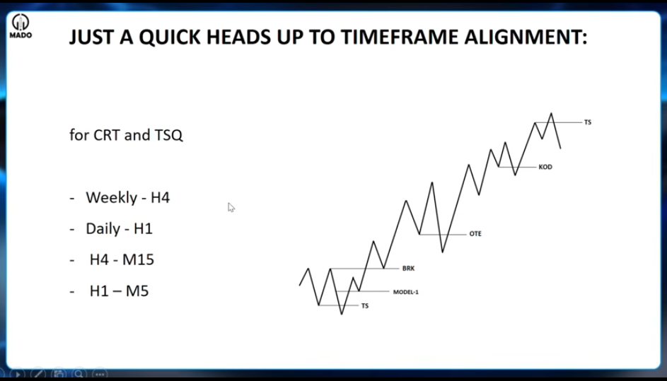

| Temporalidad Principal del CRT | Temporalidad para Observar las Fases TSQ |
| :--- | :--- |
| **Weekly** (Semanario) | **4 Hours** (4 Horas) [00:12:40] |
| **Daily** (Diario) | **1 Hour** (1 Hora) [00:12:56] |
| **4 Hours** (4 Horas) | **15 Minutes** (15 Minutos) [00:12:58] |
| **1 Hour** (1 Hora) | **5 Minutes** (5 Minutos) [00:13:02] |

**Capturas de la tabla:**

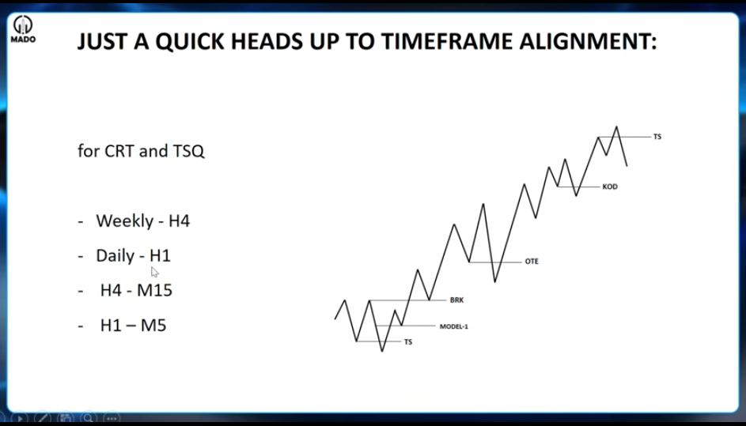

* **Aplicación Extendida:** TSQ no solo aplica dentro de una vela CRT, sino también en el trayecto de un **Key Level al Draw on Liquidity** o de **CRT High a CRT Low** [00:13:28].
  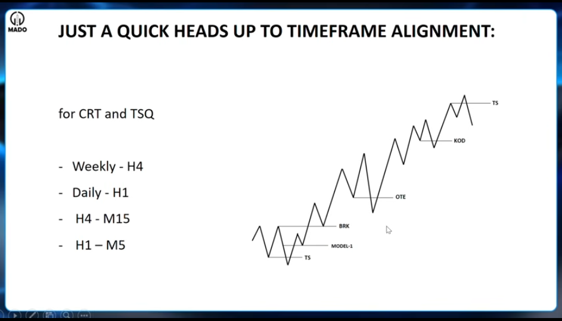
* **Tercer Marco de Referencia:** Además del rango CRT y del tramo Key Level → DOL, el TSQ también puede mapearse sobre la estructura interna open-high-low-close (**OHLC**) de una sola vela, tratándola como otro marco de referencia estructural válido para desarrollar la secuencia [00:13:57].

---

## 📊 Ejemplos Prácticos en Gráficos Reales (EUR/USD)

### Ejemplo 1: Secuencia Completa con Todas las Fases
* **Marca de tiempo en video:** [00:14:37]
  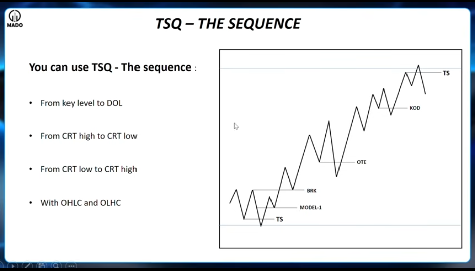
* **Análisis Paso a Paso:**
  1. **Purga CRT High:** Inicio de la secuencia [00:15:00].
     
  2. **Turtle Soup:** Reversión inicial rápida [00:15:08].
     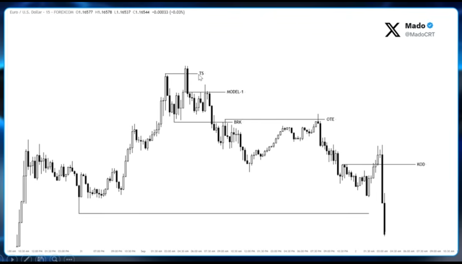
  3. **Modelo 1:** Formación de Order Block y cierre por debajo de la vela de purga [00:15:16].
     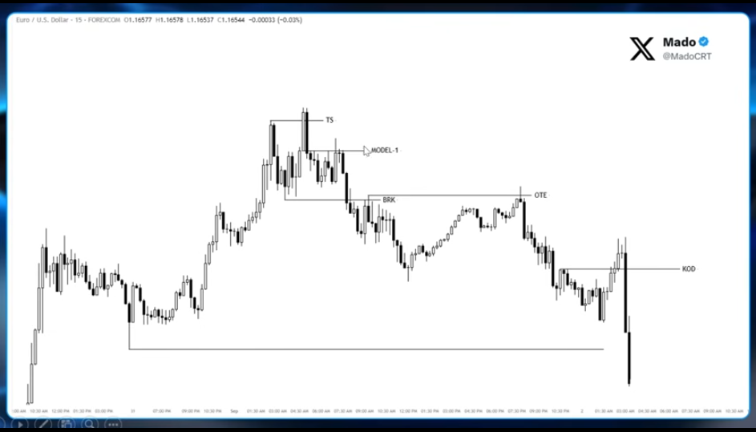
  4. **Breaker Block:** Rompe estructura interna y retrocede a retestear el Breaker [00:15:38].
     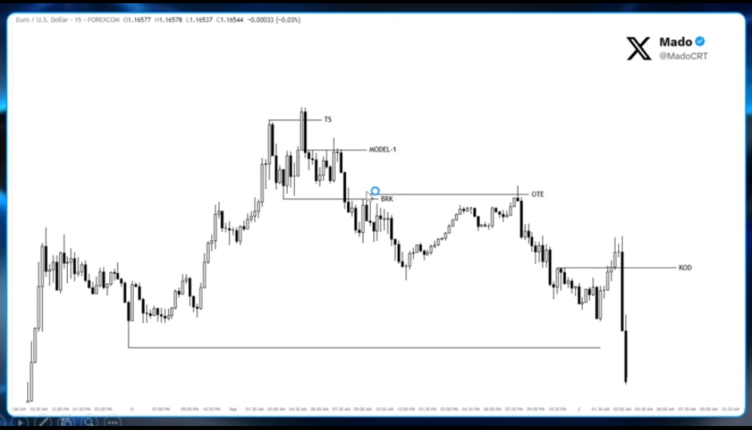
  5. **OTE Zone:** Retroceso profundo a la zona entre 60% y 75% de Fibonacci alineado con el Breaker [00:16:04].
     
  6. **Kiss of Death:** Falsa purga de un máximo relativo justo antes de caer al objetivo [00:16:23].
     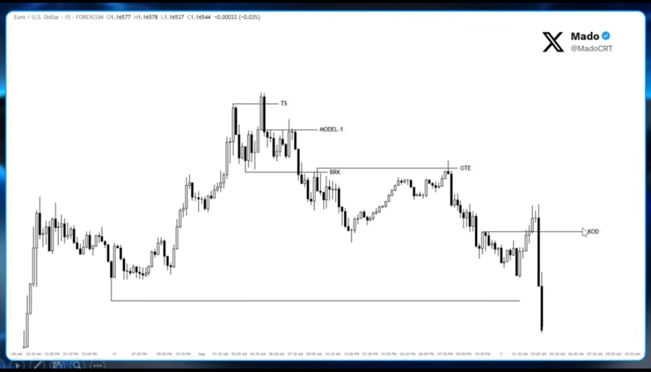
  7. **Draw on Liquidity:** Impacto del objetivo final [00:16:47].
     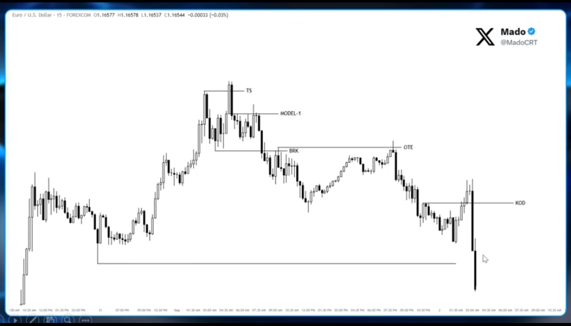

### Ejemplo 2: Secuencia de 3 Fases (EUR/USD)
* **Marca de tiempo en video:** [00:17:03]
  
* **Desarrollo:** Purga del CRT High $\rightarrow$ **Turtle Soup** $\rightarrow$ **Modelo 1** (cierre bajo la vela de purga) $\rightarrow$ Retesteo al **Breaker Block** $\rightarrow$ Movimiento directo al DOL [00:17:30].
  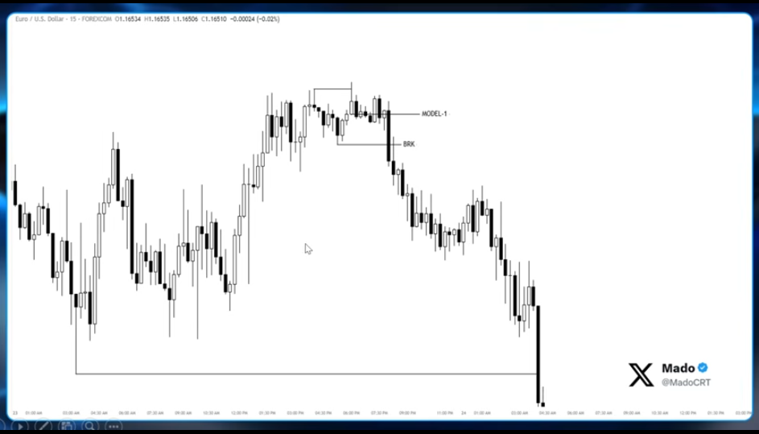

### Ejemplo 3: Secuencia de 2 Fases - Reversión Rápida (EUR/USD)
* **Marca de tiempo en video:** [00:19:15]
  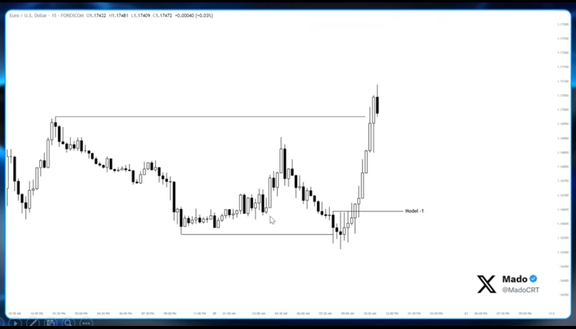
* **Desarrollo:** Purga del sell-side liquidity (CRT Low) con rechazo fuerte (**Turtle Soup**) $\rightarrow$ Desplazamiento e impulso alcista inmediato (**Modelo 1**) $\rightarrow$ Expansión directa hacia el objetivo [00:19:49].
  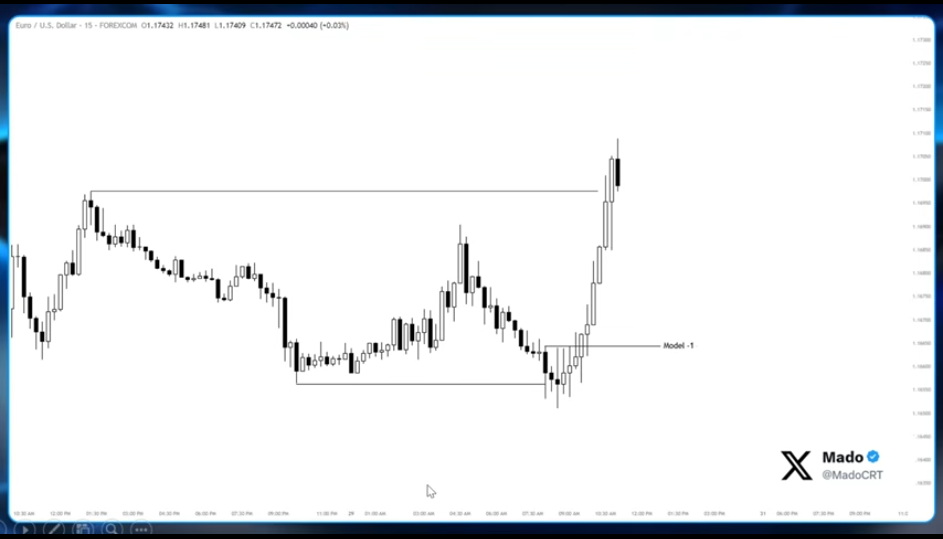

### Ejemplo 4: Secuencia de 2 Fases - Turtle Soup + Breaker Block (EUR/USD)
* **Marca de tiempo en video:** [00:21:11]
  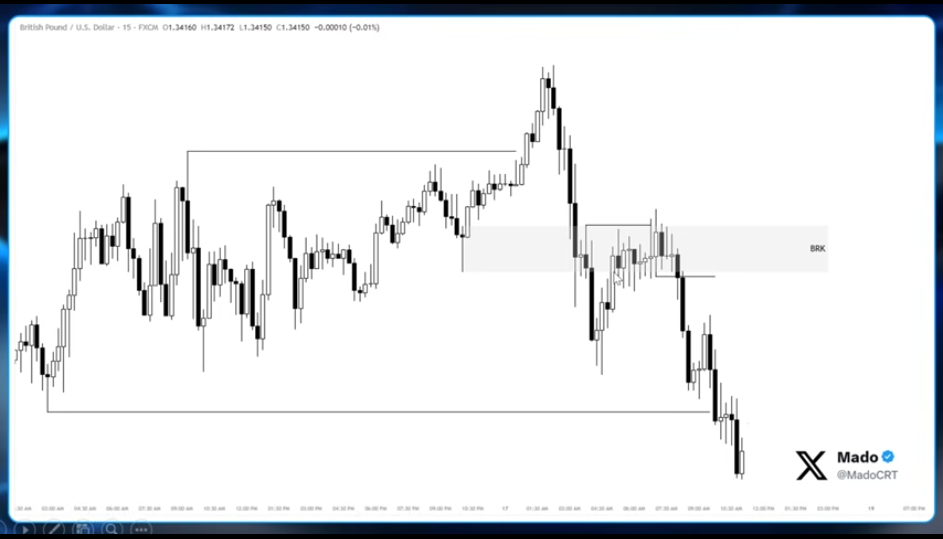
* **Desarrollo:** Purga sobre un máximo previo (**Turtle Soup**) $\rightarrow$ Cambio de soporte a resistencia en el bloque estructural (**Breaker Block**) con retesteo para entrada baja en riesgo [00:21:25].
  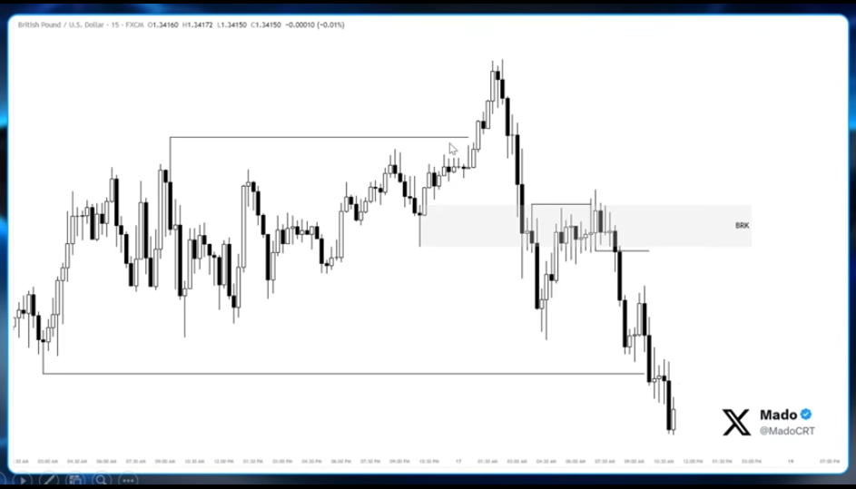

### Ejemplo 5: Secuencia de 3 Fases con OTE (EUR/USD)
* **Marca de tiempo en video:** [00:22:50]
  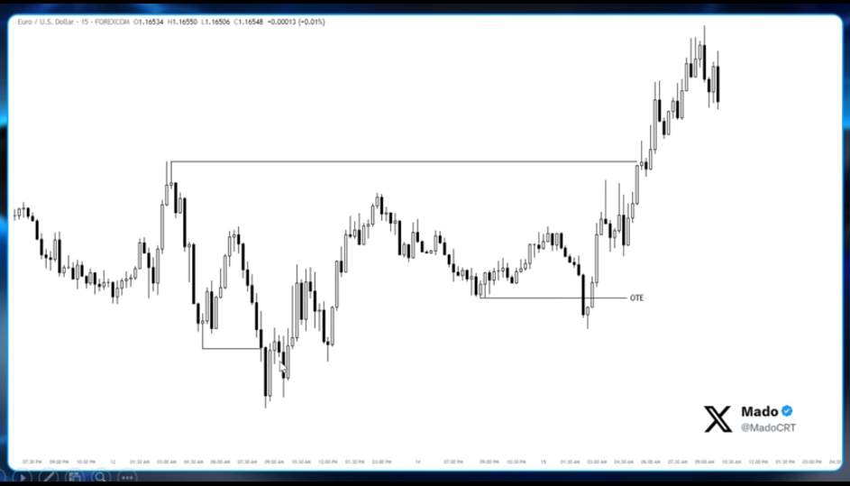
* **Desarrollo:** **Turtle Soup** al tomar el mínimo previo $\rightarrow$ **Modelo 1** para confirmación $\rightarrow$ Retroceso controlado a la zona **OTE** (60%-75%) para re-entrada $\rightarrow$ Expansión al DOL [00:23:00].
  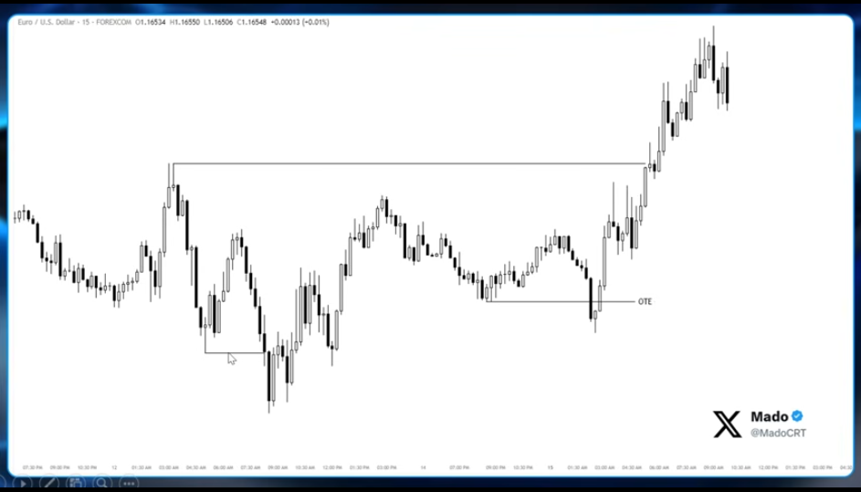

---

## 🎯 Cierre y Reflexión Final

* **TSQ como Mentalidad:** El TSQ no es solo un modelo, es una forma de pensar (*mindset*) que entrena el ojo para ver orden donde la mayoría de los traders solo ve caos [00:24:04].
* El objetivo no es atrapar cada movimiento, sino entender por qué el mercado se mueve como se mueve y esperar con paciencia a que las piezas se alineen [00:24:13].
* No hace falta dominar las seis fases de un día para el otro — conviene empezar de a poco, elegir uno o dos setups, estudiarlos en profundidad y dejar que la experiencia haga de maestra [00:24:24].
* Cuanto más tiempo se pase observando cómo se desarrollan estas secuencias, más claro se vuelve el panorama; con el tiempo se empieza a "ver respirar" al mercado, y ahí es donde entra la disciplina [00:24:35].
* Se van a perder operaciones y va a haber momentos de duda, y eso está bien: cada setup perdido sigue siendo progreso si se aprende de él. El mercado siempre da otra oportunidad, pero nunca recompensa la impulsividad [00:24:45].
* **Mensaje Final del Autor:** Mantenerse enfocado, paciente y humilde. El *edge* se construye con tiempo, observación y disciplina, no con atajos — dejar que el proceso forme al trader que no persigue setups, sino que espera a que el mercado lo llame a él [00:24:57].

---

## 🔗 Enlace al Video
* **URL:** http://www.youtube.com/watch?v=83SZ0XXkhyQ
