# charter-5: CRT 2026 Mentorship EP 5 | TSQ Phases Using OHLC & OLHC

## 📌 Introducción y Visión General
* **Concepto Principal:** En este episodio se enseña cómo aplicar las fases de **TSQ (Turtle Soup Sequence)** dentro de la estructura anatómica de la vela: **OLHC (Open-Low-High-Close)** para velas alcistas y **OHLC (Open-High-Low-Close)** para velas bajistas.
* **Requisito Previo:** Es fundamental haber estudiado el Episodio 4 (TSQ de Key Levels a Draw on Liquidity y de CRT High a Low) para comprender esta lección en su totalidad.
* **Alineación de Temporalidades (Time Frame Alignment):** Antes de buscar cualquier TSQ, se debe definir qué vela se está operando (Mensual, Semanal, Diaria o 4 Horas) [00:00:50].
  * Vela Mensual $\rightarrow$ Secuencia TSQ observada en gráfico Diario (*Daily*) [00:01:09].
  * Vela Semanal $\rightarrow$ Secuencia TSQ observada en gráfico de 4 Horas (*4Hour*) [00:01:09].
  * Las temporalidades menores siguen exactamente la misma lógica descendente [00:01:09].

---

## 🏗️ Fases de TSQ dentro de la Estructura OLHC (Vela Alcista)

### 1. 🟢 Apertura y Turtle Soup inicial (Open & Low)
* **Marca de tiempo en video:** [00:01:17]
  
* **Mecanismo:** La vela abre (*Open*) y genera liquidez hacia abajo, realizando un **Turtle Soup** en un mínimo a corto plazo [00:01:25].
  
* **Desplazamiento / Expansión:** Tras el Turtle Soup, el precio no debe consolidar ni perder tiempo; debe expandirse agresivamente, demostrando desplazamiento e intención institucional real [00:01:40].
  

### 2. 🛡️ Fase de Breaker Block (High Expansion)
* **Marca de tiempo en video:** [00:01:59]
  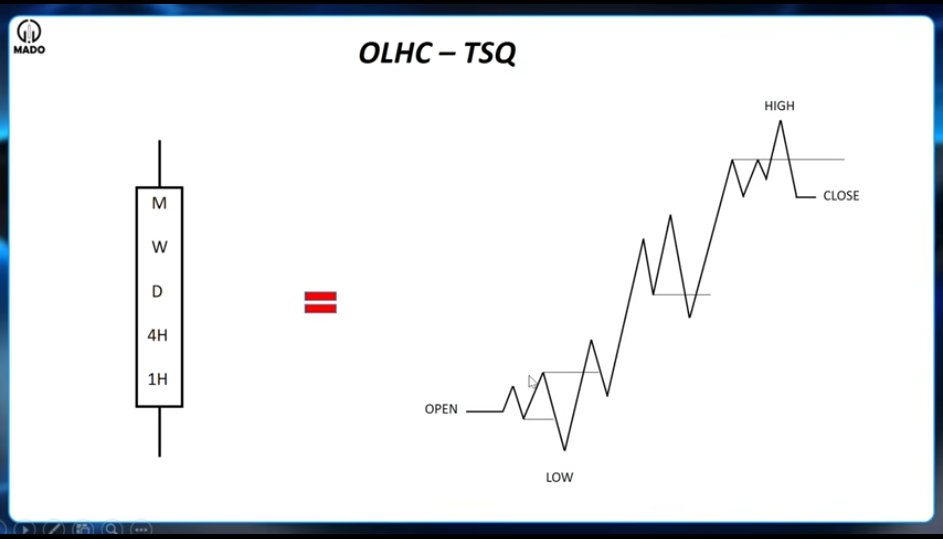
* **Mecanismo:** Al expandirse, el precio cierra por encima de un máximo a corto plazo (*short-term high*), activando la **fase de Breaker Block** [00:01:59].
* Cuando el mercado regresa a esta área y reacciona rebotando hacia arriba, se confirma la fase de Breaker Block dentro de la secuencia [00:02:06].
  

### 3. 📐 Fase OTE actuando como Kiss of Death
* **Marca de tiempo en video:** [00:02:15]
  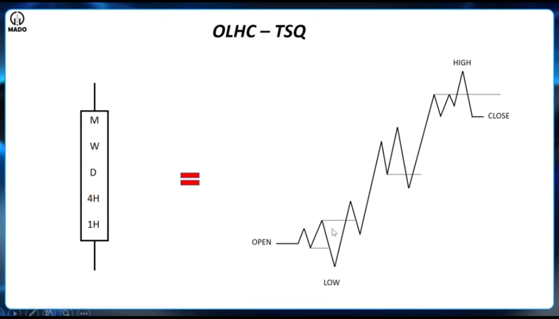
* **Nota Especial:** Al aplicar TSQ dentro de la estructura de una sola vela, la fase **OTE (Optimal Trade Entry)** a menudo actúa como un **Kiss of Death**, ofreciendo un retroceso profundo antes del impulso expansivo final [00:02:23].
  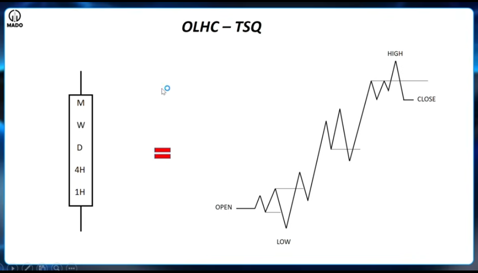

### 4. 🔴 Cierre y Capping (High & Close)
* **Marca de tiempo en video:** [00:02:33]
  
* **Mecanismo:** Se produce un último Turtle Soup en la parte superior que limita (*caps*) la vela y completa el ciclo entero de TSQ [00:02:33].

---

## ⏳ Tiempo y Ciclo Temporal (Timing & Fractional Time)

* **Marca de tiempo en video:** [00:02:41]
  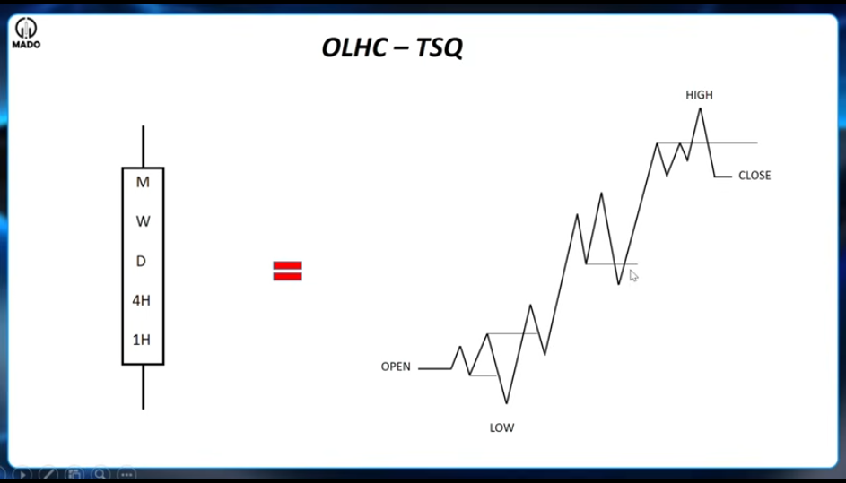
* La secuencia TSQ en una vela no es aleatoria; sigue una lógica temporal según la anatomía del periodo. Ejemplo en una **vela mensual**:
  * **Semana 1:** Rango inicial y acumulación/construcción de liquidez (*Range / Liquidity buildup*) [00:02:49].
    
  * **Semana 2:** Manipulación (Turtle Soup) seguida de la primera expansión rápida [00:02:58].
    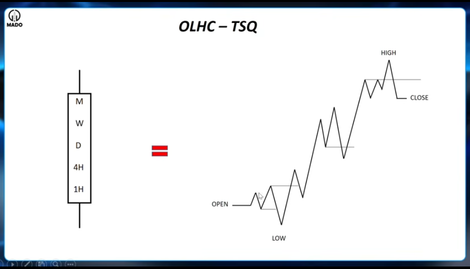
  * **Semana 3:** Retroceso profundo OTE o Kiss of Death [00:03:06].
    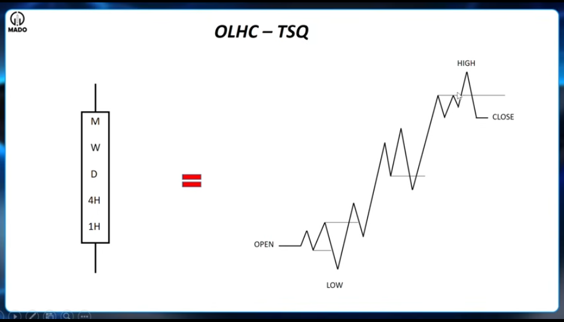
  * **Semana 4:** Último Turtle Soup (capping) que da el cierre a la vela mensual [00:03:08].

---

## 📉 Estructura OHLC (Vela Bajista)

* **Marca de tiempo en video:** [00:03:14]
  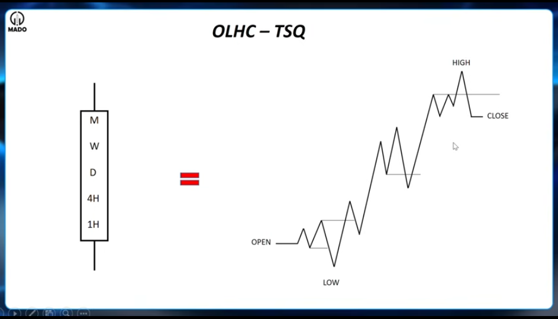
* La lógica para **Open-High-Low-Close** es exactamente la misma que en OLHC, pero invirtiendo la dirección a una forma bajista [00:03:22].
  

---

## 💎 La "Receta Secreta" (Pro-Tips de Ejecución)

### 1. Conexión de Temporalidad Mayor a Menor para Entradas
* **Marca de tiempo en video:** [00:03:49]
  
* **Ejemplo:** Cuando la vela **Mensual** activa la fase de Turtle Soup, se sabe que ocurrió la manipulación. No se entra a ciegas en la temporalidad mensual [00:04:06].
  
* **Ejecución:**
  1. Bajas al gráfico **Diario** y esperas a que el rango diario haga un Turtle Soup bajista/alcista válido [00:04:14].
     
  2. Bajas al gráfico de **4 Horas** para buscar una configuración **CRT** [00:04:22].
     
  3. Ese CRT de 4h es de altísima probabilidad porque combina la narrativa de HTF con la precisión de LTF [00:04:31].
     
* Aplica el mismo principio para la **fase de Breaker Block**: cuando el precio regresa al área del Breaker en el gráfico Diario, se baja a 4H y se busca la confirmación en CRT [00:04:41].
  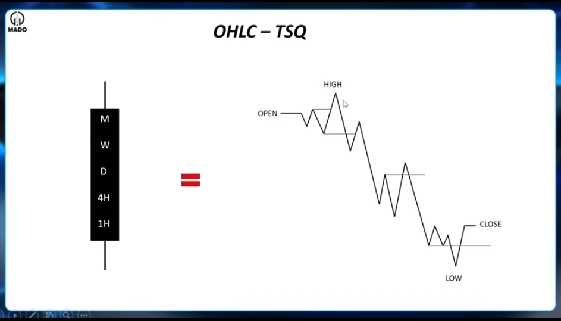

### 2. Explotar la Mecha de la Temporalidad Superior (HTF Wick)
* **Marca de tiempo en video:** [00:04:57]
  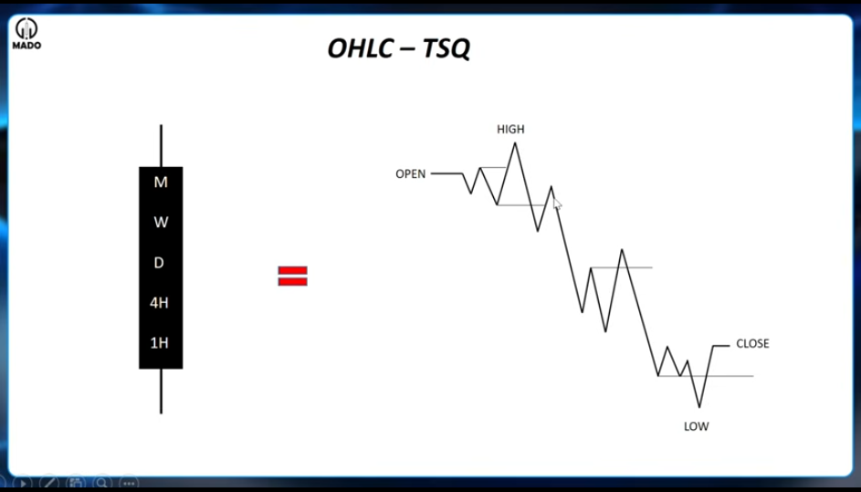
* Cuando el precio llega al *Draw on Liquidity* y hace un Turtle Soup en la temporalidad superior, esa **sola mecha** (*wick*) en HTF equivale a una **expansión entera en temporalidades menores** [00:05:03].
  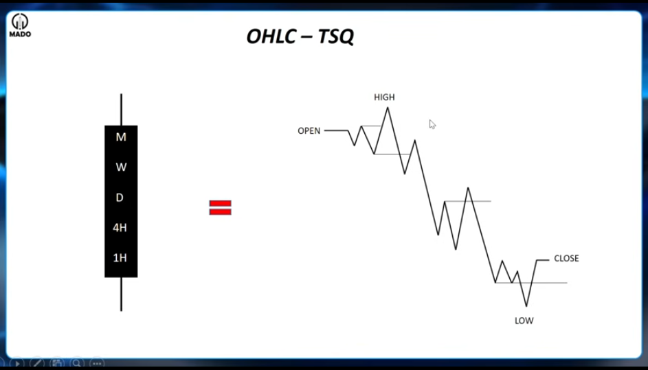
* Dentro de esa sola mecha de HTF, se generan múltiples patrones de CRT en 4H limpios para operar [00:05:19].
  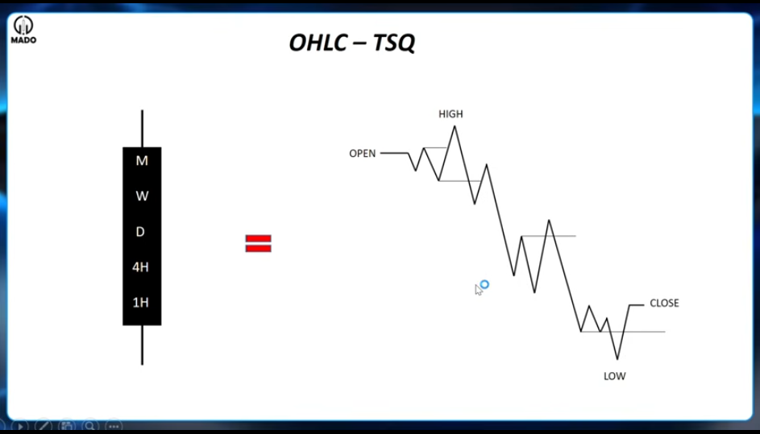
* **Regla de Oro:** La HTF da la dirección; la LTF da la ejecución. Así operan los traders profesionales [00:05:29]-[00:05:35].

---

## 📊 Ejemplo Gráfico Real en EUR/USD (Vela Mensual)

* **Nota sobre Diagramas vs. Gráfico Real:** Los diagramas conceptuales muestran todo limpio y ordenado, pero al abrir el gráfico real, el precio se ve desordenado, con velas aleatorias y, muchas veces, aburridas. Sin embargo, son justamente esas velas "aburridas" las que terminan generando el dinero, así que no hay que ignorarlas [00:06:00]-[00:06:25].

### 1. Contexto Previo y Confirmación del Sesgo Mensual
* **Marca de tiempo en video:** [00:06:24]
  
* En el gráfico mensual de EUR/USD, el precio tomó el mínimo del rango (*range low*), hizo un Turtle Soup, reaccionó desde un Order Block y cerró por encima [00:06:31].
  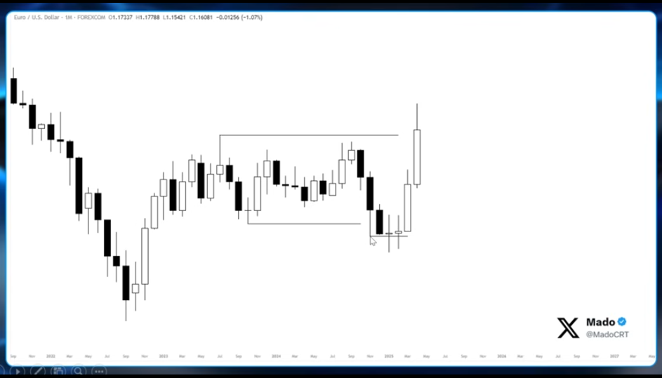
* **Regla de Validación:** *"Las mechas mienten, los cierres dicen la verdad"* (*Wicks lie, closes tell the truth*) [00:08:50]. Un cierre fuerte de cuerpo por encima confirma el cambio en el precio y da la certeza de que la siguiente vela mensual cerrará alcista (formato OLHC) apuntando al máximo del rango (*range high*) [00:06:38].
  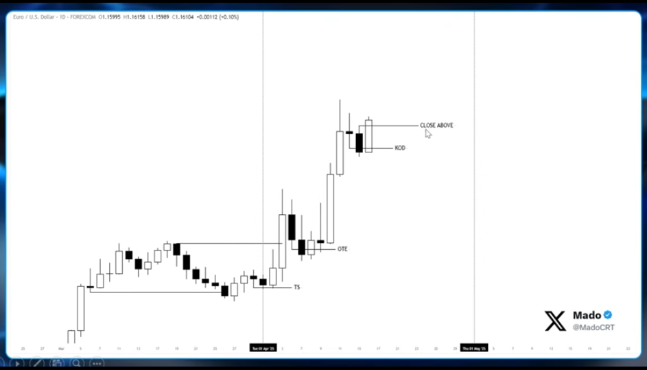
  

### 2. Desglose de la Secuencia TSQ dentro del Rango Mensual
* **Marca de tiempo en video:** [00:06:53] *(Las líneas verticales representan un mes completo)*:
  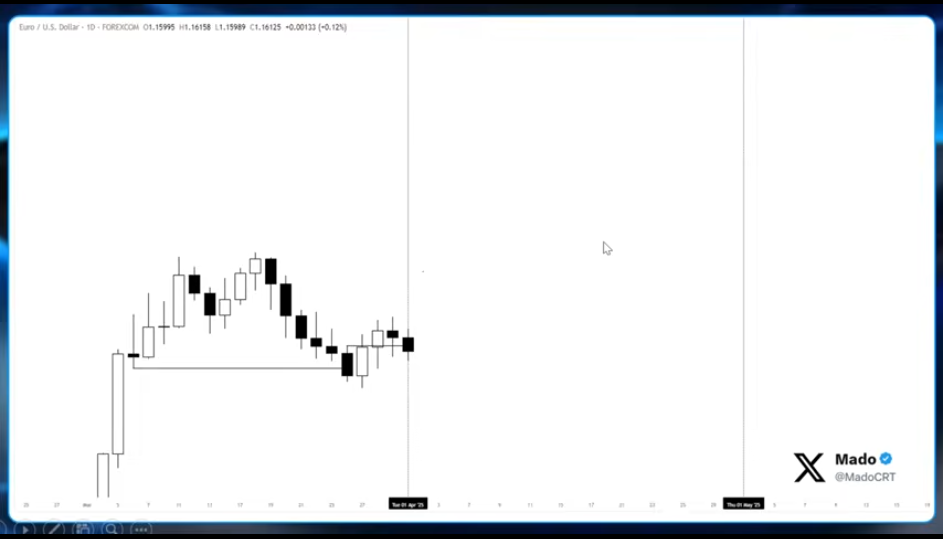
  * **Contexto Previo (antes de la apertura del mes):** El precio había retrocedido y rellenado liquidez en la forma de un **Fair Value Gap** (*FVG*) por debajo, y luego cerró por encima de ese nivel. Ese cierre confirma un cambio en el precio (*shift in price*): el mercado entra en una fase de reversión, y a partir de ahí ya se puede empezar a esperar comportamiento alcista para la vela mensual que se está por formar [00:07:03]-[00:07:21].
  1. **Apertura y Turtle Soup:** Tras abrir el mes, el mercado purga el mínimo del rango de la vela previa y cierra por encima, confirmando la validez del Turtle Soup [00:07:32].
     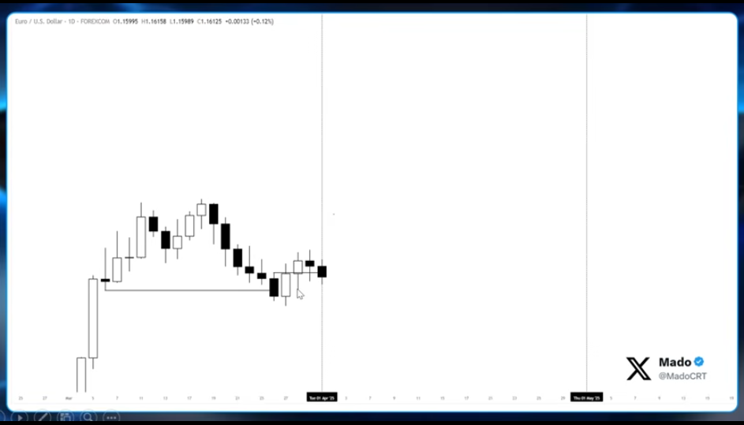
     * **Matiz de Probabilidad:** Aunque se puede esperar un Turtle Soup sobre ese mínimo, la probabilidad de que ese nivel puntual llegue a tocarse es menor justamente porque ya hubo un cambio de sesgo previo; si el precio no hubiera logrado cerrar de vuelta por encima de ese mínimo, el Turtle Soup habría quedado invalidado [00:07:25]-[00:07:33].
  2. **Fase de Expansión:** Desplazamiento rápido e inmediato sin consolidaciones [00:07:53].
     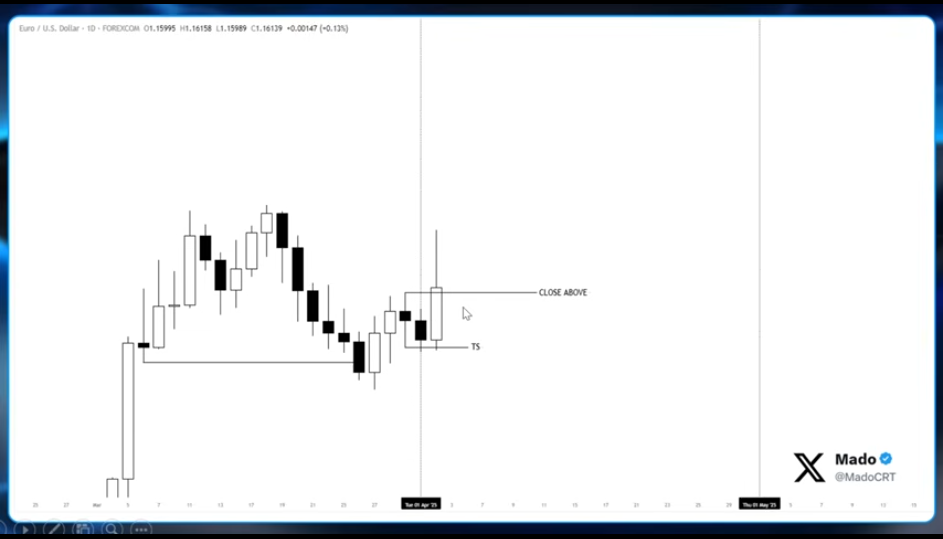
  3. **Activación del Breaker Block:** El precio cierra por encima del máximo a corto plazo (*short-term high*) [00:08:09].
     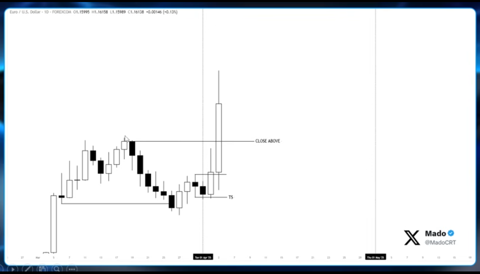
  4. **Breaker Block + OTE (Súper Fase):** Cuando el Breaker Block y la zona OTE de Fibonacci se combinan al mismo tiempo, se convierte en la fase más fuerte y de mayor probabilidad de toda la secuencia TSQ [00:08:24].
     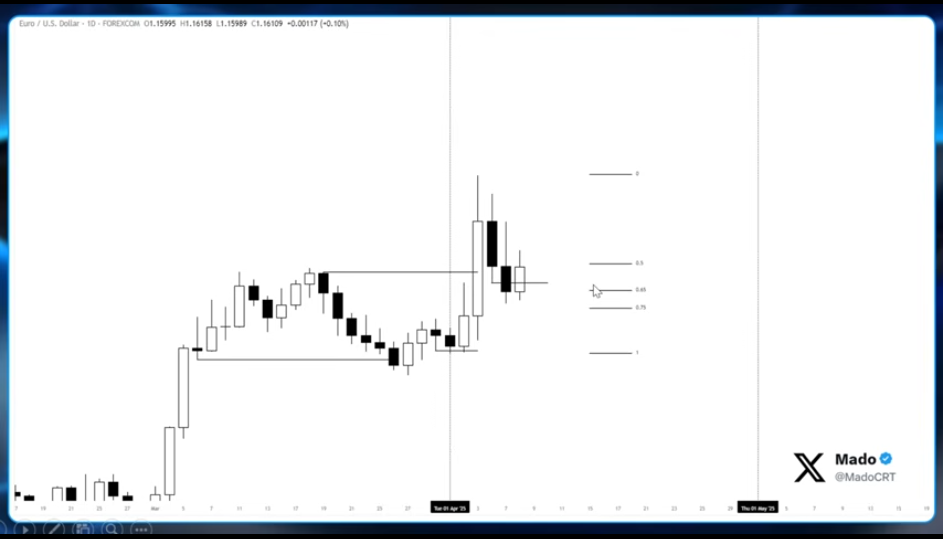
  5. **Kiss of Death y Cierre:** Impulso final (*last push*), creación del último Turtle Soup en la parte superior para limitar la vela y cierre del mes completando el ciclo TSQ [00:08:42].
     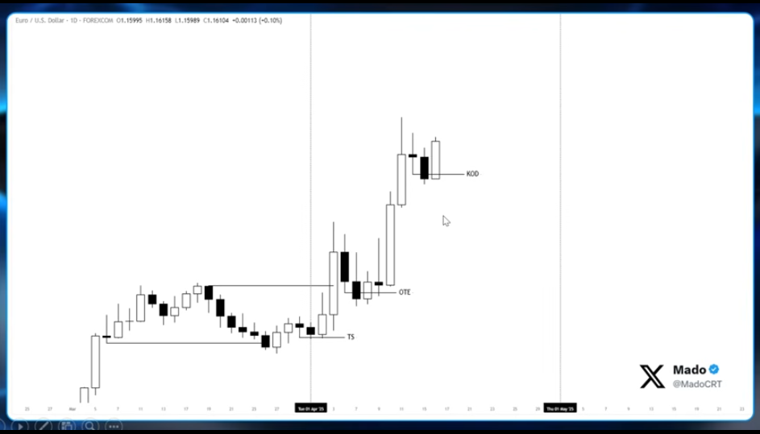

---

## 🎯 Cierre

* Mado remarca que este tema puede sentirse denso o incluso aburrido a primera vista, pero es uno de sus capítulos favoritos de toda la mentoría por lo importante que es [00:09:07]-[00:09:16].
* Recomienda volver a ver este episodio varias veces (tres o cuatro, si hace falta) y estudiarlo con calma, porque una vez que se internaliza esta lógica de fases dentro de la vela, la forma de leer el gráfico cambia por completo [00:09:19]-[00:09:31].

---

## 🔗 Enlace al Video
* **URL:** https://www.youtube.com/watch?v=bptCmin7o0s
