# charter-6: CRT 2026 Mentorship EP 6 | Daily TSQ to 4h Candle Range

## 📌 Introducción y Visión General
* **Preparación:** Antes de empezar, se recomienda tener libreta y lapicera a mano, buscar un lugar sin distracciones y prestar atención completa [00:00:06].
  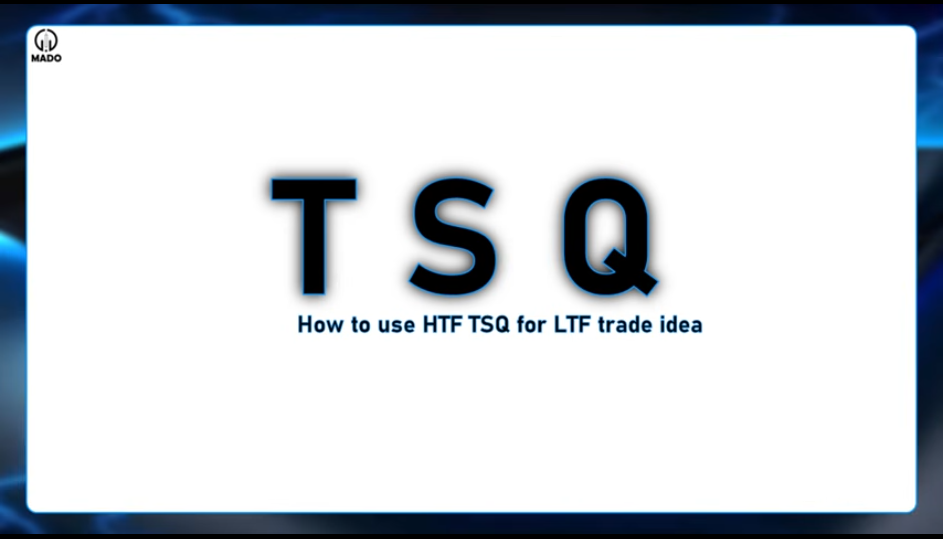
* **Objetivo del Episodio:** El foco principal es el **TSQ Diario** (*Daily TSQ*) y cómo se alinea con el **CRT de 4 Horas** (*4H CRT*) dentro de ese TSQ [00:00:40].
  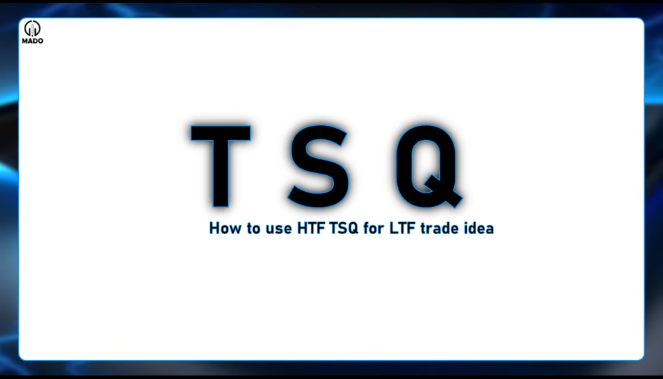
* **Segundo Objetivo — Anatomía de la Vela:** En paralelo se profundiza en algo que la mayoría ignora: la **anatomía de la vela** (*candle anatomy*). Entender cómo se forma una vela, cómo se mueve y qué representa hace que todo deje de parecer aleatorio [00:01:05].
* **Hoja de Ruta Descendente:** Se parte de la vela **Mensual**, se baja a la estructura del **TSQ Diario**, y finalmente se refina todo hasta la **vela de 4H** para la ejecución. Es el punto donde la lógica de temporalidad superior (*HTF*) se encuentra con la precisión de temporalidad menor (*LTF*) [00:01:16].
  

---

## 🔄 Repaso Rápido de las 6 Fases de TSQ
* **Marca de tiempo en video:** [00:01:39]
  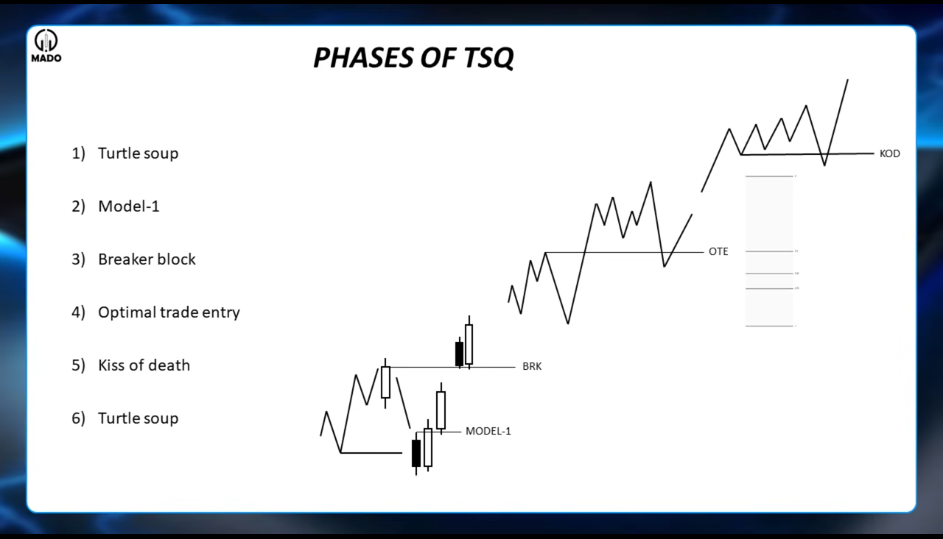
* Existen **6 fases** dentro del TSQ (Turtle Soup Sequence), ya cubiertas en detalle en el Episodio 4; si todavía no se vio esa lección, se recomienda verla primero antes de continuar.
* **Filtro Personal:** No conviene intentar operar las 6 fases. Mado se enfoca únicamente en tres: **Fase 1 (Turtle Soup)**, **Fase 2 (Model One)** y **Fase 5 (Kiss of Death)** — son las únicas que opera personalmente. La recomendación es simplificar y dominar pocas fases en lugar de todas.

---

## 📊 Ejemplo Gráfico: EUR/USD — Vela Mensual y TSQ de Fase 1

### 1. Contexto Mensual (Discount → Premium)
* **Marca de tiempo en video:** [00:02:19]
  
* En el gráfico mensual de EUR/USD, el mercado se está expandiendo desde un **key level de discount** hacia un **key level de premium**. En esa zona se puede esperar al menos algún tipo de retroceso [00:02:24].
  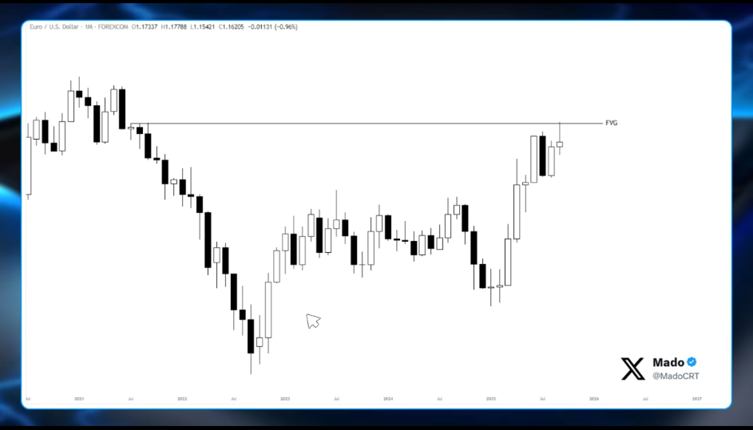
* El foco está en la estructura de esta vela: se va a anticipar el **Open, High, Low y Close** de esta vela mensual, manteniendo siempre presente su anatomía [00:02:38].
  

### 2. Confirmación del Turtle Soup (Fase 1)
* **Marca de tiempo en video:** [00:02:56]
  
* **Regla de Paciencia:** No cada Turtle Soup es válido. Antes de reaccionar se espera la confirmación: el mercado purga un máximo con una vela específica, pero eso todavía no confirma nada — podría ser solo un *liquidity run* [00:03:07].
* **Confirmación real:** Recién cuando el precio, tras purgar el máximo, toca el key level y **cierra hacia adentro** del rango, se confirma que se trata de un Turtle Soup válido. Ahí comienza la Fase 1 [00:03:25].
  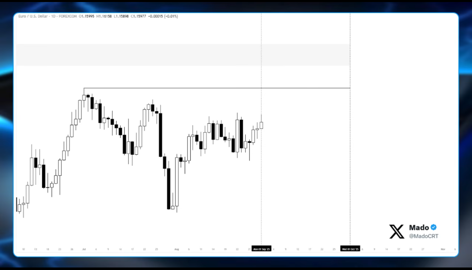

### 3. CRT Diario dentro de la Fase 1
* **Marca de tiempo en video:** [00:03:36]
  
* Con la Fase 1 confirmada, se forma un **CRT (Candle Range Theory)**: el primer objetivo para la vela siguiente es el mínimo de este rango. La tercera vela abre en ese mínimo y cierra por arriba, completando el rango [00:03:49].
  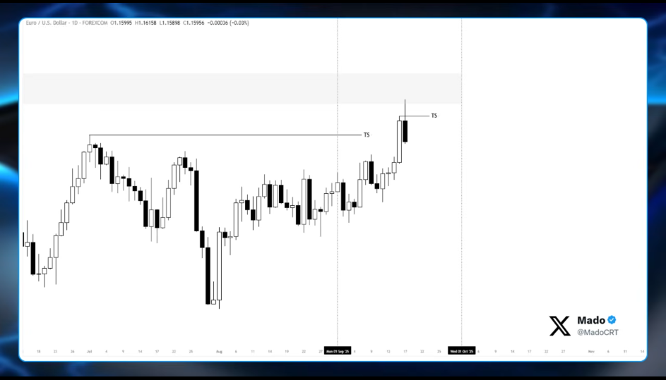

### 4. Descenso a 4H: Key Levels + Candle Range
* **Marca de tiempo en video:** [00:03:58]
  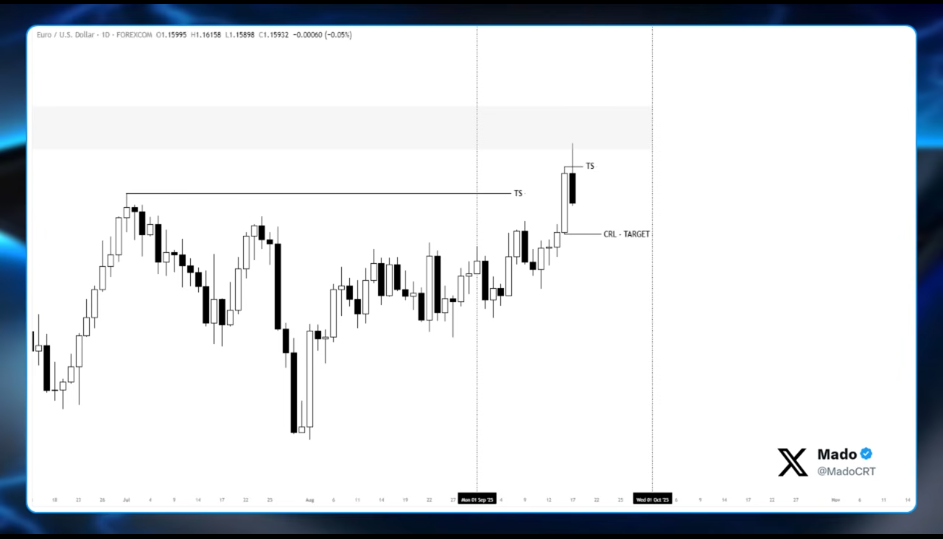
* En 4H se buscan dos cosas: **key levels** y **candle range**. Hay dos key levels disponibles: un **FVG (Fair Value Gap)** y un **Order Block** [00:04:12].
  
* **Delivery por Sesión:** Se espera que se forme el rango asiático (*Asia range*, 9:00 p.m.) para ver qué entrega el mercado. La sesión asiática se expande hacia abajo pero sin alcanzar el *Draw on Liquidity* (DOL). Luego, la sesión de Londres en 1M se expande hacia arriba, hacia el gap, y cierra por encima de la vela de las 9:00 p.m. [00:04:26].
  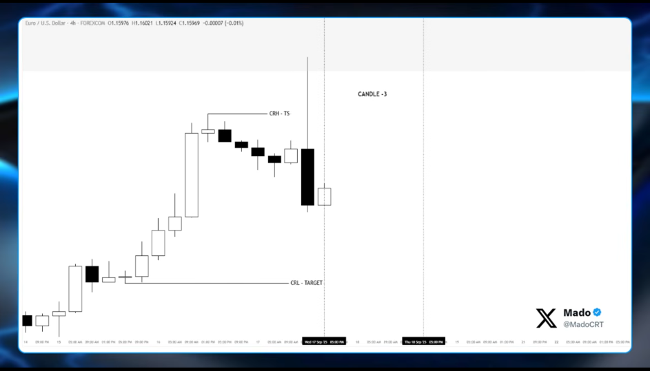
* En ese punto el "dinero tonto" (*dumb money*) empieza a comprar porque ve el cierre por encima. Esa vela específica se convierte en el **candle range de 4H**, precisamente porque atrajo a ese dumb money [00:04:45].
  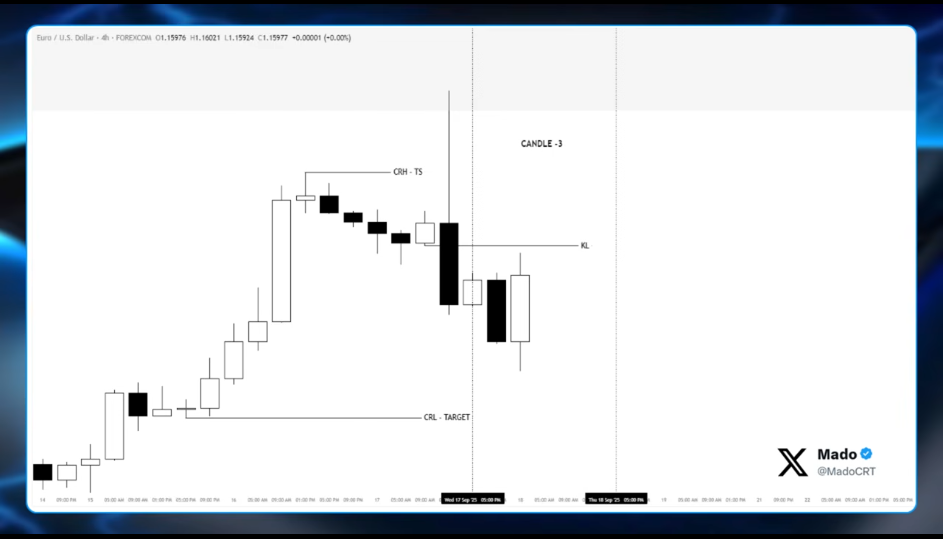

### 5. Ejecución LTF (1M → 5M) dentro del Candle Range
* **Marca de tiempo en video:** [00:04:58]
  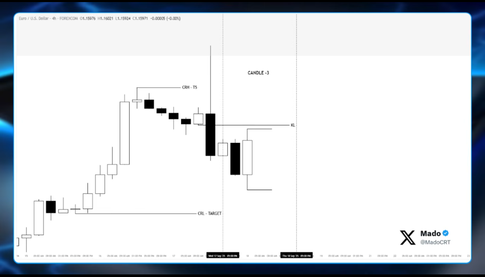
* La secuencia de espera continúa: se espera que la vela de 5M abra, purgue el máximo de 1M, toque el key level, y luego baje y cierre. Todo esto ocurre **dentro de la fase de Turtle Soup de temporalidad superior** (la tercera vela mensual) — no hace falta sostener la operación hasta los mínimos completos, solo aprovechar la ventaja de esa fase [00:05:19].
  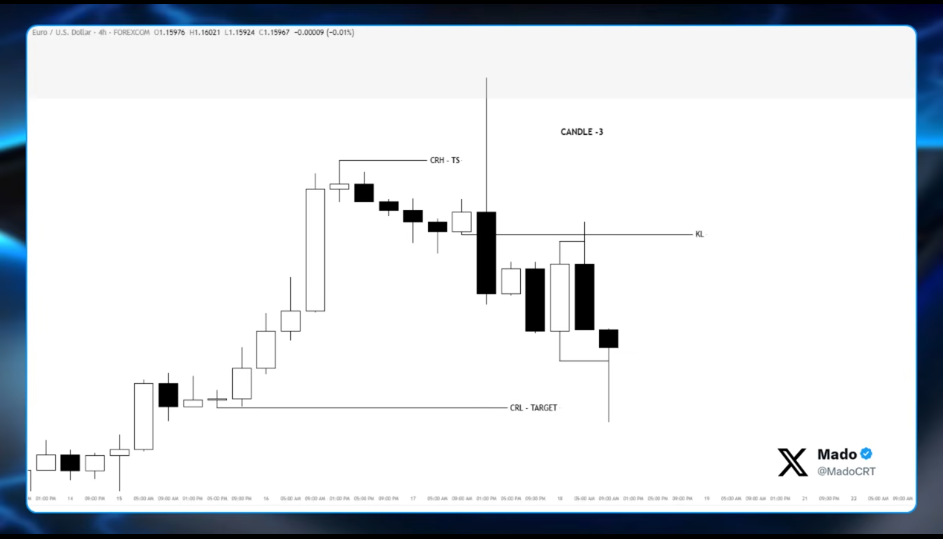

---

## 🧩 Fase de Model One (Dentro del Mismo TSQ de HTF)
* **Marca de tiempo en video:** [00:05:46]
  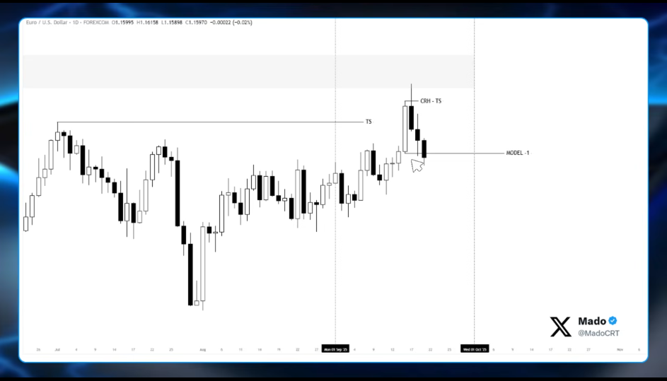
* Se espera ahora a que se forme la **fase de Model One**. Cuando una vela cierra por debajo de la que purgó el máximo anterior, se confirma el Model One [00:06:11].
  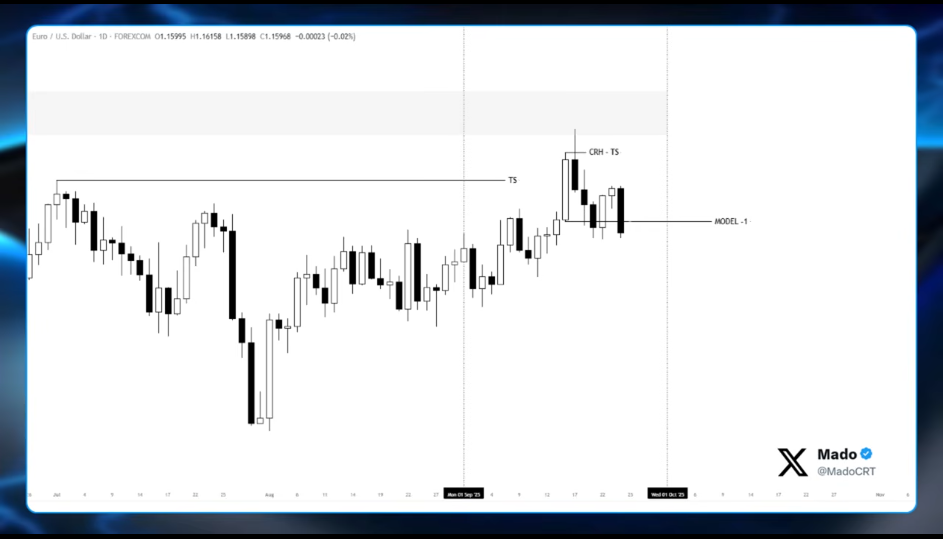
* **Advertencia:** No hay que entrar a ciegas. Todavía se está dentro de la fase de Model One de temporalidad superior — esto solo sirve para construir la idea de trade. Se espera a que el mercado toque ese Model One y recién ahí se busca un **CRT de 4H** dentro de él.

### Excepción del Lunes y el Perfil Semanal Clásico
* **Marca de tiempo en video:** [00:06:37]
  
* **Punto clave:** La vela que cierra por encima y confirma esto es la vela del **lunes**. En lunes no se puede esperar expansión directa porque es la vela de apertura de una semana nueva (aunque en algunos escenarios sí se opera el lunes, eso queda para otra ocasión) [00:07:02].
  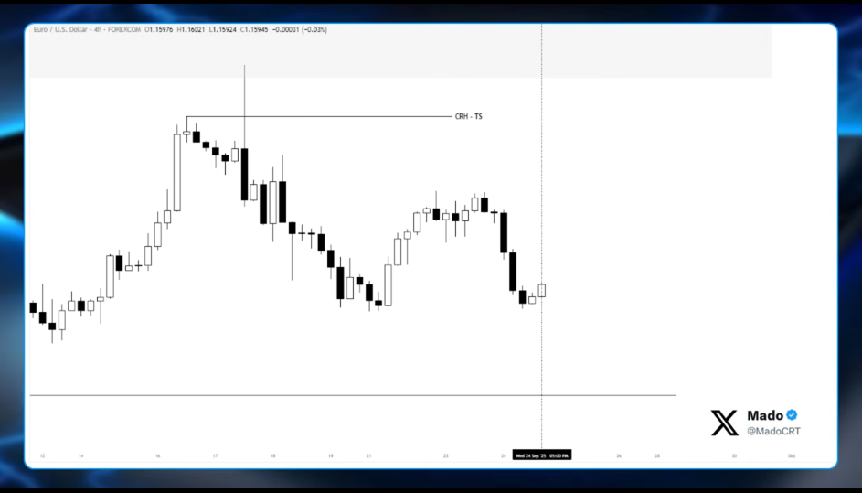
* Después de esa vela de lunes, se espera a que se forme y confirme un **perfil semanal clásico**: rango del lunes, manipulación el martes, expansión miércoles/jueves, y retroceso el viernes (*TGIF*). Confirmado ese cierre por debajo, se opera la vela siguiente (jueves), buscando el Open, High, Low y Close hacia esos mínimos [00:07:32].
  

### 4H: Key Level + Micro Kiss of Death
* **Marca de tiempo en video:** [00:07:46]
* En 4H se buscan de nuevo un **candle range** y un **key level**. Hay dos FVG disponibles, pero se prefiere el segundo porque coincide con una **micro fase de Kiss of Death** sobre unos mínimos iguales (*equal lows*) [00:07:59].
  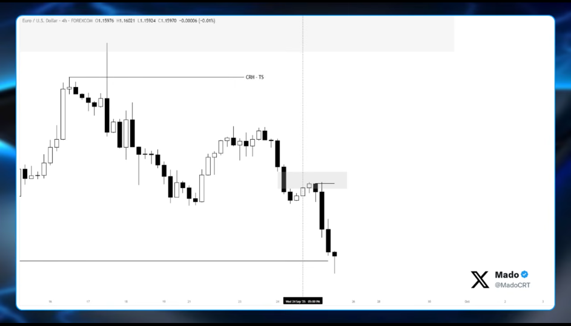
* Se busca que el mercado llene ese gap en un momento clave con una vela clave, y luego se expanda hacia abajo. En 1M el mercado no hace nada significativo — solo forma un rango — así que se espera a que 5M purgue el CRT y toque el key level [00:08:12].

---

## 💎 Filosofía: Trading es 90% Paciencia
* **Marca de tiempo en video:** [00:08:20]
* Todo el price action es irrelevante hasta tener una condición de mercado clara en la temporalidad superior. Una vez que se sabe con exactitud en qué fase de HTF se está, toca ser paciente y esperar el candle range en un momento clave con condiciones limpias [00:08:40].
  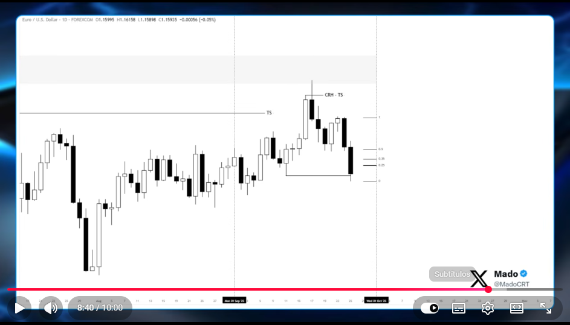

---

## 🔁 Segunda Fase de Turtle Soup (Fase Final) y Cierre Mensual
* **Marca de tiempo en video:** [00:08:54]
* Se entra ahora en una **fase final de Turtle Soup** — dentro del TSQ puede haber dos o tres apariciones de esta fase, y esta es la última, porque coincide con el cierre de la semana (viernes) y el cierre de la vela mensual. Se anticipa un retroceso de entre 30% y 35% [00:09:02].
  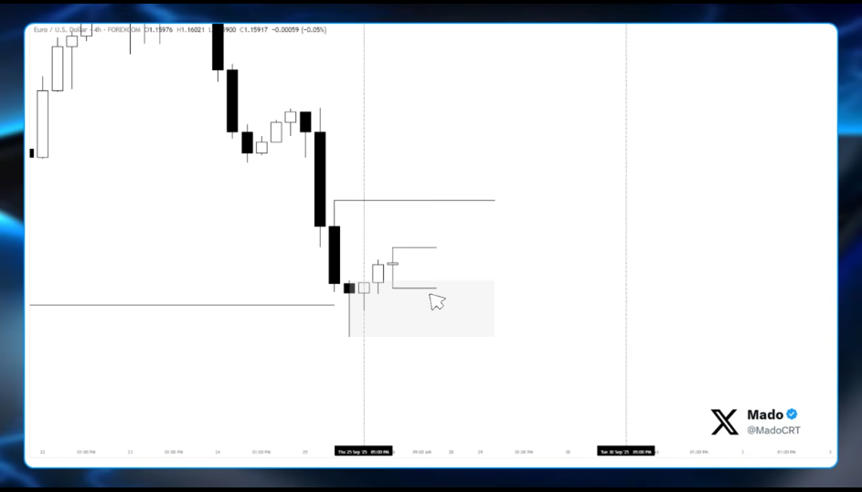

### 4H: Setup TGIF alineado al Candle Range
* Se baja a 4H buscando un **setup TGIF** alineado con el candle range de 4H. Hay un candle range formándose, pero todavía no está confirmado por el timing, así que se espera confirmación adicional. Se confirma un CRT de 4H, y un **Order Block** actúa como key level [00:09:16].
  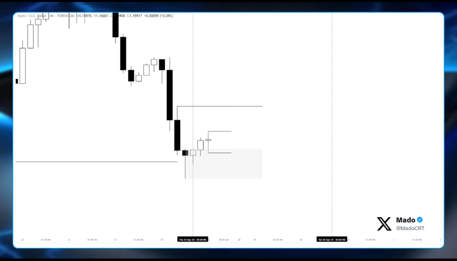
* En 1M el mercado no purga ningún mínimo del CRT (sesgo de comprador de corto plazo), así que se espera a que se purgue el mínimo del candle range en un momento clave — esa vela de 1M se convierte en la **vela de rango número uno** [00:09:31].

### Ejecución Final: 5M Purga y Expande
* Se espera a la vela de 5M para que purgue el mínimo del CR y expanda hacia arriba, primero hacia el máximo micro del CR y luego hacia el máximo macro del CR. Efectivamente el mínimo de 1M se purga y el precio se expande hacia arriba [00:09:36].
  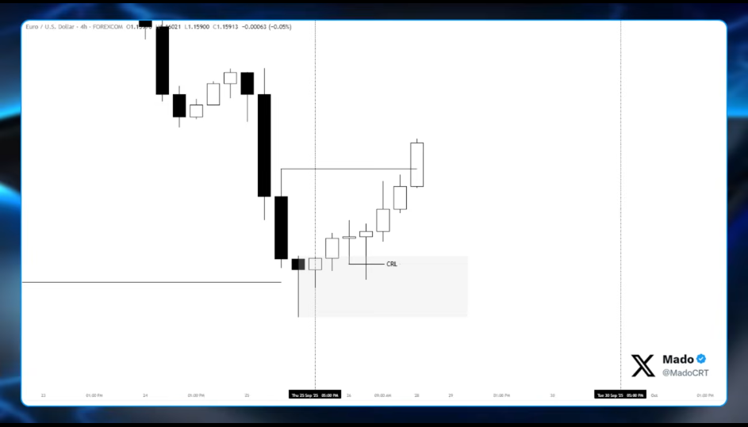

---

## ✅ Resumen del Modelo
* **Marca de tiempo en video:** [00:09:54]
  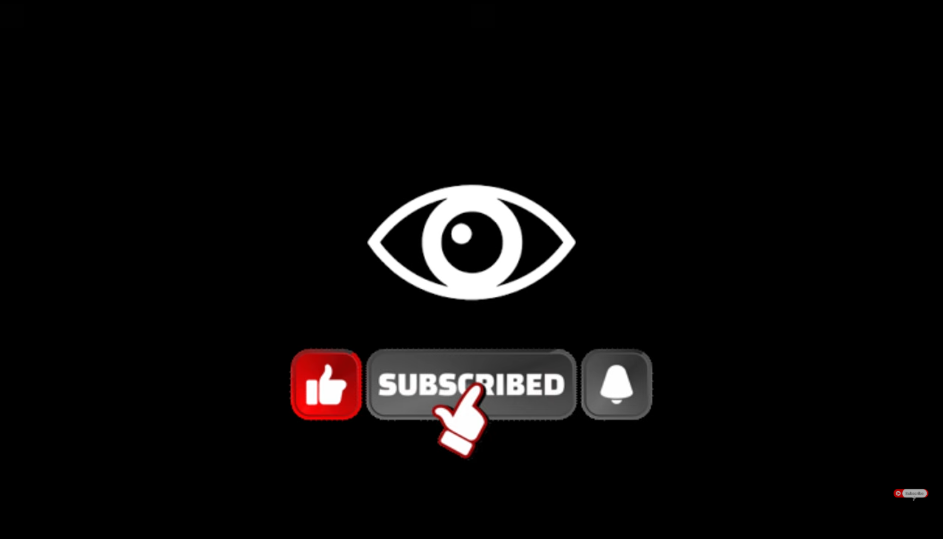
* Todo lo desarrollado se basa en la **anatomía de la vela mensual**: se sabe con exactitud cómo va a cerrar. En segundo lugar, se basa en sus fases: apertura, Turtle Soup, key level, Model One, expansión, Turtle Soup, y cierre.

---

## 🔗 Enlace al Video
* **URL:** https://www.youtube.com/watch?v=GuaAkW1OU5o
