# charter-7: CRT 2026 Mentorship EP 7 | Daily Range + Time

## 📌 Introducción y Visión General
* **Objetivo del Episodio:** Combinar dos conceptos ya conocidos por separado —el **TSQ** y las **Kill Zones**— en un único marco completo [00:00:11].
  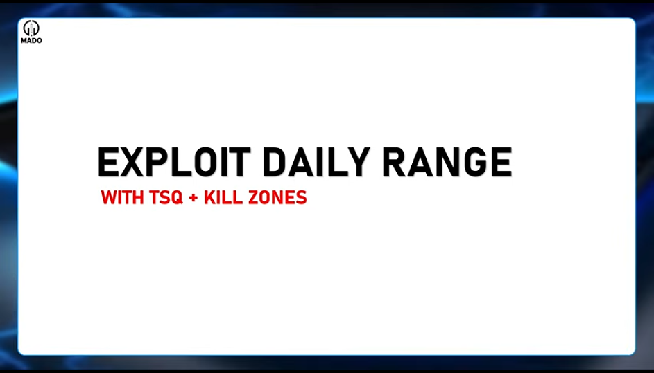
* **Por qué importa:** Leer el TSQ a través de la lente de las kill zones cambia por completo cómo se observa el día. En lugar de mirar cada vela con el mismo nivel de atención, se sabe exactamente cuándo esperar los movimientos que realmente importan [00:00:20].
* Antes de entrar a los gráficos, se recomienda tener la libreta lista y empezar por las kill zones [00:00:40].

---

## 🕐 Las 5 Sesiones de Forex (Kill Zones)
* **Marca de tiempo en video:** [00:00:46]
  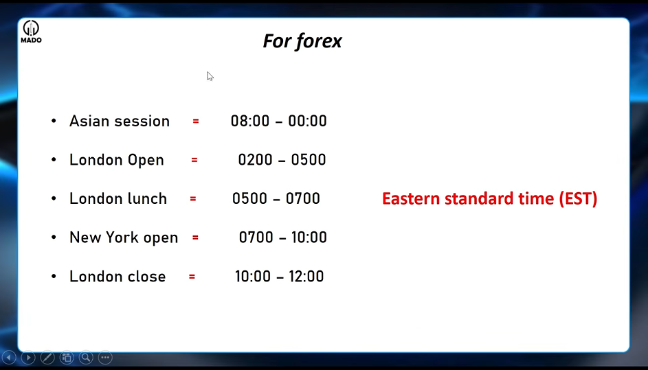
* **Sesión Asiática (Asian session):** 8:00 p.m. a medianoche. Es donde típicamente se construye el rango inicial — tranquilo, consolidativo, pero preparando el terreno para lo que sigue [00:00:58].
  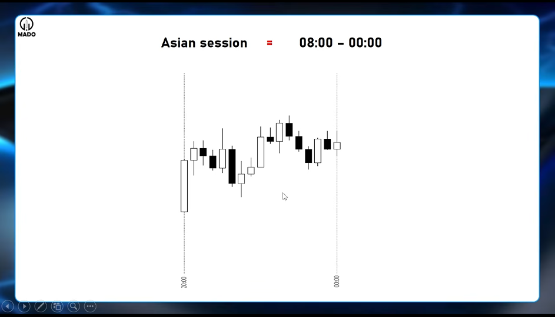
* **Londres — Apertura (London Open):** 2:00 a.m. a 5:00 a.m. Es usualmente donde ocurre la primera manipulación real: el precio busca liquidez, purga el rango asiático y empieza a mostrar su mano [00:01:09].
  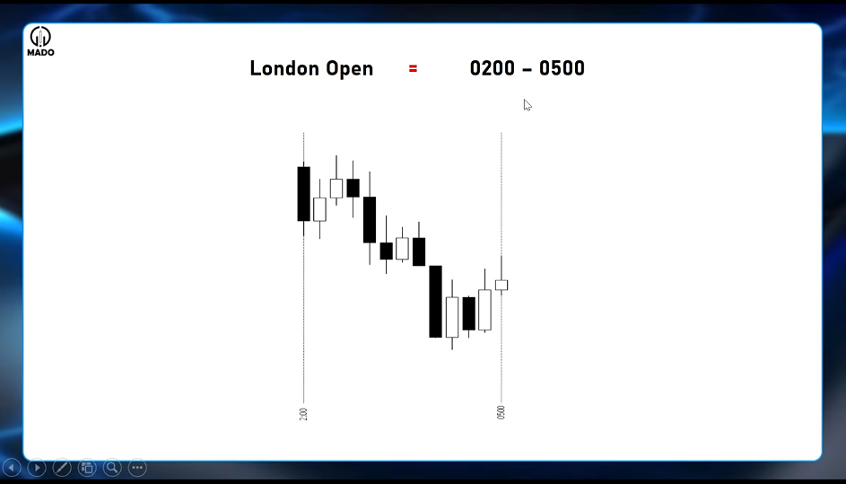
* **Londres — Almuerzo (London Lunch):** 5:00 a.m. a 7:00 a.m. Ventana más tranquila, una pausa antes de que Nueva York entre en escena [00:01:21].
* **Nueva York — Apertura (New York Open):** desde las 7:00 a.m. Si Londres hizo un Turtle Soup o una manipulación, Nueva York suele ser donde el movimiento realmente se entrega (*delivers*) [00:01:31].
* **Londres — Cierre (London Close):** 10:00 a.m. a mediodía. Aquí se suele ver el tramo final del movimiento, o el comienzo de una reversión en la dirección contraria [00:01:45].
  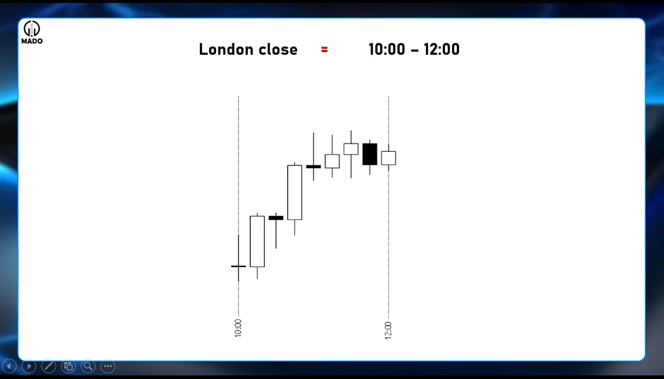

---

## 📊 Ejemplo Gráfico Real: El Rango Diario y sus Kill Zones
* **Marca de tiempo en video:** [00:01:54]
  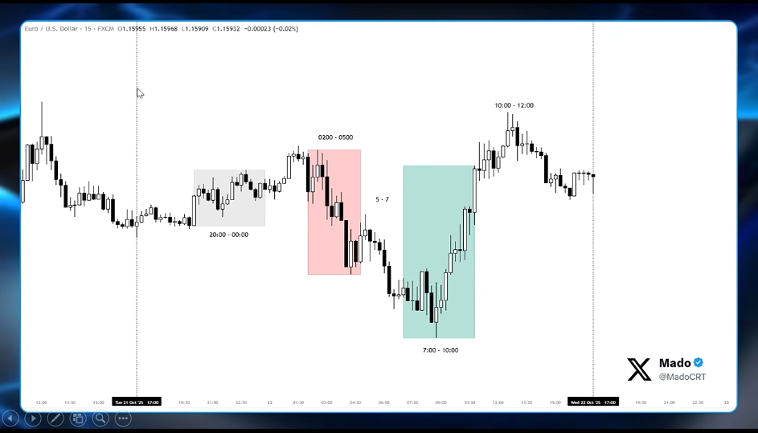
* Las dos líneas verticales representan la apertura y el cierre diario; todo lo que está entre ellas es el **rango diario** (*daily range*) [00:02:02].
  
* **Desglose por Kill Zone (de izquierda a derecha):**
  * El *Asia range* (8:00 p.m. a medianoche), resaltado en un color [00:02:14].
    
  * El recuadro rojo = sesión de Londres (2:00 a.m. a 5:00 a.m.) [00:02:23].
    
  * Entre el recuadro rojo y el verde = ventana de *London Lunch* (5:00 a.m. a 7:00 a.m.) [00:02:34].
  * El recuadro verde = kill zone de Nueva York [00:02:39].
    
  * Después de Nueva York y antes del cierre diario = *London Close* [00:02:47].

---

## 🧭 Por Qué Importa Más Que Solo Conocer el Horario
* **Marca de tiempo en video:** [00:03:05]
* Conocer las kill zones no alcanza: lo importante es entender **qué hace el precio dentro de esas ventanas** — dónde se forma liquidez, qué rango está siendo manipulado, y cómo una sesión influye en la siguiente [00:03:18].
  
* **Variante para Índices:** La estructura cambia levemente. Se mantiene la sesión asiática (8:00 p.m.-medianoche) y la apertura de Londres (2:00 a.m.-5:00 a.m.), pero en lugar de *London Lunch* y *NY Open* se usan **NY AM** (8:30-11:00 a.m.) y **NY PM** (1:00 p.m.-4:00 p.m.) — misma lógica: ventanas donde se muestra el volumen institucional [00:03:52].
  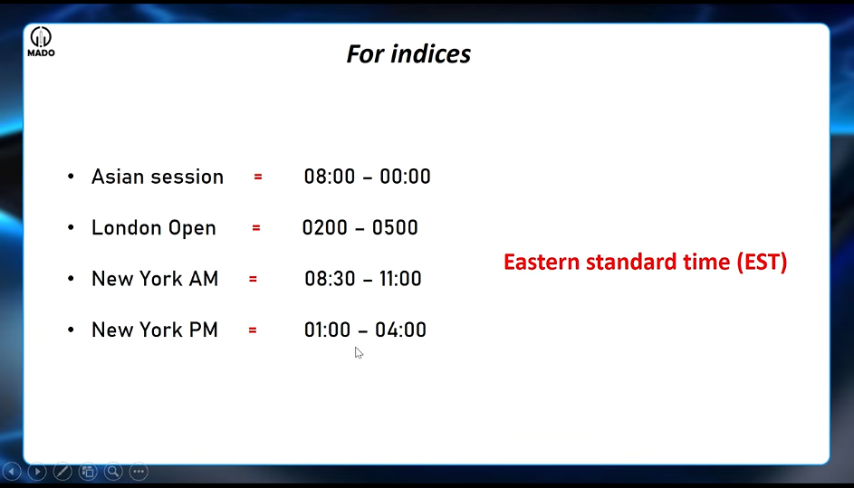

---

## 🔗 Conectando TSQ con las Kill Zones
* **Marca de tiempo en video:** [00:04:07]
  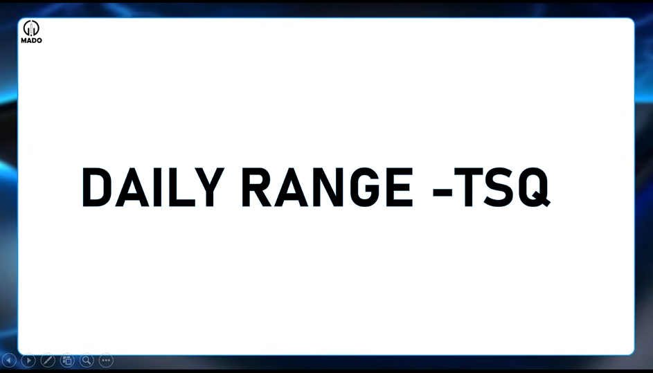
* Las fases de TSQ (Turtle Soup, Model One, Breaker...) tienden a alinearse con kill zones específicas a lo largo del día. No alcanza con saber cómo se ve un Turtle Soup o un Breaker — hay que aprender **en qué momento del día** tiende a aparecer. Esa es la verdadera explotación del rango diario: no solo la forma del movimiento, sino su *timing* [00:04:37].
  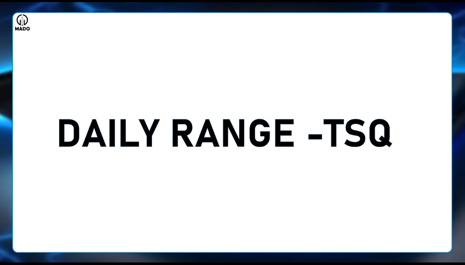

---

## 🎯 Escenario 1: Turtle Soup en Londres → OTE en Nueva York
* **Marca de tiempo en video:** [00:04:47]
  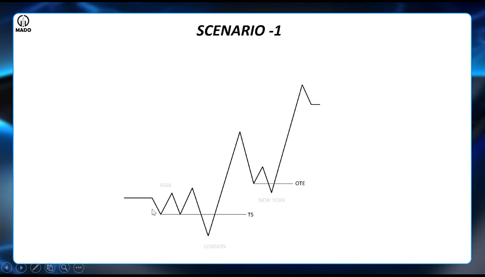
* La sesión asiática construye un rango de consolidación pequeño, sin nada dramático — solo liquidez acumulándose de ambos lados [00:04:58].
* Londres entra y hace lo que suele hacer: empuja, purga esa liquidez asiática, y entrega el **Turtle Soup** — la señal de que la manipulación comenzó [00:05:07].
  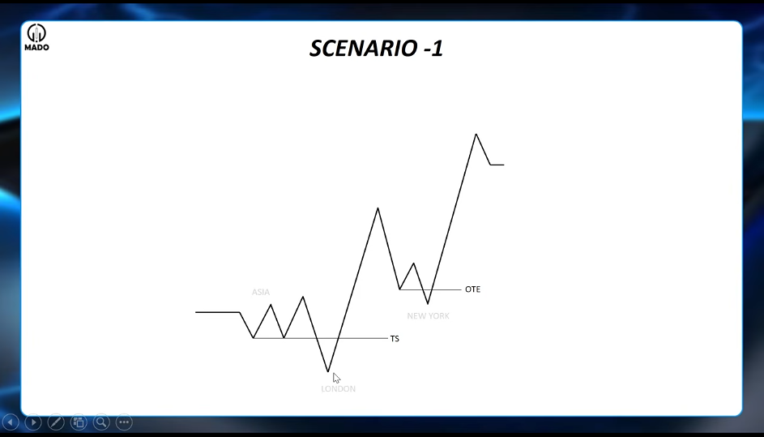
* El precio se expande hacia la sesión de Nueva York, donde retrocede hacia la zona **62%-79% (OTE)**, alineada con la dirección confirmada por el Turtle Soup de Londres. **Secuencia:** Asia construye el rango → Londres entrega el Turtle Soup → Nueva York da la entrada OTE [00:05:33].
  
* **Ejemplo real:** tras el rango asiático, dentro de la kill zone de Londres el precio purga un máximo de corto plazo tomando esa liquidez y luego se expande. Dentro de la kill zone de Nueva York, el mercado vuelve al nivel OTE, forma un Turtle Soup, y vuelve a expandirse [00:05:53].
  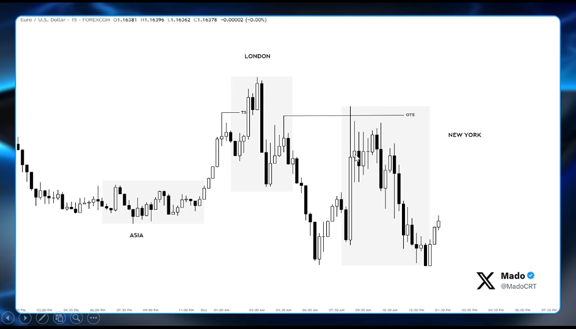

---

## 🎯 Escenario 2: Turtle Soup + Breaker en Londres → Kiss of Death en Nueva York
* **Marca de tiempo en video:** [00:06:02]
* Escenario algo más complejo, pero con la misma lógica de fondo. Asia construye un rango pequeño; Londres lo purga y, dentro de la misma sesión de Londres, se forman **tanto el Turtle Soup como el Breaker** [00:06:18].
  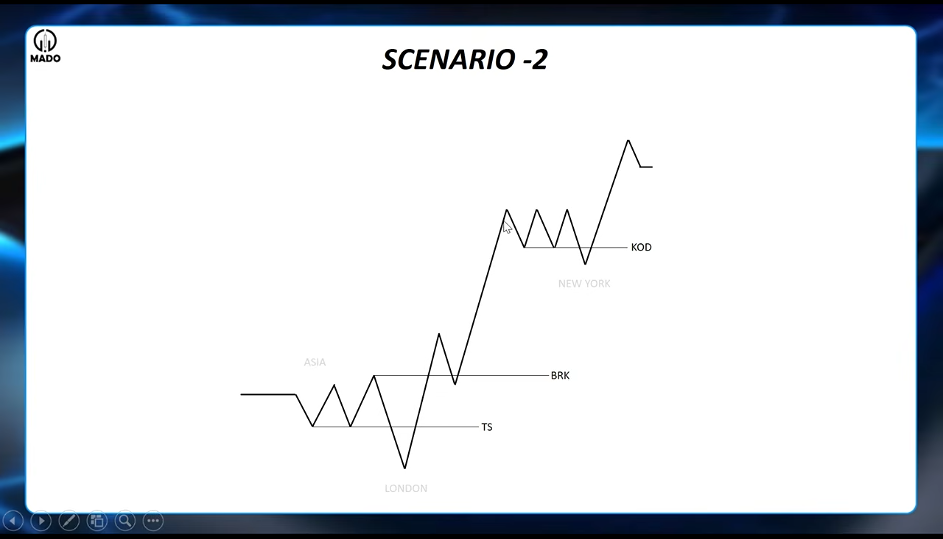
* El precio se expande fuerte hacia Nueva York, pero en lugar de escaparse directo, entrega una pieza más: un **Kiss of Death** — ese último movimiento falso justo antes de la expansión real hacia el *Draw on Liquidity* (DOL), dentro de la sesión de Nueva York [00:06:39].
  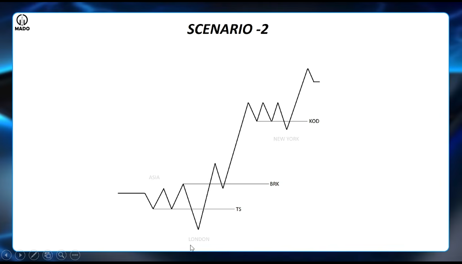
* Cada sesión entrega una pieza de la secuencia: Turtle Soup y Breaker en Londres, Kiss of Death en Nueva York. Ese es el patrón a reconocer [00:06:50].
* **Ejemplo real:** rango asiático primero; durante la kill zone de Nueva York el precio crea liquidez de corto plazo antes de dirigirse al DOL. Luego aparece otro Turtle Soup — pero atención: este es solo un Turtle Soup de ese mínimo de corto plazo formado dentro de la kill zone de Nueva York (no un retroceso profundo a la zona OTE); desde ahí el precio se expande directo hacia el DOL [00:07:06].
  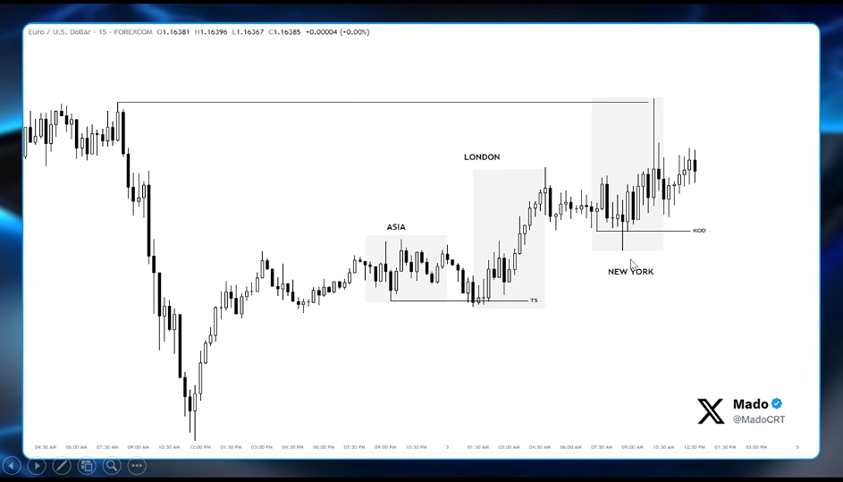

---

## 🎯 Escenario 3: El Turtle Soup No Siempre Ocurre en Londres
* **Marca de tiempo en video:** [00:07:24]
  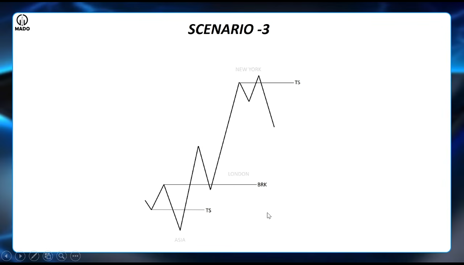
* Este escenario es distinto e importante porque muestra que el TSQ no siempre se desarrolla en una única dirección limpia. Asia construye su rango habitual, pero esta vez **el Turtle Soup se forma durante la propia sesión asiática**: el precio purga y empieza a rechazar. Londres continúa ese movimiento y, para cuando llega Nueva York, el precio ya está expandiéndose por completo en la nueva dirección [00:07:51].
  
* **Lección clave:** no todo Turtle Soup ocurre en Londres. A veces Asia forma el máximo o el mínimo del día, y Londres/Nueva York simplemente entregan sobre esa base. Por eso hay que observar el price action, no solo el reloj [00:08:00].
  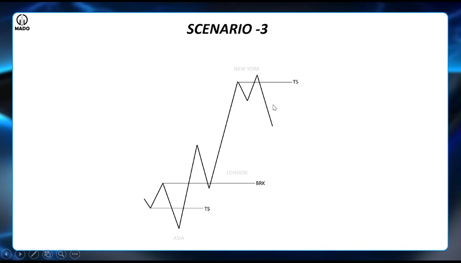
* En el ejemplo, el mercado forma el Turtle Soup dentro del rango asiático y se expande hacia abajo; también hay otra expansión bajista durante la sesión de Londres [00:08:14].
  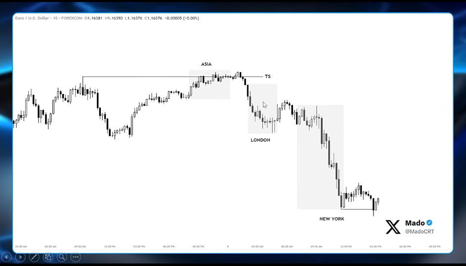
* Luego, durante la kill zone de Nueva York, si el mercado purga o forma un Turtle Soup alrededor de la liquidez de corto plazo creada durante Londres, se espera confirmación. Si la confirmación aparece, se busca el trade; si no, simplemente se descarta el día [00:08:37].
* **Recordatorio:** no hace falta operar todos los días. El trabajo no es encontrar un trade cada día, sino esperar las condiciones correctas y operar solo cuando el modelo da confirmación [00:08:57].
  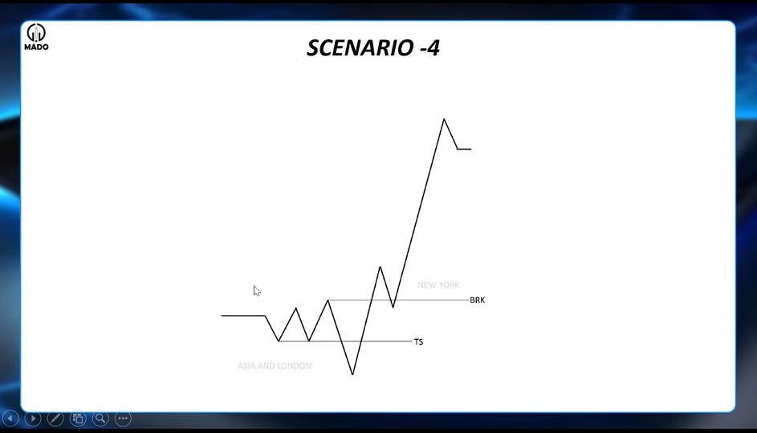

---

## 🎯 Escenario 4: La Paciencia que Paga — Todo Ocurre en Nueva York
* **Marca de tiempo en video:** [00:09:02]
  
* Este último escenario es un gran ejemplo de que la paciencia da resultado. Tanto Asia como Londres se limitan a construir el rango juntos — sin Turtle Soup mayor ni movimiento importante en esas sesiones [00:09:13].
* Nueva York abre y ahí es donde ocurre todo: el Turtle Soup, el Breaker y la expansión completa, todo dentro de esa misma ventana [00:09:24].
  
* **Recordatorio:** a veces las dos primeras sesiones del día son solo de observación. No se está perdiendo nada esperando — se está viendo cómo se construye el rango, de modo que cuando Nueva York abre, ya se sabe exactamente qué liquidez está en juego y qué esperar [00:09:42].

---

## ✅ Cierre: El Rango Diario y el TSQ No Son Aleatorios
* **Marca de tiempo en video:** [00:09:50]
  
* A través de los cuatro escenarios se repite la misma idea de fondo: ni el rango diario ni el TSQ son aleatorios. Combinando ambos se obtiene una forma estructurada de saber no solo en qué fase está el mercado, sino **cuándo** se espera que la entregue [00:10:02].
* **Tendencias generales (no reglas fijas):** Asia tiende a construir el rango, Londres tiende a manipularlo, Nueva York tiende a entregar la expansión. Pero, como mostró el Escenario 3, el mercado no siempre sigue el libro de texto — por eso se estudia primero el price action y se usan las kill zones como **marco de referencia**, no como reglamento [00:10:25].
  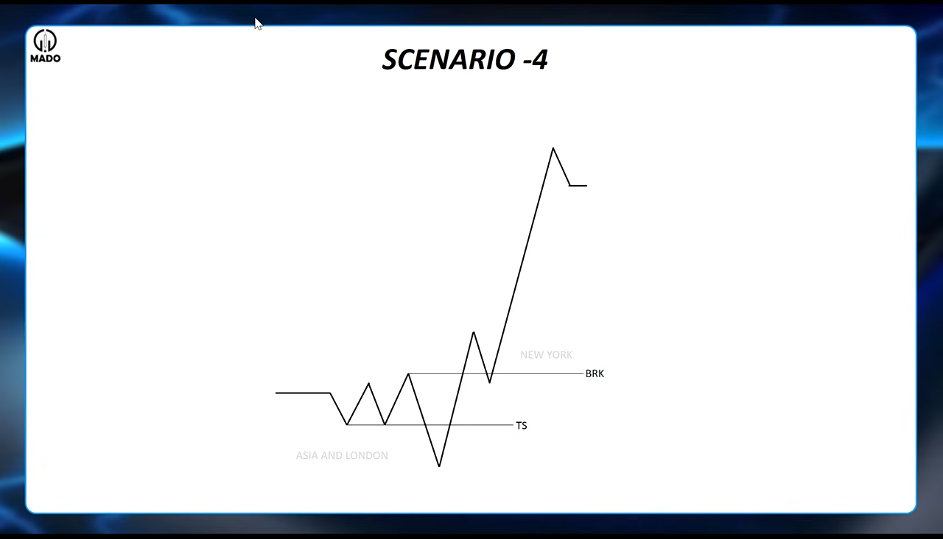
* **La habilidad real** no es memorizar qué hace cada sesión, sino reconocer la fase que se tiene enfrente y usar la kill zone como confirmación de que el *timing* coincide con lo esperado [00:10:42].
* Ese es el núcleo de explotar el rango diario combinando TSQ y kill zones: conocer las sesiones, conocer las fases, y dejar que ambas se confirmen entre sí [00:10:50].
  
* **Tarea:** tomar estos cuatro escenarios, repasar los propios gráficos y marcar en qué sesión se formó cada fase. Cuanta más práctica, más rápido se reconoce en tiempo real en lugar de después de los hechos [00:11:00].
  

---

## 🔗 Enlace al Video
* **URL:** https://www.youtube.com/watch?v=Sce82z1-hmg
