# charter-8: CRT 2026 Mentorship EP 8 | Everything About the 1 AM CRT

## 📌 Introduction and Core Principle

* **Episode objective:** Define the 1 AM CRT, identify when it should and should not be traded, and walk through chart-based applications [00:00:41].
  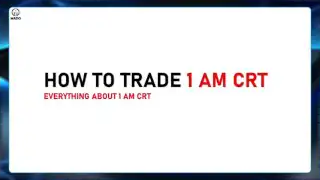
* The episode repeatedly establishes its governing principle: **time is more important than price**. A pattern is expected to work only when its timing is right; an otherwise valid-looking pattern at the wrong time is expected to fail [00:01:05].
  
* The 1 AM CRT is presented as one of the clearest demonstrations of that time-first principle [00:01:22].
  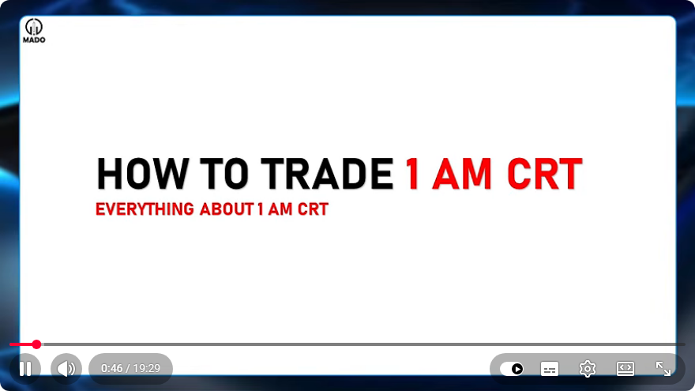

---

## 🕐 What the 1 AM CRT Is

* **Timestamp:** [00:01:33]
  
* For Forex, it is the single 4H candle that opens at **1:00 a.m.**; for indices, the equivalent candle opens at **2:00 a.m.** [00:01:41-00:02:12].
  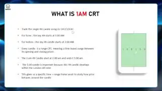
* The Forex 1 AM candle runs from 1:00 a.m. to 5:00 a.m., inside the London Kill Zone [00:02:30-00:02:46].
  
* Every 4H candle can be treated technically as a time-bounded CRT range, but this specific range is singled out because of where it forms in the daily session [00:02:21-00:02:54].
  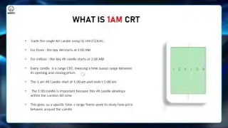

---

## 📊 The 9 PM Reference Range and Two Profiles

* **Timestamp:** [00:03:02]
  
* The 9:00 p.m. 4H candle represents the Asia range and must be profiled before building a narrative for the 1 AM candle [00:03:16-00:03:34].
  
* **Normal protraction:** the 9 PM candle consolidates; the 1 AM candle performs both the liquidity purge/Turtle Soup and the expansion [00:03:43-00:04:05].
  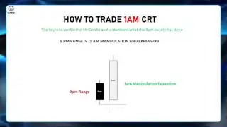
* **Delayed protraction:** the 9 PM candle performs the manipulation; the 1 AM candle becomes the expansion leg, described as candle three in an already-developing sequence [00:04:09-00:04:43].
  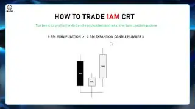
* The episode explicitly rejects predicting the profile before the 9 PM candle has revealed its behavior [00:04:45-00:05:13].
  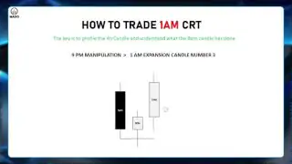

---

## 🎯 Context: Key Level and Higher-Timeframe Order Flow

* **Timestamp:** [00:05:16]
  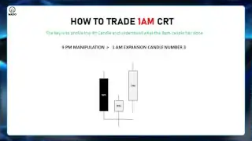
* A 1 AM sweep alone is not presented as a trade signal. It becomes meaningful when it happens at a key level and agrees with higher-timeframe order flow [00:05:32-00:06:03].
  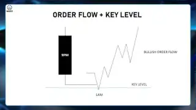
* Example direction: a sweep below a key level while higher-timeframe order flow is bullish is interpreted as liquidity being taken before continuation higher [00:05:56-00:06:03].
  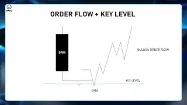
* The lesson warns against taking a 1 AM setup that fights the higher-timeframe context [00:06:03-00:06:18].
  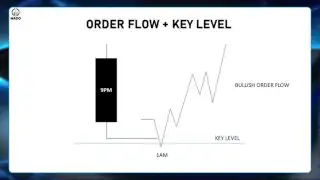

---

## 🧭 Intraday Profiles and Candle Anatomy

* **Timestamp:** [00:06:23]
  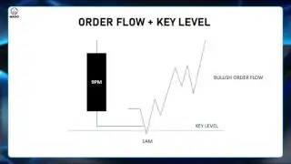
* In the normal profile, the 1 AM candle or London shortly afterward often prints the day high or low [00:06:57-00:07:14].
  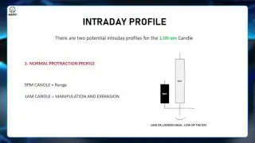
* In the delayed profile, the 9 PM candle or Asia session often marks the day high or low, while the 1 AM candle launches expansion [00:07:21-00:07:39].
  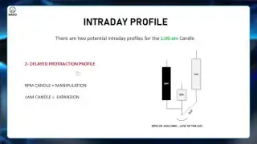
* The stated preference is to focus on the normal-protraction profile [00:07:58-00:08:03].
  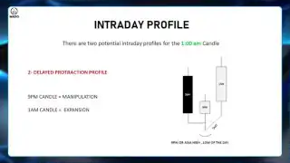
* Bullish candle anatomy is described as open → low that purges the 9 PM low/key level → Model 1 → expansion → high → close [00:08:07-00:08:34].
  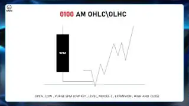
* The purge is framed as the fuel for expansion, not a cosmetic wick [00:08:29-00:08:52].
  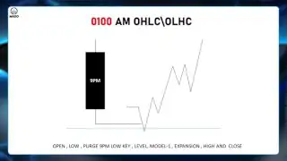

---

## 🔎 Entry Model, Range Levels, and Risk

* **Timestamp:** [00:08:58]
  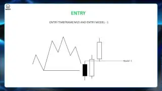
* The execution timeframe is M15. After the sweep, wait for Model 1 confirmation; the sweep itself is not the entry [00:08:58-00:10:04].
  
* The practical checklist is to mark the 9 PM range high, range low, and 50% midpoint; wait for price at the key level and for the sweep; then use M15 Model 1 confirmation [00:11:33-00:11:53].
  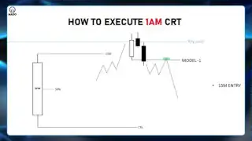
* The stated stop is beyond the Model 1 high, while the target is the opposite side of the range [00:11:53-00:11:59].
  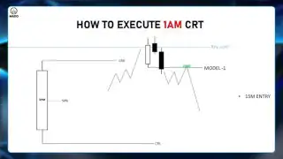
* The 4H candle is only one component of a broader system that also includes time, price, liquidity, higher-timeframe structure, and profiling [00:10:38-00:11:30].
  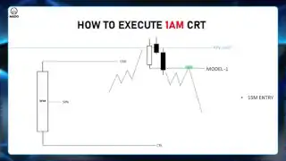

---

## ⏱️ Trading Windows

* **Timestamp:** [00:12:06]
  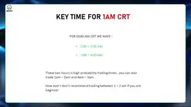
* The highest-probability windows named are **2:00-3:00 a.m.** and **3:00-4:00 a.m.** [00:12:13-00:12:23].
  
* The 1:00-2:00 a.m. and 4:00-5:00 a.m. windows may be traded when conditions align, but the first hour is specifically discouraged for beginners because it is manipulation-heavy [00:12:25-00:12:52].
  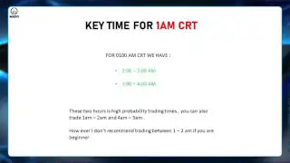
* The beginner guidance is to remain within 2:00-4:00 a.m. until sufficient experience has been built [00:12:52-00:13:02].
  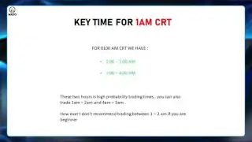

---

## 📈 Chart Application: Normal Protraction

* **Timestamp:** [00:13:07]
  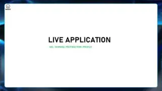
* The example begins with bullish 4H order flow, defined here as rejecting lows, breaking highs, and forming higher highs and higher lows [00:13:19-00:13:51].
  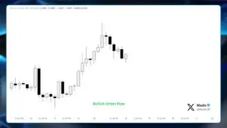
* It adds a key level and SMT, then uses the 9 PM candle as the 1 AM CRT reference [00:13:54-00:14:17].
  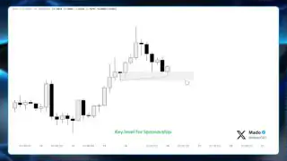
* The 1 AM candle purges the 9 PM low. This supplies confluence, while M15 Model 1 supplies the actual execution trigger [00:14:14-00:15:22].
  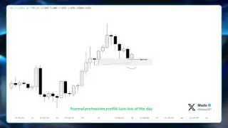
* The complete sequence is listed as bullish 4H order flow → key level + SMT → 9 PM range → 1 AM purge of the 9 PM low → M15 liquidity purge in the key window → Model 1 entry → 3R target [00:15:36-00:15:56].
  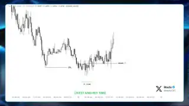

---

## 📉 Chart Application: Delayed Protraction and Discretion

* **Timestamp:** [00:15:59]
  
* In the second example, the 9 PM candle marks the Asia low and the 1 AM candle is the continuation leg [00:16:01-00:16:29].
  
* The lesson names two continuation confirmations: a purge of the 1H CRT high/low, or the 5 AM candle opening and purging the 1 AM high/low [00:16:29-00:16:48].
  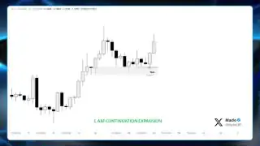
* Even where a valid continuation can appear after CISD in the 1:00-4:00 a.m. execution period, the presenter says that he personally avoids the 1 AM/London trade when Asia has already made the day high or low, preferring the 5 AM or 9 AM CRT [00:16:57-00:17:45].
  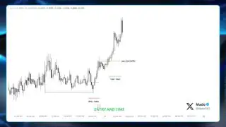
* The distinction is explicit: a valid setup need not be a setup that belongs in an individual trading plan [00:17:52-00:18:11].
  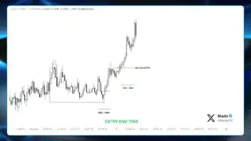

---

## ✅ Closing Summary

* The relationship to profile first is: 9 PM range → 1 AM Turtle Soup + expansion (normal); 9 PM manipulation → 1 AM expansion (delayed) [00:18:14-00:18:40].
  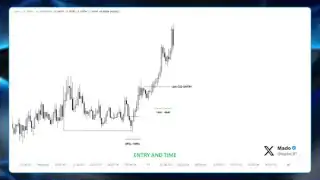
* Mark the 9 PM high, low, and 50%; prioritize 2:00-4:00 a.m.; use M15 Model 1 for the entry [00:18:40-00:19:03].
  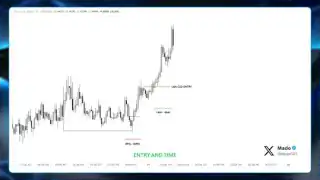
* The episode closes by restating that correct time is the condition for the pattern, and by encouraging repeated study of the sequence [00:19:03-00:19:28].
  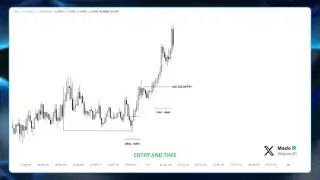

---

## 🔗 Video Link

* **URL:** https://www.youtube.com/watch?v=dtbsapGJL4c
