# charter-9: CRT 2026 Mentorship EP 9 | Executing the 1 AM CRT

## 📌 Introduction and Lesson Flow

* **Episode objective:** Show a real-time 1 AM CRT execution by descending from Daily to 4H and finally M15 [00:00:19-00:00:42].
  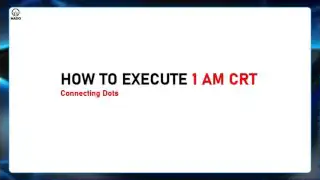
* The 1 AM CRT refresher: Forex uses the 1:00-5:00 a.m. 4H candle; indices use the 2:00 a.m. 4H candle. Its relevance is tied to the London Kill Zone [00:00:54-00:01:24].
  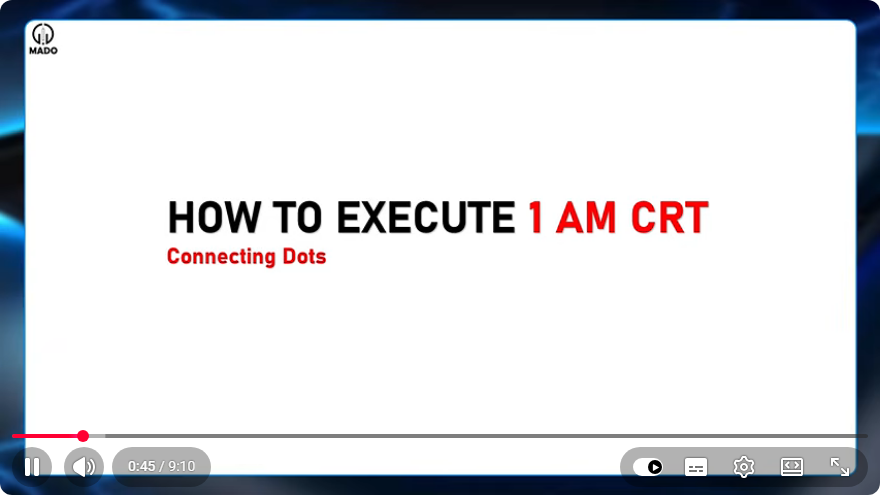

---

## 📅 Daily Narrative: Candle Three

* **Timestamp:** [00:01:31]
  
* Daily candle one establishes the range; candle two manipulates into a key level at a key time; candle three is the intended execution candle [00:01:31-00:02:17].
  
* In the example, candle two closes back inside the market and confirms the week high. Candle three/Thursday is therefore expected to continue lower [00:02:17-00:02:27].
  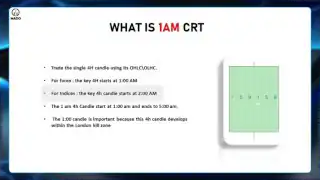
* The expected daily high is located in the upper half of candle two's wick, while price also sits in the premium region of the CRT dealing range [00:02:30-00:02:52].
  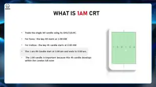
* The CRT dealing range itself is deliberately not defined in this chapter; the focus stays on the 1 AM CRT [00:02:58-00:03:11].
  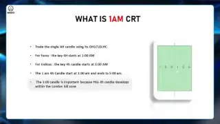

---

## 🕓 Intermediate 4H Context

* **Timestamp:** [00:03:13]
  
* On 4H, price purges a high and taps a higher-timeframe premium PD array. An engulf and close below the referenced candle provides the change in state of delivery / Model 1 and turns that area into an intermediate-timeframe key level [00:03:26-00:04:19].
  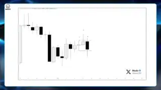
* The 9 PM candle is again the key reference range for the 1 AM CRT [00:04:21-00:04:34].
  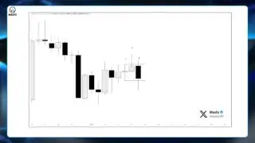
* The expected sequence is 1 AM open → purge of the 9 PM high at key time → movement at least toward the second daily candle's low, identified as the obvious draw on liquidity [00:04:36-00:04:58].
  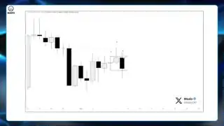

---

## 🔍 M15 Timing, Location, and Reaction

* **Timestamp:** [00:05:01]
  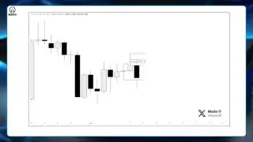
* The daily candle-three open and close are marked by two vertical lines; the 1 AM open is marked separately [00:05:01-00:05:15].
  
* In the example, the 1 AM CRT purges the 9 PM range high around 3:00 a.m. The 3 AM reference is a **3:00-4:00 a.m. window**, not one exact minute [00:05:18-00:05:52].
  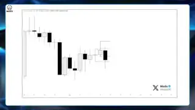
* The desired response is a quick CISD/Model 1 rather than prolonged price acceptance around the swept area [00:05:54-00:06:19].
  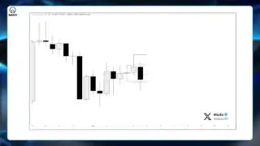
* The location is sensitive because it combines the 50% of candle two's wick, the premium of the CRT dealing range, and the 3 AM key window [00:06:07-00:06:27].
  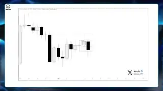

---

## 🧠 Read Behavior Rather Than Naming Patterns

* **Timestamp:** [00:06:29]
  
* The episode rejects over-reliance on pattern labels such as body-versus-wick Turtle Soup [00:06:29-00:06:47].
  
* The stated decision lens is the combination of context, location, timing, and what price actually does [00:06:50-00:07:08].
  

---

## 🎯 Entry, Stop, and Target

* **Timestamp:** [00:07:11]
  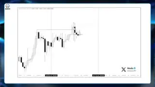
* In the example, a CISD within two candles follows the sweep. After the close below two consecutive candles, those candles become the order block used for execution [00:07:11-00:07:31].
  
* The purge candle itself is the Model 1. Normally it can trigger an entry, but here the Model 1 is considered too small, so the entry is taken from the order block to leave sufficient room for price to move [00:07:31-00:07:58].
  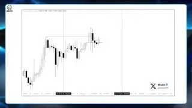
* The stop is placed above the swing high or above the candle that purged the high; the target is 3R [00:08:00-00:08:08].
  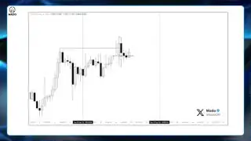
* The 3R target is presented as mechanical: once reached, the trade is closed regardless of whether price continues farther [00:08:11-00:08:33].
  

---

## ✅ Closing Summary

* The live sequence is Daily narrative → 4H context/key level and 9 PM range → 1 AM purge in the 3:00-4:00 a.m. window → quick M15 CISD/Model 1 → execution from the appropriate trigger → 3R target [00:08:35-00:09:03].
  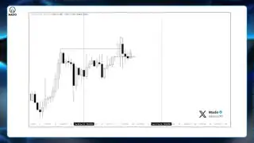
* The closing instruction is to study the sequence rather than merely memorize a named pattern, with emphasis on why the market acts as it does [00:08:52-00:09:03].
  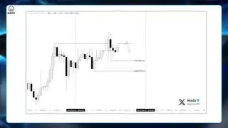

---

## 🔗 Video Link

* **URL:** https://www.youtube.com/watch?v=q9X9yDpx7yQ
